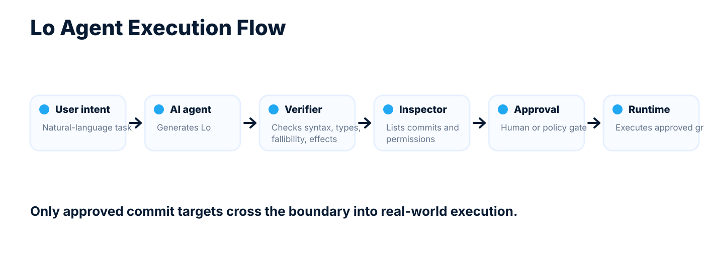

# Lo


**Lo is a typed executable plan language for AI agents.**

Language models are good at proposing workflows, but unsafe as direct executors of arbitrary Python, shell scripts, browser automation, or raw API calls. Lo gives agents a small declarative language for producing action graphs that can be parsed, type-checked, inspected, approved, and executed by a trusted runtime.

Lo is not a replacement for Go, Python, or shell. It is an execution contract between an AI planner, a verifier, and a runtime.

For language rules and training examples, start with the [Lo Language Reference](specification.md).
The [adapter design](docs/adapter-design.md) defines the next shared contract for File, HTTP, and Process.
Its [implementation plan](docs/adapter-plan.md) separates proposed APIs from current behavior.

## Status

Lo implements the **v0.3 core, native compilation, CPU and Metal training, and explicit device transfers**.

The reference implementation has a Go frontend, verifier, checked execution graph, and static inspector.
The parser and verifier accept all six specification examples.
`lo check` validates built-in signatures, flows, fallibility, and transitive effects.
`lo inspect` reports effects, targets, error kinds, and capability requirements without program execution.
`lo run` evaluates checked programs with immutable values, error traces, authorized file reads, and ordered file commits.
`lo serve` activates authorized HTTP servers with request handlers, error handlers, and orderly shutdown.
The six implementation stages passed their integration tests.
The [implementation audit](docs/implementation-audit.md) records the completed requirements and validation evidence.

The accepted [compiler design and implementation plan](docs/compiler-design.md) selects Go and a typed execution graph.
It specifies compiler stages, package boundaries, diagnostics, inspection, acceptance criteria, and open language decisions.

`lo build` creates standalone native executables through generated Go code.
Artifacts support the current operations, CPU training, File workflows, and HTTP services.
The [native compilation contract](docs/native-compilation-contract.md) defines toolchain requirements, limits, and artifact construction.
F001 completed native qualification on macOS arm64 and Linux arm64.
The [acceptance report](docs/native-compilation-results.md) records tests, performance measurements, and build resources.

The selected [training extension design](docs/training-extension-design.md) defines FP32 tensors, reverse-mode autodiff, immutable optimizer state, and explicit device execution.
P001 completed the design task.
F002, F003, and F004 implement binary64 arithmetic, immutable FP32 tensors, shape checks, and the CPU operation set.
The [forward example](examples/tensor_forward.lo) executes a two-layer ReLU network and returns loss from mean squared error `3`.
F005, F006, and F007 add reverse-mode autodiff, immutable Parameters, gradient operations, SGD, and AdamW.
The [CPU training example](examples/training_cpu.lo) completes 200 SGD updates and reduces loss from `2.46875` to `0.00013215476`.
The [XOR tutorial](docs/xor-neural-network.md) adds a small neural network that learns all four XOR inputs.
Its [CPU example](examples/xor_cpu.lo) and [Metal example](examples/xor_metal.lo) use two ReLU units and 500 SGD updates.
The [checkpoint workflow](docs/model-checkpoints.md#execution) saves trained Parameters for separate inference and restores complete SGD or AdamW state.
The XOR examples save after 250 updates and resume for another 250 updates on CPU or Metal.
F008 adds device grants, explicit transfers, and a resource ledger to interpreter and native execution.
The [device resource contract](docs/device-resources.md) records the implementation and software validation.
P002 adds the [Metal implementation plan](docs/metal-backend-plan.md).
F012 adds explicit Apple GPU transfers through the Metal interpreter build.
The [Metal transfer contract](docs/metal-transfers.md) defines the build, device profile, and validation evidence.
F013 adds [Metal arithmetic, derivatives, gradient operations, and optimizers](docs/metal-arithmetic.md).
F014 adds [standalone Metal artifacts](docs/native-metal.md).
I002 qualifies [complete Metal training](docs/metal-training.md) through software tests, the local interpreter, and standalone artifacts.
The [Metal training example](examples/training_metal.lo) completes 200 SGD updates with six uploads and six downloads.
F009, F010, F011, and I001 retain NVIDIA arithmetic, deferred execution, later precision work, and complete NVIDIA training acceptance.
The [training benchmark](docs/training-benchmark.md) records the interpreter baseline before F001.
The [native acceptance report](docs/native-compilation-results.md) compares the two execution backends, including CPU training.

This repository is public early so the design can be evaluated as an AI-agent execution language. It is not production-ready.

## Build and Validate

The [standalone compiler plan](docs/standalone-compiler-plan.md) defines the proposed native backend migration and language extensions.
The [backend experiment](docs/native-backend-experiment.md) records LLVM and Cranelift probe results separately from compiler acceptance.
The current native build still requires the Go toolchain below.

The Makefile requires installed Go 1.27.1 and keeps tool state under `_scratch/build-state/`.
Native build commands require `LO_BUILD_ROOT` to name that existing absolute directory.
The qualified platforms are macOS on arm64 and Linux on arm64.

```bash
make build
./bin/lo parse examples/http_division.lo --format json
./bin/lo check examples/list_sum.lo
./bin/lo inspect examples/agent_file_workflow.lo --format json
./bin/lo run examples/list_sum.lo
LO_BUILD_ROOT="$PWD/_scratch/build-state" ./bin/lo build examples/list_sum.lo --output ./bin/list-sum
./bin/list-sum run
./bin/lo run examples/tensor_forward.lo
./bin/lo run examples/training_cpu.lo --format json
./bin/lo run examples/xor_cpu.lo --format json
./bin/lo run examples/device_transfer.lo --allow-device cuda-sim:0 --format json
./bin/lo run examples/count_letter.lo --read-root examples
./bin/lo serve examples/http_echo.lo --listen 0 --format json
make test-conformance
make ci
```

The conformance suite runs 83 static and runtime fixtures.
The catalog tests verify all 111 built-in operations.
The integration suite also tests built-in signatures, runtime values, evaluation order, error traces, and adapter authorization.
The server command runs until a stop signal.
`Ctrl+C` starts orderly shutdown.
The [adapter examples](docs/compiler-design.md#executable-adapter-examples) specify file grants, listen grants, and expected results.

Native builds require Go 1.27.1 on the build host.
Artifacts need no Go installation, Lo installation, source file, or repository checkout during execution.
Programs that use `File.open_paths` require `lsof` on the execution host.
Use `--target darwin/arm64` or `--target linux/arm64` to select the artifact target.
The build uses the host target when this option is absent.
Supply file, listen, and device grants when you execute the artifact.
Use the artifact's `metadata` command to inspect its source digest, runtime bundle digest, target, and toolchain.
The default artifact backend is `software`.
For a Metal artifact, use the explicit build option:

```bash
make build-metal
./bin/lo-metal parse examples/training_metal.lo --format json
./bin/lo-metal check examples/training_metal.lo --format json
./bin/lo-metal inspect examples/training_metal.lo --format json
./bin/lo-metal run examples/training_metal.lo --allow-device metal:0 --format json
LO_BUILD_ROOT="$PWD/_scratch/build-state" ./bin/lo-metal build examples/training_metal.lo --device-backend metal --output ./bin/metal-training
./bin/metal-training run --allow-device metal:0 --format json
./bin/metal-training metadata
```

Metal builds require the pinned Apple toolchain and a local `darwin/arm64` target.
The [native Metal contract](docs/native-metal.md) specifies the toolchain, metadata, and validation commands.
The training example returns initial loss `2.46875` and final loss `0.00013215476064942777` after 200 updates.
The [training acceptance report](docs/metal-training.md) separates software acceptance from optional local Metal execution.
`lo run` and `lo serve` select interpreter execution.

## Core Idea

AI agents should not directly perform irreversible actions. Instead, an agent should emit a typed action graph:



The goal is simple:

```text
Small enough for models to generate reliably.
Strict enough for runtimes to reject bad plans.
Explicit enough for humans to audit.
```

## Why Lo Exists

Python and shell are powerful, but too permissive for direct model-generated execution. An AI-generated Python script can hide arbitrary file access, network calls, subprocess execution, mutation, exception paths, dependency imports, and runtime-only failure modes.

Lo makes these things visible.

A verifier should be able to inspect a Lo program before execution and answer:

- What files may be read?
- What files may be written?
- What HTTP services may be started?
- What operations can fail?
- Which `Error.kind` values can appear?
- Which side effects require `commit`?
- Which adapter boundaries define `onError`?
- Which flows are pure?
- Which flows are effectful?

## Language Discipline

Lo has a small core:

```text
.new(...)       constructs values and adapters
|>              threads values through processors and flows
Match.new(...)  branches as an expression
T!              represents fallible output
Error           represents recoverable failure
commit          activates side effects
onError         handles boundary failure
```

Lo v0.3 intentionally excludes:

- classes and inheritance
- mutable variables
- statement loops
- imperative `if / else`
- anonymous functions and lambdas
- user-visible exceptions
- `try`, `catch`, or `throw`
- implicit nullability
- modules or imports
- async syntax
- concurrency syntax
- shared mutable memory

These omissions are part of the design. The language is meant to be easy for AI agents to generate and easy for verifiers to reject.

## Example: HTTP Handler With Typed Failure

```lo
flow Calculate(request: HTTP.Request) -> HTTP.Response! {
    denominator = Int.new(0)
    result_value = Int.new(10) |> Math.div(denominator)

    return HTTP.Response.Text.new(
        status: Int.new(200),
        body: result_value |> Int.to_string()
    )
}

flow CalculatorHttpError(error: Error) -> HTTP.Response {
    return Match.new(error.kind,
        String.new("Math.DivideByZero"): HTTP.Response.Text.new(
            status: Int.new(400),
            body: String.new("division by zero")
        ),
        _: HTTP.Response.Text.new(
            status: Int.new(500),
            body: String.new("internal error")
        )
    )
}

server = HTTP.Server.new(
    port: Int.new(8080),
    handler: Calculate,
    onError: CalculatorHttpError
)

commit server
```

This program makes several things explicit:

- the HTTP server is constructed before it is activated
- activation happens only through `commit`
- division is fallible because `Math.div(...) -> Int!`
- the handler returns `HTTP.Response!`
- the server requires an `onError` boundary handler
- divide-by-zero is handled as an `Error` value, not as a hidden exception

## Example: File Processing With Self-Handling Flow

```lo
flow IsMatchingScalar(target_scalar: Scalar) -> Bool {
    return Scalar.eq(target_scalar, Scalar.new("a"))
}

flow CountFallback(error: Error) -> Int {
    return Int.new(0)
}

flow CountLetterA(file_path: File.Path) -> Int onError CountFallback {
    file_text = file_path
        |> File.read()
        |> UTF8.String.new()

    match_count = file_text
        |> List.filter(IsMatchingScalar)
        |> List.length()

    return match_count
}
```

This example demonstrates:

- file reads are fallible
- UTF-8 decoding is fallible
- fallible values bubble automatically inside a self-handling flow
- the handler converts failure into a total `Int`
- list processing uses a named pure flow
- no hidden exceptions are visible to the program

## Example: Explicit Side Effects

```lo
flow StatusError(error: Error) -> HTTP.Response {
    return HTTP.Response.Text.new(
        status: Int.new(500),
        body: String.new("status handling failed")
    )
}

flow HandleStatus(status_code: Int, request_data: String) -> HTTP.Response onError StatusError {
    success_log = File.Path.new(String.new("/logs/success.log"))
    error_log = File.Path.new(String.new("/logs/error.log"))

    target_effect = Match.new(status_code,
        Int.new(200): File.append(success_log, request_data),
        _: File.append(error_log, request_data)
    )

    commit target_effect

    return HTTP.Response.Text.new(
        status: status_code,
        body: String.new("Status processed")
    )
}
```

The branch does not perform the write. The branch constructs an effect. The write happens only when the effect is committed.

## Design Principles

1. **Explicit data over hidden behavior**  
   Values, processors, flows, adapters, errors, and commits are separate concepts.

2. **Construction is separate from activation**  
   `.new(...)` constructs values and adapters. `commit` activates side effects and activatable adapters.

3. **Named flows only**  
   Lo v0.3 does not support lambdas or anonymous functions.

4. **Errors are values**  
   Recoverable failures are represented as `Error`, not hidden host-language exceptions.

5. **Fallibility is typed**  
   `T!` means either a successful `T` or an `Error`.

6. **Boundaries are typed**  
   File, HTTP, and future tool adapters are explicit typed boundaries.

7. **Boundary handlers are mandatory**  
   Adapters that invoke user flows must require an `onError` handler.

8. **Side effects are explicit**  
   Effects happen only through evaluated `commit` statements.

9. **The syntax is small**  
   The language favors a compact, canonical surface that models can generate reliably.

10. **The graph is inspectable**  
    A Lo program should be inspectable before execution.

## Intended Use Cases

Lo is designed for AI-agent-generated workflows such as:

- file-processing jobs
- typed tool workflows
- HTTP handlers
- safe automation plans
- data transformation pipelines
- auditable agent actions
- policy-gated execution plans
- constrained internal automation

Example agent task:

```text
Read this uploaded CSV, validate rows, transform accepted records, write accepted rows to one file, write rejected rows to another file, and return a summary.
```

The agent should not execute arbitrary Python. It should generate a Lo program that can be checked, inspected, approved, and executed.

## CLI

The reference implementation has these commands:

```bash
lo parse examples/list_sum.lo
lo check examples/list_sum.lo
lo inspect examples/agent_file_workflow.lo
lo run examples/list_sum.lo
lo serve examples/http_division.lo --listen 8080
```

The most important command is:

```bash
lo inspect program.lo
```

The report includes flows, boundary reads, constructed targets, commit sites, error kinds, and capability requirements.
Each resource description identifies its source and invocation context.
The [inspection contract](docs/compiler-design.md#inspection-contract) defines the text and JSON formats.

## Repository Layout

```text
lo/
  README.md
  specification.md
  ISSUES.md
  assets/
    lo-logo-horizontal.svg
    agent-execution-flow.svg
    social-preview.png
  examples/
    list_sum.lo
    count_letter.lo
    http_division.lo
    agent_file_workflow.lo
  docs/
    compiler-design.md
    agent-language-positioning.md
    verifier-model.md
  LICENSE
```

## Implementation Roadmap

Milestones 1 through 5 are implemented.
The sections below record their scope.
F008 adds explicit transfers and device resource budgets.
F009, F010, F011, and I001 own device arithmetic, deferred execution, precision, and complete training acceptance.

### Milestone 1: Verifier MVP

The verifier can:

- parse `.lo` files
- validate the grammar
- resolve built-in constructors and processors
- type-check bindings and flows
- reject unresolved fallible values in total flows
- enforce mandatory `onError` handlers for adapter boundaries
- identify all `commit` targets
- report possible side effects
- report possible `Error.kind` values

Command:

```bash
lo check examples/list_sum.lo
```

### Milestone 2: Inspection Report

`lo inspect` provides static inspection for agent-generated programs.

Command:

```bash
lo inspect examples/agent_file_workflow.lo
```

The inspection report includes:

- pure graph nodes
- fallible graph nodes
- effectful flows
- commit targets
- adapter boundaries
- required permissions
- possible recoverable errors

### Milestone 3: Minimal Interpreter

The interpreter executes pure expressions and File workflows.

Initial support:

- `String`
- `Int`
- `Bool`
- `List`
- `Record`
- `Match.new`
- `Math`
- `List.filter`
- `List.map`
- `File.read`
- `UTF8.String.new`
- `Error`
- `T!` bubbling
- self-handling flows

Command:

```bash
lo run examples/count_letter.lo
```

### Milestone 4: Commit and HTTP

The runtime implements commit activation and HTTP services.

Initial support:

- `Effect`
- `File.append`
- `File.write`
- `commit`
- `HTTP.Server.new`
- `HTTP.Request`
- `HTTP.Response`
- adapter-level `onError`

Command:

```bash
lo serve examples/http_division.lo
```

### Milestone 5: Native Compilation

The [native compilation plan](docs/native-compilation-plan.md) defines F001.
It covers performance baselines, shared runtime contracts, generated Go code, standalone artifacts, File workflows, and HTTP services.
Its acceptance criteria require semantic equivalence, qualified target execution, and measured performance.
F001 passed these criteria on both supported targets.

## Agent Profile

Lo should support a canonical agent-generation profile.

The agent profile should require:

- canonical formatting
- no alternate equivalent syntax
- explicit adapter construction
- explicit `commit`
- no hidden capabilities
- no implicit environment access
- static listing of all side effects
- static listing of fallible operations
- mandatory boundary `onError`
- verifier success before execution

The agent profile is the practical product surface:

```text
LLMs generate Lo Agent Profile.
Verifiers check Lo Core.
Runtimes execute approved action graphs.
```

## Security Model

Lo does not make AI agents safe by itself. Instead, it gives a runtime a smaller and more inspectable execution surface.

A secure Lo runtime should:

- deny execution unless parsing succeeds
- deny execution unless type checking succeeds
- deny execution unless all required permissions are approved
- deny execution of unknown adapters
- deny execution of unknown processors
- sandbox adapter implementations
- treat `commit` as the only side-effect activation point
- log all commit activations
- preserve structured error traces

## File Workflows

The [File adapter](specification.md#91-file-adapter) supports directory observations, open-file probes, and committed removal.
`Flow.fold` adds ordered activation while List callbacks remain pure.
The [Gateway log example](docs/examples/gateway-log-cleanup.lo) selects old logs, excludes observed open files, and skips changed candidates.
The [acceptance plan](docs/file-adapter-plan.md) records grants, failure progress, interpreter tests, and native tests.
The [mac-cleanup plan](docs/mac-cleanup-plan.md) defines the remaining complete-script work.
All work and fixtures obey the [Lo repository boundary](.mprlab/POLICY.md#lo-repository-boundary).

## Language Reference

The [Lo Language Reference](specification.md) defines the implemented v0.3 core and tensor training contracts.
It includes a contents list, operation signatures, examples, and current backend limits.

- [File adapter and cleanup example](specification.md#91-file-adapter)
- [Sequential activation with Flow.fold](specification.md#88-sequential-flow-processor)
- [Quick start](specification.md#quick-start)
- [Autodiff and backpropagation](specification.md#245-reverse-mode-autodiff-and-backpropagation)
- [Parameters and gradients](specification.md#246-parameters-and-gradient-lifecycle)
- [SGD and AdamW](specification.md#247-sgd-and-adamw)
- [Complete SGD example](examples/training_sgd.lo)
- [Complete AdamW example](examples/training_adamw.lo)
- [CPU, Metal, and CUDA status](specification.md#backend-support)
- [Implementation audit of the reference](docs/language-reference-audit.md)

## Non-Goals

Lo v0.3 is not trying to be:

- a general-purpose programming language
- a Python replacement
- a shell replacement
- a workflow engine with every possible integration
- a visual programming system
- a distributed compute framework
- an ownership-language experiment
- a concurrency model
- a package ecosystem

The goal is:

```text
Make AI-generated action plans typed, inspectable, and executable by a trusted runtime.
```

## Contributing

This project has a reference compiler and runtime for the v0.3 proposal.

Useful contributions include:

- compiler and runtime improvements
- type checker validation
- conformance tests
- example Lo programs
- verifier report design
- adapter permission model design
- critique of the core semantics
- simplification proposals

Less useful contributions at this stage:

- syntax bikeshedding without implementation impact
- adding large language features
- adding general-purpose programming constructs
- adding module systems or package management
- adding async or concurrency syntax

## License

Apache-2.0 is recommended for this project.
