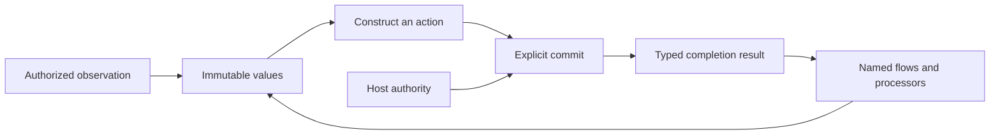

# Lo Adapter Design

Status: selected design for the next adapter contract. Implementation is pending.
This document owns the proposed shared rules and the File, HTTP, and Process contracts below.
The [language reference](../specification.md) continues to describe the implemented language.
The [implementation plan](adapter-plan.md) defines the change sequence and acceptance criteria.

All design work, implementation, fixtures, and validation stay inside Lo.
The [repository boundary](../.mprlab/POLICY.md#lo-repository-boundary) applies to this entire plan.

## Contents

- [Foundation](#foundation)
- [Shared operation contract](#shared-operation-contract)
- [Observations and purity](#observations-and-purity)
- [Activation and results](#activation-and-results)
- [Callbacks and higher-order operations](#callbacks-and-higher-order-operations)
- [File](#file)
- [HTTP](#http)
- [Process](#process)
- [Inspection and execution](#inspection-and-execution)
- [Current implementation and required changes](#current-implementation-and-required-changes)
- [Open decisions](#open-decisions)

## Foundation

Lo describes typed executable plans.
An adapter connects those plans to one external domain.
Its public operations keep explicit data, immutable values, named flows, fallibility, and host authorization.
The same rules apply to simple operations and higher-order operations.

File, HTTP, and Process have separate domain types.
They share language rules without an `IO` parent, inheritance, or mandatory identical method names.
The public domain is independent of the internal host mechanism.
A File observation can use a private subprocess without exposing general process execution.

An adapter operation must have a stable domain meaning beyond one application.
Retention periods, selected filenames, HTTP status policy, and accepted command exit codes belong in Lo flows.
The adapter owns boundary validation, resource access, and its documented execution guarantees.



## Shared Operation Contract

Each public operation must specify these fields before implementation:

| Field | Required definition |
| --- | --- |
| Domain | The external resource or immutable data that the operation represents. |
| Input and output | Exact types, validation rules, and successful result. |
| Evaluation phase | Value construction, immediate observation, activation, or an external event. |
| Authority | Required host grants and checks on the actual resource. |
| Callback contract | Named flow signature, explicit context, phase, order, count, and authorized effects. |
| Completion | The event that establishes success. |
| Failure | Constructor errors, boundary errors, host failures, and confirmed partial progress. |
| Resources | Work, bytes, handles, lifetime, cancellation, and release rules. |
| Inspection | Immediate requirements, stored callback requirements, and calculated targets. |
| Backend contract | Observable behavior shared by interpreter and native execution. |

Construction validates supplied data without access to external state.
Each constructor establishes its result type's invariants.
A response description specifies intended protocol data, but does not guarantee acceptance at emission.
Descriptions do not contain authority that the program can create for itself.
The runtime checks each actual target against host grants when it accesses that target.
Inspection and successful type checking do not grant authority.

## Observations and Purity

Direct authorized observations remain part of Lo.
For example, `File.read` returns bytes and `File.list` returns entry observations.
An observation runs when evaluation reaches its call.
Reusing its bound result does not repeat the observation.
Separate calls can return different values.

The proposed pure-flow rule excludes host observations and commit activation, including transitive calls.
Fallibility is separate from purity.
A pure calculation can return an error, and an external observation can succeed.
Device requirements remain a separate compiler summary under the existing tensor and device contracts.
This rule does not remove deterministic tensor operations from List callbacks.

| Position | Proposed rule |
| --- | --- |
| List callback | Pure named flow. No host observations or commits. |
| Match predicate | Pure total named flow. |
| Match case head | Pure value calculation. |
| Match selector or selected branch | Observations can occur. Commit activation is prohibited. |
| Flow self-handler | Pure total named flow. |
| Adapter `onError` | Pure total named flow. |
| `Flow.fold` callback | Observations and commits can occur under ordinary flow fallibility rules. |
| HTTP request handler | Observations and commits can occur under the declared handler signature. |

Match is a conditional expression.
A Match expression with an observation is not pure.
Its summary includes possible observations, but execution enters only the selected branch.
This distinction supports conditional reads without speculative access.

The compiler must keep observation order, invocation count, failure order, and evaluated branches.
It must not combine, repeat, or cache external observations as pure calculations.
In particular, two sequential callback passes are not equivalent to one interleaved pass when callbacks observe external state.
List representation and incremental realization remain runtime concerns.

## Activation and Results

The selected extension adds a bound commit statement:

```text
result = commit target
commit target
```

These forms are proposed syntax, not currently executable examples.
Both forms activate a previously bound committable target.
Commit remains a statement, with no expression form inside arguments, pipes, or Match branches.

Each nominal target type has one success type in the built-in catalog.
For example, a client request produces `HTTP.Response`, and a command produces `Process.Result`.
This relation works without a public generic `Effect<T>` or a `Unit` type.
Different target types do not become interchangeable because their success types match.

Each evaluated statement makes one activation attempt.
Activation waits for the target's defined completion event.
The bound form creates its immutable result binding only after success.
The unbound form discards the successful result.
Copies of a result do not repeat activation.
Another commit of the same description is another attempt.

Both forms keep commit failure semantics.
Inside a flow, a recoverable failure propagates to the declared flow boundary.
At top level, failure aborts execution before later statements.
A failed bound commit does not store `T!` and continue under ordinary top-level binding rules.
Host denial, cancellation, and resource exhaustion keep their host diagnostic behavior.

Success confirms only the operation's stated completion event.
A server-start result confirms startup, not service termination.
A missing HTTP response does not prove that the remote action failed to occur.
The runtime provides no automatic retry, rollback, or exactly-once delivery guarantee.
Cancellation does not reverse completed external work.

Partial progress belongs in structured failure evidence when no successful result exists.
The evidence must distinguish confirmed work from attempted work with an unknown outcome.
Cleanup failures must keep earlier progress and the original failure class.

## Callbacks and Higher-order Operations

High-level operations are valid adapter operations when their domain contract justifies them.
Names such as `map`, `fold`, and `apply` do not establish that contract by themselves.

| Candidate | Required meaning |
| --- | --- |
| Map over values | Transform each specified value through a pure named flow. Keep the stated order and failure behavior. |
| Map over action descriptions | Construct another inert description. Declare when the result callback executes and include its requirements in inspection. |
| Fold over external data | Define observation timing, input framing, resource lifetime, accumulator transitions, and partial completion. |
| Apply | State whether this is value transformation or action construction. External activation still occurs through commit. |
| External event handler | Declare event boundaries, per-event state, callback effects, and the mandatory boundary `onError`. |

A purely derived operation can remain an ordinary Lo flow.
An adapter-specific operation must have domain semantics that the existing composition does not already express.
Avoidance of list allocation alone does not justify a File fold.
Lo already supports incremental list realization when observable behavior is unchanged.

The first implementation adds no automatic `File.map`, `HTTP.fold`, or `Process.apply` family.
Future proposals use the shared operation contract and identify their other domain guarantee.
This is an admission rule for new operations, not a prohibition on higher-order adapters.
HTTP server handlers already demonstrate a domain-specific callback boundary.

Immediate callback execution and stored callbacks have separate summaries.
Construction of a server does not execute its handler.
Inspection still includes the handler's possible observations and activations.
An adapter that dispatches external events must have a total boundary `onError`.
Pure composition follows ordinary flow failure propagation without a second external event boundary.

## File

File owns filesystem observations and changes.
`File.Path` is a resource description, not a grant.
`File.Entry` is an immutable observation with private session and directory provenance.
Lists, records, and flow arguments keep that provenance.
Published metadata cannot reconstruct it.

The selected File surface is:

| Operation or target | Evaluation | Result |
| --- | --- | --- |
| `File.Path.new(text)` and `File.Path.eq(a, b)` | Pure construction or comparison | Path or Bool. |
| `File.read(path)` | Immediate observation | `Bytes!`. |
| `File.list(root)` | Immediate observation | `List<File.Entry>!`. |
| `File.open_paths(root)` | Immediate observation | `List<File.Path>!`. |
| `File.Write.new(path, content)` | Pure construction | Nominal `File.Write`. Commit produces `File.WriteReceipt`. |
| `File.Append.new(path, content)` | Pure construction | Nominal `File.Append`. Commit produces `File.AppendReceipt`. |
| `File.Remove.new(entries)` | Pure fallible construction | Nominal `File.Remove!`. Commit produces `File.RemoveReceipt`. |

Write and append accept `Bytes`.
An explicit `UTF8.Bytes.new(text: String) -> Bytes` constructor supplies text encoding.
Decoding remains explicit through `UTF8.String.new`.
The target constructors replace the current `Effect` constructors when this contract is implemented.
The change includes source examples and tests, without compatibility aliases.

| Receipt | Exact public fields | Completion event |
| --- | --- | --- |
| `File.WriteReceipt` | `path: File.Path`, `bytes_written: Int` | The full write and necessary resource release succeeded. |
| `File.AppendReceipt` | `path: File.Path`, `bytes_written: Int` | The full append and necessary resource release succeeded. |
| `File.RemoveReceipt` | `total_count: Int`, `completed_count: Int`, `observed_bytes: Int` | All selected entries were removed and necessary resource release succeeded. |

Receipt values have no public constructors.
On removal success, `completed_count` equals `total_count`.
`observed_bytes` sums the selected observations and does not measure reclaimed disk space.
Failure evidence keeps the confirmed prefix, failed position, and operation stage.
Write and append failure evidence records confirmed bytes, including a partial write.

The current operation grants, access through retained directories, and entry checks remain the basis of File authority.
Observations are not atomic snapshots.
Identity checks do not make deletion atomic against an uncoordinated writer.
Write and append do not promise a transaction or durable storage after a machine failure.
The [current File design](file-adapter-design.md) records these implemented limits.

`File.open_paths` remains a File observation with an independent grant.
Its domain meaning is an observation of open paths beneath the authorized directory.
It does not establish that a file remains open or closed after the observation.
The current `lsof` framing and filename restrictions remain documented backend limitations.
A replacement must pass acceptance before the reference can claim broader filename support.
Moving this operation to Process would not remove those limitations.

## HTTP

HTTP owns protocol values, outgoing exchanges, and server boundaries.
Client actions and incoming server requests have different types because their resource descriptions differ.
All outgoing methods use activation, including methods that request a representation.
Method semantics do not make an outgoing request a pure calculation.

| Type or operation | Selected contract |
| --- | --- |
| `HTTP.URL.new(text) -> HTTP.URL!` | Validate an absolute HTTP or HTTPS URL without DNS or network access. Reject credentials in the URL. |
| `HTTP.Method.new(text) -> HTTP.Method!` | Validate a method token without changing its case. |
| `HTTP.Headers.new(entries) -> HTTP.Headers!` | Validate a list of `Record{name: String, value: Bytes}` entries. |
| `HTTP.Client.Request.new(method, url, headers, body) -> HTTP.Client.Request!` | Construct a nominal client action from validated values and a Bytes body. Reject unsupported exchange forms. |
| Bound client commit | Return `HTTP.Response` after the full response arrives within the host limits. |
| `HTTP.Server.new(port, handler, onError)` | Construct an inert server with the existing named callback signatures. |
| Bound server commit | Return `HTTP.ServerReceipt` after successful listener startup. |

Incoming `HTTP.Request` keeps `method: String`, `path: String`, and `body: Bytes`.
Its `headers` field changes to `HTTP.Headers`.
`HTTP.Response` has `status: Int`, `headers: HTTP.Headers`, and `body: Bytes`.
The general response constructor is `HTTP.Response.new(status, headers, body) -> HTTP.Response`.
It constructs a response description without network access.
The Text and Bytes constructors remain total conveniences with an empty validated `HTTP.Headers` value.
The Text constructor explicitly selects UTF-8 encoding.
All three constructors use one response representation.

The server validates response status and body constraints at emission.
This keeps a total response path available to the mandatory pure total `onError` flow.
An invalid handler response enters that error boundary.
An invalid `onError` response produces a host failure without another handler invocation or a substitute response.
Client response values come from protocol validation at the receive boundary.

Headers keep repeated entries without comma joining.
The boundary normalizes names to lowercase and orders distinct names lexically.
Values with the same name keep their protocol order.
`HTTP.Headers.values(headers, name) -> List<Bytes>!` validates the lookup name and compares it without case sensitivity.
An absent valid name returns an empty typed list.
The `entries` projection exposes the canonical list.
These are semantic header values, not a copy of wire bytes.
Protocol framing remains the transport's responsibility.

Client grants identify authorized destinations and methods.
The host validates the resolved connection target as well as the requested destination.
Ambient proxy settings cannot expand authority.
The first contract does not follow redirects or retry requests automatically.
A redirect response is ordinary response data.
A later explicit request must have its own authorization.

The initial client supports ordinary bounded HTTP exchanges only.
Its constructor rejects CONNECT and requests for protocol switching.
The receive boundary rejects protocol-switch responses without publishing a successful response.
Interim informational responses consume bounded work and header storage before the final response.
HEAD responses and statuses that prohibit a body produce empty body bytes under their protocol rules.
No tunnel or upgraded connection becomes a Lo value.

Valid final response statuses, including client and server error statuses, remain response data.
Lo flows select the acceptable statuses.
Transport failure produces a Lo boundary error with operation context and known execution progress.
Output overflow and cancellation remain host failures.
Failure after transmission can leave the remote outcome unknown.

`HTTP.ServerReceipt` has `address: String` and `port: Int`.
It has no public constructor and identifies the actual bound listener, including an allocated port.
The host session owns the server lifetime and orderly shutdown.
Copying or discarding the receipt has no lifecycle effect.
Another commit is another startup attempt.

Server startup errors reach the initiating flow boundary.
The server `onError` handles recoverable request-boundary errors after startup.
Each request has its own handler invocation and progress state.
No ordering across separate requests is implied.
Host failures keep the existing abort behavior.

## Process

Process owns bounded execution of an explicitly described child program.
It does not expose shell source, ambient executable discovery, or implicit environment inheritance.

| Type or operation | Selected contract |
| --- | --- |
| `Process.Executable.new(path: File.Path) -> Process.Executable!` | Validate an absolute executable description without access or launch. |
| `Process.Command.new(executable, arguments, environment, directory, stdin) -> Process.Command!` | Construct an inert command with `Process.Executable`, `List<String>`, `Map<String, String>`, `File.Path`, and `Bytes` inputs. |
| Bound command commit | Return `Process.Result` after bounded execution and output capture complete. |
| `Process.Result` | Exact fields: `termination: Process.Termination`, `stdout: Bytes`, `stderr: Bytes`. |
| `Process.Termination` | A nominal runtime value with `kind: String`, restricted to `exited` or `signaled`. |
| `Process.Termination.exit_code(value) -> Int!` | Return the exit code for `exited`, otherwise `Process.TerminationKind`. |
| `Process.Termination.signal(value) -> Int!` | Return the signal number for `signaled`, otherwise `Process.TerminationKind`. |

The result and termination values have no public constructors.
The nominal representation has exactly one termination variant, without nullable fields or irrelevant sentinel values.
Nonzero exits and signals remain completed-process data.
Lo flows select the accepted outcomes.
Launch and ordinary capture failures are boundary errors.
Host cancellation and limits keep host diagnostics with available partial execution evidence.

Executable and working-directory paths must be absolute and contain no NUL.
Arguments and environment values must contain no NUL.
Environment names must be nonempty and contain neither NUL nor `=`.
The constructors validate these inputs without filesystem access.
Constructor errors are distinct from executable access and launch failures.

The program supplies the working directory and the full environment.
Arguments contain the values after `argv[0]`.
The runtime supplies the selected executable path as `argv[0]`.
It encodes argument strings as UTF-8 without shell expansion or quoting changes.
It sends the specified stdin bytes, then closes that channel.
Only declared channels and necessary runtime control channels reach the child.
An empty input is explicit and closes without terminal interaction.

### Execution Profile Prerequisite

An executable grant alone cannot constrain the child's filesystem or network access.
Process must therefore have an enforceable host execution profile before launch.
The profile is host policy, not a value that a Lo program can manufacture.

The profile must cover:

- Executable identity and resistance to replacement before launch.
- Filesystem access, including directories, path traversal, and symlinks.
- Network destinations and inherited host channels.
- Environment inputs and standard input/output channels.
- Descendant processes and their authority.
- Work, output, process-count, and lifetime limits.
- Cancellation, descendant termination, output drainage, and resource release.

An unsupported profile fails before executable resolution or launch.
The runtime must keep the profile effective throughout child and descendant execution.
There is no unrestricted execution mode when profile enforcement is unavailable.
Process remains unavailable on an unqualified backend.

Success confirms child termination, completed output capture, and no surviving descendants under the profile.
A descendant that outlives the selected limits causes failure and host cleanup.
Termination of the primary child alone does not establish completion.
Failure evidence must keep confirmed output and distinguish execution from successful resource release.

The host mechanisms for macOS and Linux must pass qualification before implementation acceptance.
Well-behaved test helpers prove command semantics but do not prove confinement.
Adversarial helpers and controlled boundary failures must establish the profile guarantees separately.
Every helper, attempted filesystem target, and output remains inside Lo during this work.

## Inspection and Execution

The catalog owns types, constructor failures, observations, activation result types, and callback contracts.
The checker and inspector consume that shared definition.
The IR keeps observations, commits, and device requirements separate.
Stored callbacks keep requirements for their later invocation phase.

Inspection identifies possible operations, grants, completion types, and callback contexts without external access.
Calculated targets remain calculated requirements until runtime authorization.
Process inspection reports the required profile and declared inputs.
If host configuration is supplied, inspection identifies the declared profile without claiming runtime enforcement.
Activation verifies backend support and establishes enforcement before launch.
It does not infer the executable's internal algorithm or specific effects from its path.

Interpreter and native execution must agree on results, order, errors, authority, and progress.
Neither backend can silently repeat an observation or activate a constructed target.
Resources remain host-owned, even when immutable observations or receipts outlive a particular operation.
Diagnostic output must not expose secret header or environment values.

## Current Implementation and Required Changes

| Area | Implemented behavior | Selected change |
| --- | --- | --- |
| Observations | File reads, entries, and open paths return immutable values. | Keep direct observations and strengthen callback rules. |
| Purity | No transitive commits. Reads have a separate compiler flag. | Exclude observations from pure callback positions as specified above. |
| Commit | Statement with no bound result. | Add bound result publication with statement failure semantics. |
| File actions | Write, append, and removal produce `Effect`. | Replace them with nominal targets and operation-specific receipts. |
| HTTP | Server boundary and map-based headers. | Add client activation, repeated byte-valued headers, and server receipts. |
| Process | No general public adapter. | Require profile qualification, then implement command activation. |
| Higher-order operations | Pure List callbacks and ordered `Flow.fold`. | Apply one admission contract to future domain operations. |

The [File implementation record](file-adapter-plan.md) remains evidence for the current behavior only.
The cleanup example does not establish the new contract's acceptance.
The next implementation updates the specification, catalog, examples, and both backends together for each selected stage.
Obsolete shapes and aliases do not remain as compatibility paths.

## Open Decisions

- Select and qualify the host mechanisms that enforce each Process execution profile.
- Specify concrete client grant inputs, connection authorization, and per-operation limits before the HTTP stage.
- Specify the error kinds and diagnostic schemas for new operations before their failing integration tests.
- Qualify open-file observation backends before any broader filename-support claim.

These decisions do not reopen bound commit semantics or authorize unrestricted Process execution.
Before implementation, specify individual operation contracts for other metadata, executable discovery, locks, and domain-specific folds.
