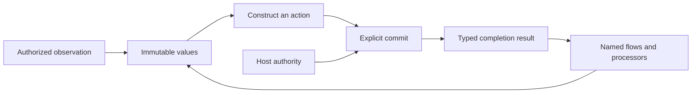

# Lo Adapter Design

Status: stages 1–3 and the pure Process phase passed current-stack CI.
The pure Process phase also passed focused interpreter and native checks.
Independent review approved the implemented pure Process checkpoint.
Independent source review closed the current shared-contract and HTTP findings.
HTTP-to-File composition passes in both execution backends.
Process-dependent composition remains incomplete.
The latest current-stack CI includes pure Process construction, inspection, and unavailable rejection.

Process qualification failed source review. No backend is qualified.
The current candidate could not demonstrate a runnable helper.
Probes stopped after independent review.

This document owns the shared rules and selected domain contracts below.
The [language reference](../specification.md) continues to describe the implemented language.
The [implementation plan](adapter-plan.md) defines the change sequence and acceptance criteria.

All design work, implementation, fixtures, and validation stay inside Lo.
The [repository boundary](../.mprlab/POLICY.md#lo-repository-boundary) applies to this entire plan.

## Contents

- [Foundation](#foundation)
- [Shared operation contract](#shared-operation-contract)
- [Observations and purity](#observations-and-purity)
- [Activation and results](#activation-and-results)
- [Callbacks and higher-order operations](#callbacks-and-higher-order-operations)
- [File](#file)
- [HTTP](#http)
- [Process](#process)
- [Inspection and execution](#inspection-and-execution)
- [Current implementation and required changes](#current-implementation-and-required-changes)
- [Open decisions](#open-decisions)

## Foundation

Lo describes typed executable plans.
An adapter connects those plans to one external domain.
Its public operations keep explicit data, immutable values, named flows, fallibility, and host authorization.
The same rules apply to simple operations and higher-order operations.

File, HTTP, and Process have separate domain types.
They share language rules without an `IO` parent, inheritance, or mandatory identical method names.
The public domain is independent of the internal host mechanism.
A File observation can use a private subprocess without exposing general process execution.

An adapter operation must have a stable domain meaning beyond one application.
Retention periods, selected filenames, HTTP status policy, and accepted command exit codes belong in Lo flows.
The adapter owns boundary validation, resource access, and its documented execution guarantees.



## Shared Operation Contract

Each public operation must specify these fields before implementation:

| Field | Required definition |
| --- | --- |
| Domain | The external resource or immutable data that the operation represents. |
| Input and output | Exact types, validation rules, and successful result. |
| Evaluation phase | Value construction, immediate observation, activation, or an external event. |
| Authority | Required host grants and checks on the actual resource. |
| Callback contract | Named flow signature, explicit context, phase, order, count, and authorized effects. |
| Completion | The event that establishes success. |
| Failure | Constructor errors, boundary errors, host failures, and confirmed partial progress. |
| Resources | Work, bytes, handles, lifetime, cancellation, and release rules. |
| Inspection | Immediate requirements, stored callback requirements, and calculated targets. |
| Backend contract | Observable behavior shared by interpreter and native execution. |

Construction validates supplied data without access to external state.
Each constructor establishes its result type's invariants.
A response description specifies intended protocol data, but does not guarantee acceptance at emission.
Descriptions do not contain authority that the program can create for itself.
The runtime checks each actual target against host grants when it accesses that target.
Inspection and successful type checking do not grant authority.

## Observations and Purity

Direct authorized observations remain part of Lo.
For example, `File.read` returns bytes and `File.list` returns entry observations.
An observation runs when evaluation reaches its call.
Reusing its bound result does not repeat the observation.
Separate calls can return different values.

The implemented pure-flow rule excludes host observations and commit activation, including transitive calls.
Fallibility is separate from purity.
A pure calculation can return an error, and an external observation can succeed.
Device requirements remain a separate compiler summary under the existing tensor and device contracts.
This rule does not remove deterministic tensor operations from List callbacks.

| Position | Implemented rule |
| --- | --- |
| List callback | Pure named flow. No host observations or commits. |
| Match predicate | Pure total named flow. |
| Match case head | Pure total value calculation. |
| Match selector or selected branch | Observations can occur. Commit activation is prohibited. |
| Flow self-handler | Pure total named flow. |
| Adapter `onError` | Pure total named flow. |
| `Flow.fold` callback | Observations and commits can occur under ordinary flow fallibility rules. |
| HTTP request handler | Observations and commits can occur under the declared handler signature. |

Match is a conditional expression.
A Match expression with an observation is not pure.
Its summary includes possible observations, but execution enters only the selected branch.
This distinction supports conditional reads without speculative access.

The compiler must keep observation order, invocation count, failure order, and evaluated branches.
It must not combine, repeat, or cache external observations as pure calculations.
In particular, two sequential callback passes are not equivalent to one interleaved pass when callbacks observe external state.
List representation and incremental realization remain runtime concerns.

## Activation and Results

Lo supports bound and unbound commit statements:

```text
result = commit target
commit target
```

Both forms are implemented for nominal File targets and `HTTP.Server`.
Both forms activate a previously bound committable target.
Commit remains a statement, with no expression form inside arguments, pipes, or Match branches.

Each nominal target type has one success type in the built-in catalog.
For example, `File.Write` produces `File.WriteReceipt`, and `HTTP.Server` produces `HTTP.ServerReceipt`.
Client targets produce `HTTP.Response`.
Selected future command targets produce `Process.Result`.
This relation works without a public generic `Effect<T>` or a `Unit` type.
Different target types do not become interchangeable because their success types match.

Each evaluated commit statement makes one activation attempt.
Activation waits for the target's defined completion event.
The bound form creates its immutable result binding only after success.
The unbound form discards the successful result.
Copies of a result do not repeat activation.
Another commit of the same description is another attempt.

Both forms keep commit failure semantics.
Inside a flow, a recoverable failure propagates to the declared flow boundary.
At top level, failure aborts execution before later statements.
A failed bound commit does not store `T!` and continue under ordinary top-level binding rules.
Host denial, cancellation, and resource exhaustion keep their host diagnostic behavior.

Success confirms only the operation's stated completion event.
A server-start result confirms startup, not service termination.
A missing HTTP response does not prove that the remote action failed to occur.
The runtime provides no automatic retry, rollback, or exactly-once delivery guarantee.
Cancellation does not reverse completed external work.

Partial progress belongs in structured failure evidence when no successful result exists.
The evidence must distinguish confirmed work from attempted work with an unknown outcome.
Cleanup failures must keep earlier progress and the original failure class.

Host write failures expose `write_progress` for the current partial operation.
Its fields are `bytes_written: Int` and `stage: String`.
`last_completed_activation` identifies only the latest completed activation in an invocation.
Its fields are `operation`, `span`, and `receipt`.
Diagnostic evidence does not create a result binding.

Cleanup cancellation must keep the original operation failure class.
Recoverable write errors keep `cleanup_errors: List<String>` in `Error.input`.
Host diagnostics expose `cleanup_errors` as a JSON array.

Recoverable fold failures keep reserved progress snapshots in `Error.flow_progress: List<Record>`.
Each failing fold prepends its record, so nested records run from outermost to innermost.
Equal record contents do not remove nested invocation records.
A pure handler that returns the same error keeps this metadata.
A fresh `Error.new` resets it to an empty list.
A handled fold cannot contaminate a later unrelated error.

The records retain no tensor storage or executable authority.
Their state remains explicit program data under ordinary snapshot rules.
Type-only automatic trace inputs do not replace that state.
Error JSON omits an empty `flow_progress` list.
CLI top-level diagnostics also expose recoverable carrier records.
If a value budget rejects an error value, the host diagnostic keeps its already reserved progress records.
Failed fallible values follow the same rule without publication of the rejected value.

## Callbacks and Higher-order Operations

High-level operations are valid adapter operations when their domain contract justifies them.
Names such as `map`, `fold`, and `apply` do not establish that contract by themselves.

| Candidate | Required meaning |
| --- | --- |
| Map over values | Transform each specified value through a pure named flow. Keep the stated order and failure behavior. |
| Map over action descriptions | Construct another inert description. Declare when the result callback executes and include its requirements in inspection. |
| Fold over external data | Define observation timing, input framing, resource lifetime, accumulator transitions, and partial completion. |
| Apply | State whether this is value transformation or action construction. External activation still occurs through commit. |
| External event handler | Declare event boundaries, per-event state, callback effects, and the mandatory boundary `onError`. |

A purely derived operation can remain an ordinary Lo flow.
An adapter-specific operation must have domain semantics that the existing composition does not already express.
Avoidance of list allocation alone does not justify a File fold.
Lo already supports incremental list realization when observable behavior is unchanged.

The first implementation adds no automatic `File.map`, `HTTP.fold`, or `Process.apply` family.
Future proposals use the shared operation contract and identify their other domain guarantee.
This is an admission rule for new operations, not a prohibition on higher-order adapters.
HTTP server handlers already demonstrate a domain-specific callback boundary.

Immediate callback execution and stored callbacks have separate summaries.
Construction of a server does not execute its handler.
Inspection still includes the handler's possible observations and activations.
An adapter that dispatches external events must have a total boundary `onError`.
Pure composition follows ordinary flow failure propagation without a second external event boundary.

## File

File owns filesystem observations and changes.
`File.Path` is a resource description, not a grant.
`File.Entry` is an immutable observation with private session and directory provenance.
Lists, records, and flow arguments keep that provenance.
Published metadata cannot reconstruct it.

The selected File surface is:

| Operation or target | Evaluation | Result |
| --- | --- | --- |
| `File.Path.new(text)` and `File.Path.eq(a, b)` | Pure construction or comparison | Path or Bool. |
| `File.read(path)` | Immediate observation | `Bytes!`. |
| `File.list(root)` | Immediate observation | `List<File.Entry>!`. |
| `File.open_paths(root)` | Immediate observation | `List<File.Path>!`. |
| `File.Write.new(path, content)` | Pure construction | Nominal `File.Write`. Commit produces `File.WriteReceipt`. |
| `File.Append.new(path, content)` | Pure construction | Nominal `File.Append`. Commit produces `File.AppendReceipt`. |
| `File.Remove.new(entries)` | Pure fallible construction | Nominal `File.Remove!`. Commit produces `File.RemoveReceipt`. |

Write and append accept `Bytes`.
An explicit `UTF8.Bytes.new(text: String) -> Bytes` constructor supplies text encoding.
Decoding remains explicit through `UTF8.String.new`.
The nominal File targets and their receipts are implemented.
Source examples and tests use the canonical constructors without compatibility aliases.

| Receipt | Exact public fields | Completion event |
| --- | --- | --- |
| `File.WriteReceipt` | `path: File.Path`, `bytes_written: Int` | The full write and necessary resource release succeeded. |
| `File.AppendReceipt` | `path: File.Path`, `bytes_written: Int` | The full append and necessary resource release succeeded. |
| `File.RemoveReceipt` | `total_count: Int`, `completed_count: Int`, `observed_bytes: Int` | All selected entries were removed and necessary resource release succeeded. |

Receipt values have no public constructors.
On removal success, `completed_count` equals `total_count`.
`observed_bytes` sums the selected observations and does not measure reclaimed disk space.
Failure evidence keeps the confirmed prefix, failed position, and operation stage.
Write and append failure evidence records confirmed bytes, including a partial write.

The current operation grants, access through retained directories, and entry checks remain the basis of File authority.
Observations are not atomic snapshots.
Identity checks do not make deletion atomic against an uncoordinated writer.
Write and append do not promise a transaction or durable storage after a machine failure.
The [current File design](file-adapter-design.md) records these implemented limits.

`File.open_paths` remains a File observation with an independent grant.
Its domain meaning is an observation of open paths beneath the authorized directory.
It does not establish that a file remains open or closed after the observation.
The current `lsof` framing and filename restrictions remain documented backend limitations.
A replacement must pass acceptance before the reference can claim broader filename support.
Moving this operation to Process would not remove those limitations.

## HTTP

Server construction, startup receipts, nominal headers, and the general response constructor are implemented.
The header and automatic trace cases have focused validation.
Client source and selected interpreter cases are complete.
Combined interpreter protocol and composition cases passed.
Independent source review closed the current findings.
Matching focused native qualification passed.

HTTP owns protocol values, outgoing exchanges, and server boundaries.
Client actions and incoming server requests have different types because their resource descriptions differ.
All outgoing methods use activation, including methods that request a representation.
Method semantics do not make an outgoing request a pure calculation.

| Type or operation | Current contract |
| --- | --- |
| `HTTP.URL.new(text) -> HTTP.URL!` | Validate an absolute HTTP or HTTPS URL without DNS or network access. Reject credentials in the URL. |
| `HTTP.Method.new(text) -> HTTP.Method!` | Validate a method token without changing its case. |
| `HTTP.Headers.new(entries) -> HTTP.Headers!` | Validate a list of `Record{name: String, value: Bytes}` entries. |
| `HTTP.Headers.values(headers, name) -> List<Bytes>!` | Validate the lookup name and return repeated values without case sensitivity. |
| `HTTP.Response.new(status, headers, body) -> HTTP.Response` | Construct a total response from explicit nominal headers and a Bytes body. |
| `HTTP.Client.Request.new(method, url, headers, body) -> HTTP.Client.Request!` | Construct a nominal client action from validated values and a Bytes body. Reject unsupported exchange forms. |
| Bound client commit | Return `HTTP.Response` after the full response arrives within the host limits. |
| `HTTP.Server.new(port, handler, onError)` | Construct an inert server with the existing named callback signatures. |
| Bound server commit | Return `HTTP.ServerReceipt` after successful listener startup. |

Incoming `HTTP.Request` keeps `method: String`, `path: String`, and `body: Bytes`.
Its `headers` field changes to `HTTP.Headers`.
`HTTP.Response` has `status: Int`, `headers: HTTP.Headers`, and `body: Bytes`.
The general response constructor is `HTTP.Response.new(status, headers, body) -> HTTP.Response`.
It constructs a response description without network access.
The Text and Bytes constructors remain total conveniences with an empty validated `HTTP.Headers` value.
The Text constructor explicitly selects UTF-8 encoding.
All three constructors use one response representation.

The server validates response status and body constraints at emission.
This keeps a total response path available to the mandatory pure total `onError` flow.
An invalid handler response enters that error boundary.
An invalid `onError` response produces a host failure without another handler invocation or a substitute response.
Client response values come from protocol validation at the receive boundary.

Headers keep repeated entries without comma joining.
The boundary normalizes names to lowercase and orders distinct names lexically.
Values with the same name keep their protocol order.
`HTTP.Headers.values(headers, name) -> List<Bytes>!` validates the lookup name and compares it without case sensitivity.
An absent valid name returns an empty typed list.
The `entries` projection exposes the canonical list.
These are semantic header values, not a copy of wire bytes.
Protocol framing remains the transport's responsibility.

The repeatable grant is `--http-allow METHOD,ORIGIN,ADDRESS`.
It requires an exact case-sensitive method, canonical origin, and numeric connection address.
The origin has no credentials, query, fragment, or non-root path.
A grant must contain no whitespace.

The host checks method and origin before DNS access.
It selects an explicitly granted resolved address before one connection attempt.
Ambient proxy settings cannot expand authority.
The first contract does not follow redirects or retry requests automatically.
A redirect response is ordinary response data.
A later explicit request must have its own authorization.

The selected host input is a repeatable `--http-allow 'METHOD,ORIGIN,ADDRESS'` option for `run` and `serve`.
Each grant contains exactly three nonempty fields, without whitespace.
`METHOD` keeps its case.
`ORIGIN` contains an HTTP or HTTPS scheme, a hostname, and an effective port.
The host rejects credentials, queries, fragments, and paths other than an empty path or `/` in this field.
`ADDRESS` contains an IP literal without a zone identifier.
The host converts IPv4-mapped IPv6 addresses to IPv4 before comparison.
Grants with the same canonical origin and method supply one authorized address set.

The runtime checks the method and origin before DNS resolution.
It selects the first authorized resolved address in canonical lexical order.
It makes one connection attempt to that IP literal.
The original hostname controls TLS verification, SNI, and HTTP authority.
A failed attempt does not select another address.
The first client supports HTTP/1.1 only and creates a separate transport for each activation.
It does not use an ambient proxy, automatic redirects, or request replay.

The client constructor rejects CONNECT and user-supplied authority, connection, upgrade, and framing headers.
The host limits each request body and response body to 1 MiB.
It limits each response header section to 64 KiB.
It permits at most eight interim responses, with an aggregate header limit of 64 KiB.
Each exchange has a five-second timeout.
Output overflow and timeout remain host failures.
Ordinary transport and protocol failures use `HTTP.ExchangeFailed`.

Failure evidence contains the operation stage, request-write confirmation, and the known remote-outcome state.
Once transmission can occur, an incomplete exchange has an unknown remote outcome.
This evidence does not contain headers, bodies, full URLs, or query data.
Successful response evidence contains the final status, result type, operation, and commit source span.
The runtime records this completion evidence before it charges the response result.
The complete response remains ordinary program data.

Request and response bodies each have a 1 MiB limit.
Response headers have a 64 KiB limit.
Outgoing request headers use ordinary value budgets.
A separate request-header byte limit is not specified.
At most eight interim responses can consume a combined 64 KiB of headers.
The complete exchange has a five-second deadline.

The initial client supports ordinary bounded HTTP exchanges only.
Its constructor rejects CONNECT and requests for protocol switching.
The receive boundary rejects protocol-switch responses without publishing a successful response.
Interim informational responses consume bounded work and header storage before the final response.
HEAD responses and statuses that prohibit a body produce empty body bytes under their protocol rules.
No tunnel or upgraded connection becomes a Lo value.
The client requires HTTP/1.1 for every response section.

Valid final response statuses, including client and server error statuses, remain response data.
Lo flows select the acceptable statuses.
Transport failure produces a Lo boundary error with operation context and known execution progress.
Output overflow and cancellation remain host failures.
Failure after transmission can leave the remote outcome unknown.

Client failure evidence contains `stage`, `request_written`, and `remote_outcome`.
The remote outcome is `not_started` or `unknown`.
Recoverable failures keep the record in `Error.input.progress`.
Host failures expose it as `http_progress`.
Header and body payloads are absent from this evidence.

Automatic trace inputs keep field names and type-only summaries.
Nominal Headers snapshots keep names and remove value payloads.
Client request snapshots keep method, origin, root path, and header names.
They remove original path, query, body, and header value payloads.
Standalone URL snapshots also replace the path with `/` and remove the query.
Raw program-authored error input and explicit fold state are not general secret scrubbing boundaries.

`HTTP.ServerReceipt` has `address: String` and `port: Int`.
It has no public constructor and identifies the actual bound listener, including an allocated port.
The host session owns the server lifetime and orderly shutdown.
Copying or discarding the receipt has no lifecycle effect.
Another commit is another startup attempt.

Server startup errors reach the initiating flow boundary.
The server `onError` handles recoverable request-boundary errors after startup.
Each request has its own handler invocation and progress state.
No ordering across separate requests is implied.
Host failures keep the existing abort behavior.

## Process

This section separates the approved pure phase from future execution.
The pure phase is implemented, and focused interpreter validation passed.
No general public Process adapter is implemented.

Process owns bounded execution of an explicitly described child program.
It does not expose shell source, ambient executable discovery, or implicit environment inheritance.

| Type or operation | Selected contract |
| --- | --- |
| `Process.Executable.new(path: File.Path) -> Process.Executable!` | Validate an absolute executable description without access or launch. |
| `Process.Command.new(executable, arguments, environment, directory, stdin) -> Process.Command!` | Construct an inert command with `Process.Executable`, `List<String>`, `Map<String, String>`, `File.Path`, and `Bytes` inputs. |
| Bound command commit | Return `Process.Result` after bounded execution and output capture complete. |
| Future `Process.Result` runtime value | Exact fields: `termination: Process.Termination`, `stdout: Bytes`, `stderr: Bytes`. |
| Future `Process.Termination` | A nominal runtime value with `kind: String`, restricted to `exited` or `signaled`. |
| Future `Process.Termination.exit_code(value) -> Int!` | Return the exit code for `exited`, otherwise `Process.TerminationKind`. |
| Future `Process.Termination.signal(value) -> Int!` | Return the signal number for `signaled`, otherwise `Process.TerminationKind`. |

The result and termination values have no public constructors.
The nominal representation has exactly one termination variant, without nullable fields or irrelevant sentinel values.
Nonzero exits and signals remain completed-process data.
Lo flows select the accepted outcomes.
Launch and ordinary capture failures are boundary errors.
Host cancellation and limits keep host diagnostics with available partial execution evidence.

Executable and working-directory paths must be absolute and contain no NUL.
Arguments and environment values must contain no NUL.
Environment names must be nonempty and contain neither NUL nor `=`.
The constructors validate these inputs without filesystem access.
Constructor errors are distinct from executable access and launch failures.

The program supplies the working directory and the full environment.
Arguments contain the values after `argv[0]`.
The runtime supplies the selected executable path as `argv[0]`.
It encodes argument strings as UTF-8 without shell expansion or quoting changes.
It sends the specified stdin bytes, then closes that channel.
Only declared channels and necessary runtime control channels reach the child.
An empty input is explicit and closes without terminal interaction.

### Pure Process Phase

This approved phase is implemented, and focused interpreter validation passed.
It can proceed before execution profile qualification.
It adds pure constructors, inspection, and host rejection without child execution.

| Operation | Result |
| --- | --- |
| `Process.Executable.new(path: File.Path)` | `Process.Executable!` |
| `Process.Command.new(executable: Process.Executable, arguments: List<String>, environment: Map<String, String>, directory: File.Path, stdin: Bytes)` | `Process.Command!` |

Executable and directory paths must be absolute and contain no NUL.
Arguments and environment values must contain no NUL.
Environment names must be nonempty and contain neither NUL nor `=`.
Construction keeps exact lexical data without access, path resolution, shell expansion, or environment inheritance.

Command activation declares metadata capability `Process.run` and opaque static success type `Process.Result`.
`Process.run` is not a callable builtin.
This phase provides no result constructor, result accessor, or result runtime value.
CLI `run` and `serve` reject activation with host diagnostic `runtime.process-unavailable` before any executable access.
Lo `onError` cannot handle this host diagnostic.
Constructor diagnostics and nominal command snapshots omit argument, environment, and stdin payloads.
Explicit program output keeps those values.
Inspection adds no access or launch authority.
The inspector adds an optional `process` object to command targets and capabilities.
It contains `executable`, `arguments`, `environment`, `directory`, and `stdin` input descriptions.
Each description uses ordinary `kind`, `type`, `node`, `span`, and `dependencies` fields, with `value` or `expression`.
It also contains `execution_profile: {required: true, status: "unavailable"}`.
This profile status describes the current standard host, not arbitrary injected boundaries.
Executable descriptions trace the supplied `File.Path`.
Dynamic command descriptions retain whole-command dependencies.
Text inspection shows `execution_profile=required/unavailable` and the named inputs.
Source literals remain inspection data, while runtime snapshots omit sensitive payloads.

The standard runner installs `adapter.WithProcess` for `run`, `serve`, and server callbacks.
This wrapper rejects command activation before delegation or executable access.
Custom Go boundaries are trusted host implementations and must enforce qualification.
Generic commit execution validates the result type without a universal host qualification gate.
An HTTP request-handler commit returns `runtime.process-unavailable` and aborts the server.
HTTP `onError` remains pure, so a Process commit there fails with `check.effectful-callback` before execution.

Qualification remains mandatory before any launch or execution acceptance.
Executable results, Process-dependent composition, and full-plan acceptance remain pending.
The earlier File/HTTP CI remains valid for its recorded scope.
Final focused interpreter validation passed in 2.934 seconds.
Final focused native Process validation passed in 14.086 seconds.
Current-stack CI passed, including the pure Process phase.
Independent review approved the implemented pure Process checkpoint.

### Execution Profile Prerequisite

An executable grant alone cannot constrain the child's filesystem or network access.
Process must therefore have an enforceable host execution profile before launch.
The profile is host policy, not a value that a Lo program can manufacture.

The profile must cover:

- Executable identity and resistance to replacement before launch.
- Filesystem access, including directories, path traversal, and symlinks.
- Network destinations and inherited host channels.
- Environment inputs and standard input/output channels.
- Descendant processes and their authority.
- Work, output, process-count, and lifetime limits.
- Cancellation, descendant termination, output drainage, and resource release.

An unsupported profile fails before executable resolution or launch.
The runtime must keep the profile effective throughout child and descendant execution.
There is no unrestricted execution mode when profile enforcement is unavailable.
Process remains unavailable on an unqualified backend.

Success confirms child termination, completed output capture, and no surviving descendants under the profile.
A descendant that outlives the selected limits causes failure and host cleanup.
Termination of the primary child alone does not establish completion.
Failure evidence must keep confirmed output and distinguish execution from successful resource release.

The host mechanisms for macOS and Linux must pass qualification before execution acceptance.
Well-behaved test helpers prove command semantics but do not prove confinement.
Adversarial helpers and controlled boundary failures must establish the profile guarantees separately.
Every helper, attempted filesystem target, and output remains inside Lo during this work.

### Qualification Status

Independent source review did not qualify any Process backend.
The scratch helper build passed.
The main candidate and an immediate-return child each terminated with `SIGABRT` and exit code `-6`.
Both runs produced empty standard output and standard error.
No helper observations were recorded.
The exact candidate did not demonstrate a runnable helper.
Independent review stopped further probes.
The review found these missing guarantees:

- Executable identity must resist replacement between authorization and launch.
- The macOS Seatbelt profile must establish default denial and reliable fork denial.
- Filesystem and IPC access must not escape the profile.
- Work, resource, and lifetime limits need enforceable host mechanisms.
- Descendant prevention or cleanup must hold through operation completion.

A single-process profile with fork denial is only a proposed qualification candidate.
It is not an approved profile or an implementation.
The [earlier backend experiment](evidence/native-backends/experiment.json) records network-denial isolation only.
That evidence does not qualify filesystem confinement, executable identity, descendant control, or resource enforcement.
The new candidate used no external file-read allowances, and the launch-only probe kept the same profile.
The profile SHA-256 is `5cbccacce7d9f0b3d71222fe289bb6917374847bdf02460e4d28b0b60e605c0c`.
No profile broadening occurred.

Static Mach-O inspection read only the scratch helper bytes.
The helper SHA-256 is `dd6ec36820a69a59bd3ab5220b5856738b39f8e9ac8bd78f450d635d78a55b88`, with CPU `CpuArm64`.
It names loader `/usr/lib/dyld` and libraries `/usr/lib/libSystem.B.dylib` and `/usr/lib/libresolv.9.dylib`.
It has no rpaths.
The inspection opened none of those referenced paths and did not launch the helper.
These names are absent from the candidate's explicit read grants.
This fact proves no runtime access, abort cause, denial, or platform impossibility.
No new probe or profile broadening occurred.

A later build-only experiment constructed an arm64 `_start: brk #0` artifact without headers or standard libraries.
It used Clang target `arm64-apple-macos11` with `-nostdlib -Wl,-static -Wl,-e,_start`.
The build passed.
Artifact inspection reported `Exec`, `CpuArm64`, and `LC_UNIXTHREAD`.
The SHA-256 is `f2709f3d825a8ef1ee0c5b2f7f4cf1021cc3350a7de8f945513cbd417537a3a2`.
The artifact has no load-dylinker, dylib, rpath, or undefined symbol.
The inspector parses the same bytes used for the SHA-256.
The `_start` symbol and ARM64 UnixThread PC both identify `0x1000002e8` (`4294968040`).
The instruction bytes are `000020d4`.
Independent local artifact decoding with `otool` also identifies `BRK #0`.
No helper launch, external referenced-path access, or profile change occurred.
This evidence establishes construction feasibility only.
It does not validate the entry ABI, startup, sandbox, executable identity, or lifetime and resource guarantees.
Independent review accepted these bounded construction claims.

Independent review rejected the proposed intentional-crash launch before execution.
A zero `RLIMIT_CORE` does not establish suppression or redirection of host crash reports.
Child IPC denial does not establish confinement of host crash-reporter output.
No launch occurred.
The primary agent removed the proposed launcher, profile, and launch Make target.
Static source, artifact, and inspection evidence remain.
Local helper disassembly shows that `runtime.exit` uses `libcCall` and a trampoline.
Syscall number constants do not establish the raw Darwin/arm64 exit ABI.
Current local evidence does not support a non-crashing fixture launch.
Independent final review confirmed a blocked qualification operation under the available repository evidence.
No concrete supported implementation or launch action remains.
The missing prerequisite is an evidenced non-crashing repository-contained execution path or demonstrated task-local control of intentional-crash reports.
Neither prerequisite is present.
Executable identity, confinement, descendants, and resource guarantees also remain unqualified.
These limits do not establish platform impossibility.
The approved static-construction evidence and unchanged-source CI remain valid.
Existing full CI remains valid for unchanged product source.
No backend is qualified, and the full adapter goal remains incomplete.

These results establish neither sandbox denial nor platform-wide impossibility.
The [implementation review](evidence/adapter-implementation-review.json) records the probe limits and current validation checkpoint.

## Inspection and Execution

The catalog owns types, constructor failures, observations, activation result types, and callback contracts.
The checker and inspector consume that shared definition.
The IR keeps observations, commits, and device requirements separate.
Stored callbacks keep requirements for their later invocation phase.

Inspection identifies possible operations, grants, completion types, and callback contexts without external access.
Calculated targets remain calculated requirements until runtime authorization.
Future Process inspection must report the required profile and declared inputs.
If host configuration is supplied, future Process inspection must identify the declared profile without a runtime enforcement claim.
Future Process activation must verify backend support and establish enforcement before launch.
It does not infer the executable's internal algorithm or specific effects from its path.

Interpreter and native execution must agree on results, order, errors, authority, and progress.
Neither backend can silently repeat an observation or activate a constructed target.
Resources remain host-owned, even when immutable observations or receipts outlive a particular operation.
Diagnostic output must not expose secret header or environment values.

## Current Implementation and Required Changes

| Area | Implemented behavior | Remaining work |
| --- | --- | --- |
| Observations | File reads, entries, and open paths return immutable values. | Keep observation order and selected branches in later adapters. |
| Purity | Pure callbacks exclude transitive observations and commits. Device requirements stay separate. | Apply this rule to future callback positions. |
| Commit | Bound and unbound statements use catalog-defined success types and statement failure semantics. | Add future nominal target categories. |
| File actions | Nominal Write, Append, and Remove targets return operation-specific receipts. Current-stack CI passed. | No stage 1–2 checkpoint work remains. |
| HTTP | Nominal headers, total responses, client actions, server receipts, and HTTP-to-File composition passed current-stack CI. | Process-dependent composition remains pending. |
| Process | No backend is qualified. The pure phase is implemented, and focused interpreter validation passed. | Qualify enforcement before any launch or execution acceptance. |
| Higher-order operations | Pure List callbacks and ordered `Flow.fold` with observations and commits. | Apply the admission contract to future domain operations. |

The [implementation review](evidence/adapter-implementation-review.json) records stage 1–2 red and green evidence.
The focused interpreter run passed in 1.423 seconds.
The native run passed in 31.031 seconds and included all `TestFile` cases.
Independent source review closed the three operation-progress and cleanup findings.
The reviewer did not run Make.

These results do not complete the full adapter plan.
The historical stages 1–3 checkpoint passed `CI=1 make ci </dev/null` with exit status `0`.
Full interpreter integration took 54.454 seconds, and full native integration took 482.811 seconds.
Runtime bundle checks, formatting, Go vet, and the build passed.
The earlier independent checkpoint review approved stages 1–3 without a remaining source finding.
The reviewer examined source and evidence without execution of tests.

Initial CI failed in integration after 60.053 seconds.
The corrected fold carrier, value-budget preservation, and pure-head Match fixture are included in final CI.
The [implementation review](evidence/adapter-implementation-review.json) keeps the initial failure and correction history.

The validated stages 1–3 checkpoint stops before the new pure Process phase.
Pure Process work requires new validation but does not require launch qualification.
Process execution requires a qualified profile and its own final stack validation.

The [File implementation record](file-adapter-plan.md) separates earlier workflow evidence from the current adapter update.
Future stages must update the specification, catalog, examples, and both backends together.
Obsolete shapes and aliases must not remain as compatibility paths.

## Open Decisions

- Select and qualify the host mechanisms that enforce each Process execution profile.
- Select enforceable executable identity, filesystem/IPC, descendant, and resource mechanisms for each Process profile.
- Specify Process launch, profile denial, and partial-output diagnostics before their failing integration tests.
- Specify a separate outgoing request-header byte limit before a broader bound claim.
- Qualify open-file observation backends before any broader filename-support claim.

These decisions do not reopen bound commit semantics or authorize unrestricted Process execution.
Before implementation, specify individual operation contracts for other metadata, executable discovery, locks, and domain-specific folds.

The latest pure Process checkpoint passed `CI=1 make ci </dev/null` with exit status `0`.
Full interpreter integration took 43.391 seconds, and full native integration took 522.053 seconds.
Runtime bundle verification, formatting, Go vet, tests, and the final build passed.
The source finding is closed, and independent review approved the pure Process checkpoint.
Process execution is unqualified, and the full adapter plan remains incomplete.
