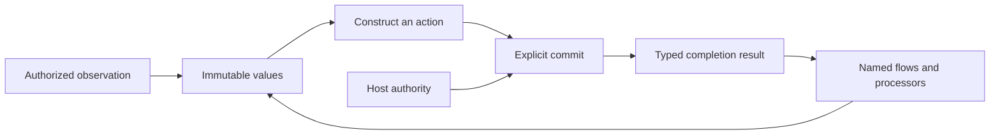

# Lo Adapter Design

Status: shared adapter contracts, Process results, executable registration, and the native host are implemented.
The selected Darwin 27 arm64 profile passed [native qualification](evidence/process-host-native.json).
Canonical public acceptance passed all 24 interpreter/generated-native cases, including server callbacks and Process-to-File composition.
Final stack CI and independent completion review passed.
The [final validation record](evidence/process-enabled-validation.json) preserves the CI log and review outcome.
Earlier injected checkpoints passed CI and independent review.
Implementation and final stack CI passed. Independent completion review passed.

This document owns the shared rules and selected domain contracts below.
The [language reference](../specification.md) continues to describe the implemented language.
The [implementation plan](adapter-plan.md) defines the change sequence and acceptance criteria.

All design work, implementation, fixtures, and validation stay inside Lo.
The [repository boundary](../.mprlab/POLICY.md#lo-repository-boundary) applies to this entire plan.

## Contents

- [Foundation](#foundation)
- [Shared operation contract](#shared-operation-contract)
- [Observations and purity](#observations-and-purity)
- [Activation and results](#activation-and-results)
- [Callbacks and higher-order operations](#callbacks-and-higher-order-operations)
- [File](#file)
- [HTTP](#http)
- [Process](#process)
- [Inspection and execution](#inspection-and-execution)
- [Current implementation and required changes](#current-implementation-and-required-changes)
- [Open decisions](#open-decisions)

## Foundation

Lo describes typed executable plans.
An adapter connects those plans to one external domain.
Its public operations keep explicit data, immutable values, named flows, fallibility, and host authorization.
The same rules apply to simple operations and higher-order operations.

File, HTTP, and Process have separate domain types.
They share language rules without an `IO` parent, inheritance, or mandatory identical method names.
The public domain is independent of the internal host mechanism.
A File observation can use a private subprocess without exposing general process execution.

An adapter operation must have a stable domain meaning beyond one application.
Retention periods, selected filenames, HTTP status policy, and accepted command exit codes belong in Lo flows.
The adapter owns boundary validation, resource access, and its documented execution guarantees.



## Shared Operation Contract

Each public operation must specify these fields before implementation:

| Field | Required definition |
| --- | --- |
| Domain | The external resource or immutable data that the operation represents. |
| Input and output | Exact types, validation rules, and successful result. |
| Evaluation phase | Value construction, immediate observation, activation, or an external event. |
| Authority | Required host grants and checks on the actual resource. |
| Callback contract | Named flow signature, explicit context, phase, order, count, and authorized effects. |
| Completion | The event that establishes success. |
| Failure | Constructor errors, boundary errors, host failures, and confirmed partial progress. |
| Resources | Work, bytes, handles, lifetime, cancellation, and release rules. |
| Inspection | Immediate requirements, stored callback requirements, and calculated targets. |
| Backend contract | Observable behavior shared by interpreter and native execution. |

Construction validates supplied data without access to external state.
Each constructor establishes its result type's invariants.
A response description specifies intended protocol data, but does not guarantee acceptance at emission.
Descriptions do not contain authority that the program can create for itself.
The runtime checks each actual target against host grants when it accesses that target.
Inspection and successful type checking do not grant authority.

## Observations and Purity

Direct authorized observations remain part of Lo.
For example, `File.read` returns bytes and `File.list` returns entry observations.
An observation runs when evaluation reaches its call.
Reusing its bound result does not repeat the observation.
Separate calls can return different values.

The implemented pure-flow rule excludes host observations and commit activation, including transitive calls.
Fallibility is separate from purity.
A pure calculation can return an error, and an external observation can succeed.
Device requirements remain a separate compiler summary under the existing tensor and device contracts.
This rule does not remove deterministic tensor operations from List callbacks.

| Position | Implemented rule |
| --- | --- |
| List callback | Pure named flow. No host observations or commits. |
| Match predicate | Pure total named flow. |
| Match case head | Pure total value calculation. |
| Match selector or selected branch | Observations can occur. Commit activation is prohibited. |
| Flow self-handler | Pure total named flow. |
| Adapter `onError` | Pure total named flow. |
| `Flow.fold` callback | Observations and commits can occur under ordinary flow fallibility rules. |
| HTTP request handler | Observations and commits can occur under the declared handler signature. |

Match is a conditional expression.
A Match expression with an observation is not pure.
Its summary includes possible observations, but execution enters only the selected branch.
This distinction supports conditional reads without speculative access.

The compiler must keep observation order, invocation count, failure order, and evaluated branches.
It must not combine, repeat, or cache external observations as pure calculations.
In particular, two sequential callback passes are not equivalent to one interleaved pass when callbacks observe external state.
List representation and incremental realization remain runtime concerns.

## Activation and Results

Lo supports bound and unbound commit statements:

```text
result = commit target
commit target
```

Both forms are implemented for nominal File targets and `HTTP.Server`.
Both forms activate a previously bound committable target.
Commit remains a statement, with no expression form inside arguments, pipes, or Match branches.

Each nominal target type has one success type in the built-in catalog.
For example, `File.Write` produces `File.WriteReceipt`, and `HTTP.Server` produces `HTTP.ServerReceipt`.
Client targets produce `HTTP.Response`.
Selected future command targets produce `Process.Result`.
This relation works without a public generic `Effect<T>` or a `Unit` type.
Different target types do not become interchangeable because their success types match.

Each evaluated commit statement makes one activation attempt.
Activation waits for the target's defined completion event.
The bound form creates its immutable result binding only after success.
The unbound form discards the successful result.
Copies of a result do not repeat activation.
Another commit of the same description is another attempt.

Both forms keep commit failure semantics.
Inside a flow, a recoverable failure propagates to the declared flow boundary.
At top level, failure aborts execution before later statements.
A failed bound commit does not store `T!` and continue under ordinary top-level binding rules.
Host denial, cancellation, and resource exhaustion keep their host diagnostic behavior.

Success confirms only the operation's stated completion event.
A server-start result confirms startup, not service termination.
A missing HTTP response does not prove that the remote action failed to occur.
The runtime provides no automatic retry, rollback, or exactly-once delivery guarantee.
Cancellation does not reverse completed external work.

Partial progress belongs in structured failure evidence when no successful result exists.
The evidence must distinguish confirmed work from attempted work with an unknown outcome.
Cleanup failures must keep earlier progress and the original failure class.

Host write failures expose `write_progress` for the current partial operation.
Its fields are `bytes_written: Int` and `stage: String`.
`last_completed_activation` identifies only the latest completed activation in an invocation.
Its fields are `operation`, `span`, and `receipt`.
Diagnostic evidence does not create a result binding.

Cleanup cancellation must keep the original operation failure class.
Recoverable write errors keep `cleanup_errors: List<String>` in `Error.input`.
Host diagnostics expose `cleanup_errors` as a JSON array.

Recoverable fold failures keep reserved progress snapshots in `Error.flow_progress: List<Record>`.
Each failing fold prepends its record, so nested records run from outermost to innermost.
Equal record contents do not remove nested invocation records.
A pure handler that returns the same error keeps this metadata.
A fresh `Error.new` resets it to an empty list.
A handled fold cannot contaminate a later unrelated error.

The records retain no tensor storage or executable authority.
Their state remains explicit program data under ordinary snapshot rules.
Type-only automatic trace inputs do not replace that state.
Error JSON omits an empty `flow_progress` list.
CLI top-level diagnostics also expose recoverable carrier records.
If a value budget rejects an error value, the host diagnostic keeps its already reserved progress records.
Failed fallible values follow the same rule without publication of the rejected value.

## Callbacks and Higher-order Operations

High-level operations are valid adapter operations when their domain contract justifies them.
Names such as `map`, `fold`, and `apply` do not establish that contract by themselves.

| Candidate | Required meaning |
| --- | --- |
| Map over values | Transform each specified value through a pure named flow. Keep the stated order and failure behavior. |
| Map over action descriptions | Construct another inert description. Declare when the result callback executes and include its requirements in inspection. |
| Fold over external data | Define observation timing, input framing, resource lifetime, accumulator transitions, and partial completion. |
| Apply | State whether this is value transformation or action construction. External activation still occurs through commit. |
| External event handler | Declare event boundaries, per-event state, callback effects, and the mandatory boundary `onError`. |

A purely derived operation can remain an ordinary Lo flow.
An adapter-specific operation must have domain semantics that the existing composition does not already express.
Avoidance of list allocation alone does not justify a File fold.
Lo already supports incremental list realization when observable behavior is unchanged.

The first implementation adds no automatic `File.map`, `HTTP.fold`, or `Process.apply` family.
Future proposals use the shared operation contract and identify their other domain guarantee.
This is an admission rule for new operations, not a prohibition on higher-order adapters.
HTTP server handlers already demonstrate a domain-specific callback boundary.

Immediate callback execution and stored callbacks have separate summaries.
Construction of a server does not execute its handler.
Inspection still includes the handler's possible observations and activations.
An adapter that dispatches external events must have a total boundary `onError`.
Pure composition follows ordinary flow failure propagation without a second external event boundary.

## File

File owns filesystem observations and changes.
`File.Path` is a resource description, not a grant.
`File.Entry` is an immutable observation with private session and directory provenance.
Lists, records, and flow arguments keep that provenance.
Published metadata cannot reconstruct it.

The selected File surface is:

| Operation or target | Evaluation | Result |
| --- | --- | --- |
| `File.Path.new(text)` and `File.Path.eq(a, b)` | Pure construction or comparison | Path or Bool. |
| `File.read(path)` | Immediate observation | `Bytes!`. |
| `File.list(root)` | Immediate observation | `List<File.Entry>!`. |
| `File.open_paths(root)` | Immediate observation | `List<File.Path>!`. |
| `File.Write.new(path, content)` | Pure construction | Nominal `File.Write`. Commit produces `File.WriteReceipt`. |
| `File.Append.new(path, content)` | Pure construction | Nominal `File.Append`. Commit produces `File.AppendReceipt`. |
| `File.Remove.new(entries)` | Pure fallible construction | Nominal `File.Remove!`. Commit produces `File.RemoveReceipt`. |

Write and append accept `Bytes`.
An explicit `UTF8.Bytes.new(text: String) -> Bytes` constructor supplies text encoding.
Decoding remains explicit through `UTF8.String.new`.
The nominal File targets and their receipts are implemented.
Source examples and tests use the canonical constructors without compatibility aliases.

| Receipt | Exact public fields | Completion event |
| --- | --- | --- |
| `File.WriteReceipt` | `path: File.Path`, `bytes_written: Int` | The full write and necessary resource release succeeded. |
| `File.AppendReceipt` | `path: File.Path`, `bytes_written: Int` | The full append and necessary resource release succeeded. |
| `File.RemoveReceipt` | `total_count: Int`, `completed_count: Int`, `observed_bytes: Int` | All selected entries were removed and necessary resource release succeeded. |

Receipt values have no public constructors.
On removal success, `completed_count` equals `total_count`.
`observed_bytes` sums the selected observations and does not measure reclaimed disk space.
Failure evidence keeps the confirmed prefix, failed position, and operation stage.
Write and append failure evidence records confirmed bytes, including a partial write.

The current operation grants, access through retained directories, and entry checks remain the basis of File authority.
Observations are not atomic snapshots.
Identity checks do not make deletion atomic against an uncoordinated writer.
Write and append do not promise a transaction or durable storage after a machine failure.
The [current File design](file-adapter-design.md) records these implemented limits.

`File.open_paths` remains a File observation with an independent grant.
Its domain meaning is an observation of open paths beneath the authorized directory.
It does not establish that a file remains open or closed after the observation.
The current `lsof` framing and filename restrictions remain documented backend limitations.
A replacement must pass acceptance before the reference can claim broader filename support.
Moving this operation to Process would not remove those limitations.

## HTTP

Server construction, startup receipts, nominal headers, and the general response constructor are implemented.
The header and automatic trace cases have focused validation.
Client source and selected interpreter cases are complete.
Combined interpreter protocol and composition cases passed.
Independent source review closed the current findings.
Matching focused native qualification passed.

HTTP owns protocol values, outgoing exchanges, and server boundaries.
Client actions and incoming server requests have different types because their resource descriptions differ.
All outgoing methods use activation, including methods that request a representation.
Method semantics do not make an outgoing request a pure calculation.

| Type or operation | Current contract |
| --- | --- |
| `HTTP.URL.new(text) -> HTTP.URL!` | Validate an absolute HTTP or HTTPS URL without DNS or network access. Reject credentials in the URL. |
| `HTTP.Method.new(text) -> HTTP.Method!` | Validate a method token without changing its case. |
| `HTTP.Headers.new(entries) -> HTTP.Headers!` | Validate a list of `Record{name: String, value: Bytes}` entries. |
| `HTTP.Headers.values(headers, name) -> List<Bytes>!` | Validate the lookup name and return repeated values without case sensitivity. |
| `HTTP.Response.new(status, headers, body) -> HTTP.Response` | Construct a total response from explicit nominal headers and a Bytes body. |
| `HTTP.Client.Request.new(method, url, headers, body) -> HTTP.Client.Request!` | Construct a nominal client action from validated values and a Bytes body. Reject unsupported exchange forms. |
| Bound client commit | Return `HTTP.Response` after the full response arrives within the host limits. |
| `HTTP.Server.new(port, handler, onError)` | Construct an inert server with the existing named callback signatures. |
| Bound server commit | Return `HTTP.ServerReceipt` after successful listener startup. |

Incoming `HTTP.Request` keeps `method: String`, `path: String`, and `body: Bytes`.
Its `headers` field changes to `HTTP.Headers`.
`HTTP.Response` has `status: Int`, `headers: HTTP.Headers`, and `body: Bytes`.
The general response constructor is `HTTP.Response.new(status, headers, body) -> HTTP.Response`.
It constructs a response description without network access.
The Text and Bytes constructors remain total conveniences with an empty validated `HTTP.Headers` value.
The Text constructor explicitly selects UTF-8 encoding.
All three constructors use one response representation.

The server validates response status and body constraints at emission.
This keeps a total response path available to the mandatory pure total `onError` flow.
An invalid handler response enters that error boundary.
An invalid `onError` response produces a host failure without another handler invocation or a substitute response.
Client response values come from protocol validation at the receive boundary.

Headers keep repeated entries without comma joining.
The boundary normalizes names to lowercase and orders distinct names lexically.
Values with the same name keep their protocol order.
`HTTP.Headers.values(headers, name) -> List<Bytes>!` validates the lookup name and compares it without case sensitivity.
An absent valid name returns an empty typed list.
The `entries` projection exposes the canonical list.
These are semantic header values, not a copy of wire bytes.
Protocol framing remains the transport's responsibility.

The repeatable grant is `--http-allow METHOD,ORIGIN,ADDRESS`.
It requires an exact case-sensitive method, canonical origin, and numeric connection address.
The origin has no credentials, query, fragment, or non-root path.
A grant must contain no whitespace.

The host checks method and origin before DNS access.
It selects an explicitly granted resolved address before one connection attempt.
Ambient proxy settings cannot expand authority.
The first contract does not follow redirects or retry requests automatically.
A redirect response is ordinary response data.
A later explicit request must have its own authorization.

The selected host input is a repeatable `--http-allow 'METHOD,ORIGIN,ADDRESS'` option for `run` and `serve`.
Each grant contains exactly three nonempty fields, without whitespace.
`METHOD` keeps its case.
`ORIGIN` contains an HTTP or HTTPS scheme, a hostname, and an effective port.
The host rejects credentials, queries, fragments, and paths other than an empty path or `/` in this field.
`ADDRESS` contains an IP literal without a zone identifier.
The host converts IPv4-mapped IPv6 addresses to IPv4 before comparison.
Grants with the same canonical origin and method supply one authorized address set.

The runtime checks the method and origin before DNS resolution.
It selects the first authorized resolved address in canonical lexical order.
It makes one connection attempt to that IP literal.
The original hostname controls TLS verification, SNI, and HTTP authority.
A failed attempt does not select another address.
The first client supports HTTP/1.1 only and creates a separate transport for each activation.
It does not use an ambient proxy, automatic redirects, or request replay.

The client constructor rejects CONNECT and user-supplied authority, connection, upgrade, and framing headers.
The host limits each request body and response body to 1 MiB.
It limits each response header section to 64 KiB.
It permits at most eight interim responses, with an aggregate header limit of 64 KiB.
Each exchange has a five-second timeout.
Output overflow and timeout remain host failures.
Ordinary transport and protocol failures use `HTTP.ExchangeFailed`.

Failure evidence contains the operation stage, request-write confirmation, and the known remote-outcome state.
Once transmission can occur, an incomplete exchange has an unknown remote outcome.
This evidence does not contain headers, bodies, full URLs, or query data.
Successful response evidence contains the final status, result type, operation, and commit source span.
The runtime records this completion evidence before it charges the response result.
The complete response remains ordinary program data.

Request and response bodies each have a 1 MiB limit.
Response headers have a 64 KiB limit.
Outgoing request headers use ordinary value budgets.
A separate request-header byte limit is not specified.
At most eight interim responses can consume a combined 64 KiB of headers.
The complete exchange has a five-second deadline.

The initial client supports ordinary bounded HTTP exchanges only.
Its constructor rejects CONNECT and requests for protocol switching.
The receive boundary rejects protocol-switch responses without publishing a successful response.
Interim informational responses consume bounded work and header storage before the final response.
HEAD responses and statuses that prohibit a body produce empty body bytes under their protocol rules.
No tunnel or upgraded connection becomes a Lo value.
The client requires HTTP/1.1 for every response section.

Valid final response statuses, including client and server error statuses, remain response data.
Lo flows select the acceptable statuses.
Transport failure produces a Lo boundary error with operation context and known execution progress.
Output overflow and cancellation remain host failures.
Failure after transmission can leave the remote outcome unknown.

Client failure evidence contains `stage`, `request_written`, and `remote_outcome`.
The remote outcome is `not_started` or `unknown`.
Recoverable failures keep the record in `Error.input.progress`.
Host failures expose it as `http_progress`.
Header and body payloads are absent from this evidence.

Automatic trace inputs keep field names and type-only summaries.
Nominal Headers snapshots keep names and remove value payloads.
Client request snapshots keep method, origin, root path, and header names.
They remove original path, query, body, and header value payloads.
Standalone URL snapshots also replace the path with `/` and remove the query.
Raw program-authored error input and explicit fold state are not general secret scrubbing boundaries.

`HTTP.ServerReceipt` has `address: String` and `port: Int`.
It has no public constructor and identifies the actual bound listener, including an allocated port.
The host session owns the server lifetime and orderly shutdown.
Copying or discarding the receipt has no lifecycle effect.
Another commit is another startup attempt.

Server startup errors reach the initiating flow boundary.
The server `onError` handles recoverable request-boundary errors after startup.
Each request has its own handler invocation and progress state.
No ordering across separate requests is implied.
Host failures keep the existing abort behavior.

## Process

Existing installed OS and runtime dependencies can serve as read-only execution infrastructure.
This allowance does not include another repository, external task data, or external writes.
All added sources, fixtures, caches, and output remain inside Lo.
The abandoned intentional-crash experiment is optional and establishes no native impossibility.

This section defines pure values, the shared lifecycle, and the selected native execution profile.
Pure construction and source inspection need no executable access.
Native host qualification and all 24 canonical public activation cases passed. Final stack CI and independent completion review passed.

Process owns bounded execution of an explicitly described child program.
It does not expose shell source, ambient executable discovery, or implicit environment inheritance.

| Type or operation | Selected contract |
| --- | --- |
| `Process.Executable.new(path: File.Path) -> Process.Executable!` | Validate an absolute executable description without access or launch. |
| `Process.Command.new(executable, arguments, environment, directory, stdin) -> Process.Command!` | Construct an inert command with `Process.Executable`, `List<String>`, `Map<String, String>`, `File.Path`, and `Bytes` inputs. |
| Bound command commit | Return `Process.Result` after bounded execution and output capture complete. |
| `Process.Result` runtime value | Exact fields: `termination: Process.Termination`, `stdout: Bytes`, `stderr: Bytes`. |
| `Process.Termination` | A nominal runtime value with `kind: String`, restricted to `exited` or `signaled`. |
| `Process.Termination.exit_code(value) -> Int!` | Return the exit code for `exited`, otherwise `Process.TerminationKind`. |
| `Process.Termination.signal(value) -> Int!` | Return the signal number for `signaled`, otherwise `Process.TerminationKind`. |

The result and termination values have no public constructors.
The nominal representation has exactly one termination variant, without nullable fields or irrelevant sentinel values.
Nonzero exits and signals remain completed-process data.
Lo flows select the accepted outcomes.
Launch and ordinary capture failures are boundary errors.
Host cancellation and limits keep host diagnostics with available partial execution evidence.

Executable and working-directory paths must be absolute and contain no NUL.
Arguments and environment values must contain no NUL.
Environment names must be nonempty and contain neither NUL nor `=`.
The constructors validate these inputs without filesystem access.
Constructor errors are distinct from executable access and launch failures.

The program supplies the working directory and the full environment.
Arguments contain the values after `argv[0]`.
The runtime supplies the selected executable path as `argv[0]`.
It encodes argument strings as UTF-8 without shell expansion or quoting changes.
It sends the specified stdin bytes, then closes that channel.
Only declared channels and necessary runtime control channels reach the child.
An empty input is explicit and closes without terminal interaction.

### Pure Process Phase

This approved phase is implemented, and focused interpreter validation passed.
It can proceed before execution profile qualification.
It adds pure constructors, inspection, and host rejection without child execution.

| Operation | Result |
| --- | --- |
| `Process.Executable.new(path: File.Path)` | `Process.Executable!` |
| `Process.Command.new(executable: Process.Executable, arguments: List<String>, environment: Map<String, String>, directory: File.Path, stdin: Bytes)` | `Process.Command!` |

Executable and directory paths must be absolute and contain no NUL.
Arguments and environment values must contain no NUL.
Environment names must be nonempty and contain neither NUL nor `=`.
Construction keeps exact lexical data without access, path resolution, shell expansion, or environment inheritance.

Command activation declares metadata capability `Process.run` and nominal success type `Process.Result`.
`Process.run` is not a callable builtin.
The earlier pure checkpoint provided no result runtime values or accessors.
The shared core provides results and termination accessors through trusted injection and the selected native host.
Without Process grants, ordinary execution remains available. Only attempted Process activation returns `runtime.process-unavailable`.
Configured Process policy on an unsupported backend fails session open before program evaluation.
Lo `onError` cannot handle this host diagnostic.
Constructor diagnostics and nominal command snapshots omit argument, environment, and stdin payloads.
Explicit program output keeps those values.
Inspection adds no access or launch authority.
The inspector adds an optional `process` object to command targets and capabilities.
It contains `executable`, `arguments`, `environment`, `directory`, and `stdin` input descriptions.
Each description uses ordinary `kind`, `type`, `node`, `span`, and `dependencies` fields, with `value` or `expression`.
It also contains `execution_profile: {required: true, status: "unavailable"}`.
Without host configuration, source inspection reports this unavailable profile status. It does not establish runtime enforcement.
Executable descriptions trace the supplied `File.Path`.
Dynamic command descriptions retain whole-command dependencies.
Text inspection shows `execution_profile=required/unavailable` and the named inputs.
Source literals remain inspection data, while runtime snapshots omit sensitive payloads.

The standard runner opens one canonical `processhost.Session` for `run`, `serve`, and server callbacks.
The session owns native policy, the executable registry, participating File adapters, and retained shutdown.
`Close(ctx)` closes admission and starts one shutdown owner. Its context bounds only the caller wait.
`WaitRetained()` joins that same owner without a cleanup retry. A caller timeout does not release ownership.
Custom Go boundaries are trusted host implementations and must enforce qualification.
Generic commit execution validates the result type without a universal host qualification gate.
HTTP request handlers can commit Process commands under the same configured session. Host failures stop the server.
HTTP `onError` remains pure, so a Process commit there fails with `check.effectful-callback` before execution.

Qualification remains mandatory before standard-host native Process activation acceptance.
Bounded repository-contained qualification probes have a separate review gate.
This phase authorizes no new probe launch.
This earlier pure checkpoint did not establish native execution. Current canonical public acceptance passed. Final stack CI and independent completion review passed.
The earlier File/HTTP CI remains valid for its recorded scope.
Final focused interpreter validation passed in 2.934 seconds.
Final focused native Process validation passed in 14.086 seconds.
Current-stack CI passed, including the pure Process phase.
Independent review approved the implemented pure Process checkpoint.

### Host-Independent Results and Lifecycle Core

Status: the host-independent result and lifecycle core is implemented.
The [lifecycle evidence](evidence/process-start-lifecycle.json) records focused checks, race checks, and current-stack CI.
Current-stack CI passed with interpreter integration in 39.879 seconds and generated-native integration in 462.176 seconds.
Independent final review approved the pending-start correction without a remaining finding.
This core can precede native execution profile qualification.
It uses an injected OS boundary without an OS launcher or CLI execution opt-in.
`NewProcessLifecycle` and `WithProcessLifecycle` are trusted Go embedding APIs only.
Without Process grants, ordinary execution remains available. Only attempted Process activation returns `runtime.process-unavailable`.
Configured Process policy on an unsupported backend fails session open before program evaluation.

The selected result shape is `{termination: Process.Termination, stdout: Bytes, stderr: Bytes}`.
`Process.Termination.kind` is `exited` or `signaled`.
Fallible `Process.Termination.exit_code` and `Process.Termination.signal` accessors select the matching variant.
Neither type has a Lo constructor.
The core derives an immutable invocation from the exact executable, `argv[0]`, environment, directory, and stdin.
Every nonnil child returned by `Start` transfers ownership, including a child returned with an error.
An owned launch can still wait for OS process creation.
`ProcessChild.StartConfirmed()` reports known primary creation, including late creation.
The query is prompt, safe for concurrent calls, and valid after release.
Its result never changes from true to false.
It does not show target execution or an execution permit.
The core keeps positive query results and valid termination as creation evidence.
The core closes each pipe exactly once.
Pipe `Close` must return promptly and unblock I/O even when it reports an error.
One `Wait` continues after request cancellation through a fresh bounded cleanup context.
`Stop` covers descendants.
Successful `Release` means creation is finished and no owned primary, descendant, or private resource is left.
No child can appear after successful release.
Failed release keeps ownership and any registry quarantine.

Failure progress uses `start_confirmed` for creation evidence.
False means that creation is unknown, without an independent guarantee that no child exists.
With successful release and no creation evidence, cancellation does not require a termination value.
Creation evidence without observed termination causes a host cleanup failure.
Returned progress is an immutable snapshot, even if the owner later obtains creation evidence.

Success requires complete stdin delivery, stdout and stderr EOF, known termination, joined I/O, and successful `Release`.
Early stdin closure produces ordinary `Process.ExecutionFailed`.
Nonzero exit and signal termination remain completed-process data.
Cancellation and limits remain host failures.
Missing termination after known creation, or unresolved containment, produces host cleanup failure and overrides an ordinary failure.
Safe evidence preserves the original failure class and stage.

Trusted Go `ProcessFailure` keeps bounded partial stdout and stderr bytes.
Lo errors and automatic diagnostics keep counts and status only, without raw partial bytes.
Before result charging, a completion summary keeps termination and byte counts without payloads.
`MaxProcessOutputBytes` is 1 MiB per stream.
`DefaultProcessLimits` uses a five-second execution timeout and a one-second cleanup timeout.
Configured durations must be positive, and each stream limit must be from one byte through 1 MiB.

Pipe-close cleanup errors remain host failures with `cleanup_complete: false`.
A failed `Release` followed by successful `Stop` and a second successful `Release` remains a host failure.
That recovered cleanup records `cleanup_complete: true`, without an unresolved-containment claim.
Execution timeout and cancellation produce host cancellation.
Output overflow produces a host limit failure.
Ordinary activation errors use catalog kind `Process.ExecutionFailed`.

1. Add public integration fixtures for the approved result and lifecycle contract.
2. Confirm the expected failures before production changes.
3. Implement the host-independent core through an injected OS boundary.
4. Verify the core and unchanged standard-host rejection in interpreter and native paths.
5. Run final stack CI and obtain independent checkpoint review.

These checks do not qualify a native launcher or its confinement.
Native launch remains dependent on qualification.

### Executable Registry Phase

Status: the registry is implemented, and focused public tests passed in 0.804 seconds.
Post-correction Process, File, and Gateway fixture race checks passed in 13.547 seconds.
Independent source/test review closed the nested-ownership and quarantine-test findings.
Final current-stack CI passed: interpreter integration 49.549 seconds and generated native integration 574.835 seconds.
Runtime bundle verification, formatting, Go vet, all Go tests, native integration, and build passed.
Independent final review approved the registry checkpoint with both findings closed.
Validation uses byte fixtures, real Lo File operations, and injected lifecycle drivers without native Process execution.
Initial public fixtures reached expected missing-API failures before implementation.
This phase protects identity within the trusted host model and does not enable native execution.
Untrusted Lo programs and children remain subject to registry and confinement controls.
The model excludes hostile unsandboxed host mutation.

Registry new-file creation uses `os.CreateTemp` default creation semantics within the frozen registry model.
Before creation, the parent pathname device/inode must match the retained granted parent.
The namespace must remain stable during this operation.
Publication uses a root-relative link and temporary-file cleanup.
A replaced parent pathname fails before creation, even when the retained handle still reaches the original directory.
This edge check does not establish protection against hostile concurrent host namespace mutation.
Standalone File behavior remains unchanged.

| Trusted Go API | Contract |
| --- | --- |
| `NewProcessExecutableGrant(path string, sha256 [32]byte) (ProcessExecutableGrant, error)` | Select one exact executable path and digest. |
| `NewProcessRegistryLimits(maxExecutableBytes int64) (ProcessRegistryLimits, error)` | Validate the registration byte limit. |
| `DefaultProcessRegistryLimits()` | Supply the 64 MiB default executable limit. |
| `OpenProcessRegistry(ctx, []ProcessExecutableGrant, limits) (ProcessRegistry, error)` | Validate and freeze the registry under cancellation and byte limits. |
| `registry.OpenFiles(FileRoots, FileIO) (Files, error)` | Share registered identity protection across File adapters. |
| `registry.Driver(ProcessDriver) (ProcessDriver, error)` | Check exact grants and retain activation ownership around a trusted driver. |
| `registry.Close() error` | Reject active ownership, then close idempotently. |

Registered names, device/inode identities, and ancestors remain protected continuously.
Lo File write, append, and removal must reject protected direct paths and aliases before mutation.
Symlink and hardlink aliases cannot bypass protection across separate registry File adapters.
A lease covers the whole execution and verified release, not only a hash check before exec.
No coordinator lock remains held through child execution or injected callbacks.
Registry/File protection does not establish native child filesystem confinement.
Unrelated sibling mutations remain available.
Retained adapters cannot bypass registry closure.

Digest mismatch, identity replacement, an unregistered executable, and canceled admission fail before underlying `Start`.
Every nonnil child returned by `Start` retains ownership, including a child returned with an error.
A failed child `Release` leaves ownership active and quarantines later activation.
Later successful `Release` discharges ownership but does not clear quarantine.
`Start(nil, nil)` is a host contract violation with sticky quarantine and unresolved ownership.
Its lifecycle evidence records `cleanup_complete: false`, without confirmed start or termination.
A missing child handle does not prove cleanup, so `Close` must fail for that unresolved lease.
There is no arbitrary recovery API.
An ordinary trusted `Start(nil, error)` under the no-resource contract clears the lease.
Its lifecycle evidence records `cleanup_complete: true`.
Typed unresolved-start errors retain ownership and quarantine every registry wrapper, including after contextual error wrapping.

The selected native profile now supplies child filesystem protection. Other backends require separate qualification.
Registry/File integration can be validated independently through byte fixtures and injected lifecycle execution.
No OS launcher or CLI execution opt-in belongs to this phase.

### Host Policy Inputs

The compiler and generated-program runners accept these inputs with `run` and `serve`.
The [policy checks](evidence/process-policy.json) passed through both public argument entry points.
Parsing validates descriptions without filesystem access. The selected native profile and canonical public acceptance passed. Final stack CI and independent completion review passed.

| CLI input | Description |
| --- | --- |
| `--process-allow SHA256,ABSOLUTE_PATH` | Repeatable command grant with a 64-digit hexadecimal digest. |
| `--process-launcher ABSOLUTE_PATH` | One trusted launcher path. The build must supply its expected identity before activation. |
| `--process-read-root ABSOLUTE_PATH` | Repeatable child read root. The selected profile uses these roots for data reads and the working directory. |

A configured policy requires all three input categories.
Paths must be clean, absolute, and free of NUL.
The grant separator follows the digest. Commas after that separator are part of the path.
Duplicate command paths, read roots, and launcher options are invalid.
A command grant cannot use the launcher path.
Native validation rejects a command that uses an alias of the launcher.
These inputs do not grant parent File authority or inherit parent File grants.
Without grants, the session keeps File support and rejects only attempted Process activation.
Configured Process policy on an unsupported backend fails session open before helper or command lookup.

### Selected Native Admission Limits

These limits apply to the qualified Darwin 27 arm64 profile, separately from pure constructor validation.
Pure constructors can accept descriptions that exceed these native limits.
Native admission rejects those descriptions without target execution.

| Native input | Limit |
| --- | --- |
| Command grants | At most 16 exact path/digest grants. |
| Child read roots | At most 16 roots. |
| Arguments | At most 16 entries including `argv[0]`, so at most 15 supplied arguments. |
| Environment | At most 16 `NAME=value` entries. |
| Entry or path | At most 1024 UTF-8 bytes. The environment bound includes the entire `NAME=value` entry. |
| Command body | At most 8192 bytes, including each entry's four-byte length prefix. |

Native helper, command, read-root, and working-directory paths must equal their resolved paths.
The selected native profile rejects paths with symlink resolution.
These restrictions do not change the constructors' lexical path contract.

### Execution Profile Prerequisite

An executable grant alone cannot constrain the child's filesystem or network access.
Process must therefore have an enforceable host execution profile before launch.
The profile is host policy, not a value that a Lo program can manufacture.

The profile must cover:

- Executable identity and resistance to replacement before launch.
- Filesystem access, including directories, path traversal, and symlinks.
- Network destinations and inherited host channels.
- Environment inputs and standard input/output channels.
- Descendant processes and their authority.
- Work, output, process-count, and lifetime limits.
- Cancellation, descendant termination, output drainage, and resource release.

The native launcher must start with a fixed host environment.
Command environment variables must not enter that environment.
Loader variables can execute command-supplied code before the launcher's entry point.
Install confinement before receipt of the command environment through a separate bounded channel.
Validate the complete frame and its end before target execution.
Close the control channel before exec, and keep standard input separate.
Pass the validated environment to the target without changes or inherited entries.
An empty command environment must remain empty.

An unsupported profile fails before executable resolution or launch.
The runtime must keep the profile effective throughout child and descendant execution.
There is no unrestricted execution mode when profile enforcement is unavailable.
Process remains unavailable on an unqualified backend.

Success confirms child termination, completed output capture, and no surviving descendants under the profile.
A descendant that outlives the selected limits causes failure and host cleanup.
Termination of the primary child alone does not establish completion.
Failure evidence must keep confirmed output and distinguish execution from successful resource release.

Each selected native backend/profile must pass qualification before its activation acceptance.
A qualified macOS profile can activate while Linux remains unavailable.
Well-behaved test helpers prove command semantics but do not prove confinement.
Adversarial helpers and controlled boundary failures must establish the profile guarantees separately.
Every helper, attempted filesystem target, and output remains inside Lo during this work.

### First Native Profile

The selected profile permits one active command per host executor, with bounded admission.
It denies descendants, network access, and child filesystem writes.
The child can return captured bytes for a later parent File commit.
Only explicit command inputs and the specified standard channels reach the child.
The profile enforces output, descriptor, execution-time, and cleanup-time limits.

The conditional work bound derives from maximum host execution parallelism and total child lifetime.
For parallelism `P` and lifetime `L`, the conservative CPU-time bound is `P × L`.
This bound does not provide a separately configurable CPU quota or an enforced thread-count limit.
No-fork enforcement does not prevent threads.
Qualification must establish `P`, bounded admission, and `L` from startup through confirmed termination.
The earlier synchronous experiment did not establish that lifetime bound. The qualified supervisor tracks the complete admitted lifetime.

This bound assumes a responsive OS and scheduler that complete creation and termination operations.
A bounded caller return does not establish bounded child lifetime.
If creation or termination is unresolved, report incomplete cleanup and an unverified lifetime bound.
Ownership and quarantine prevent another admission but do not establish `L`.
Do not claim that the work bound held for that operation.

The failed hard CPU-limit experiment remains failed evidence.
The first profile does not depend on that mechanism or an unverified CPU monitor.
The selected profile passed native host qualification and canonical public acceptance.

### Native Startup Protocol

Native startup must retain ownership before asynchronous OS creation can leave a child behind.
One owner must track pending creation, the eventual primary, its channels, and its reaper.
Admission must bound pending launches as well as active commands.
Cancellation must retain that owner until creation settles and resource release succeeds.
An unresolved OS call must produce incomplete cleanup and registry quarantine.
An asynchronous wrapper does not prove that the OS call can be interrupted.

The launcher must use its fixed host environment and install confinement before receipt of command inputs.
The launcher must validate command inputs and send `READY` through a private control channel.
`READY` shows confinement and input validation.
After the final cancellation and ownership check, the host must send a separate affirmative execution permit.
Closure without that permit must abort startup. EOF alone must not authorize execution.
Permit publication defines the activation boundary.
Cancellation after that boundary can race activation and must terminate the owned child.
The driver must preserve that uncertainty instead of claiming that command code could not execute.
Launcher control and failure messages must remain separate from target stdout and stderr.

| Evidence | Meaning |
| --- | --- |
| Owned pending launch | The host keeps creation and cleanup responsibility. |
| `StartConfirmed()` | The owned OS primary exists. |
| `READY` | The launcher completed confinement and input validation. |
| Successful permit publication | Target execution can occur. Concurrent cancellation can race this boundary. |
| Target execution evidence | The selected command executed. |
| Primary termination | The owned primary terminated, which can occur before target execution. |
| Successful `Release` | Creation is finished and no owned process or private resource is left. |

The supervisor must serialize observed cancellation and permit publication.
Raw context cancellation is not an atomic pipe operation.
Before known target execution, launcher termination produces an activation failure with available primary-termination evidence.
EOF on an error channel does not independently show target execution because process death also closes the channel.
Structured startup failures must identify the stage without command payloads.

The candidate will test a parent `NOTE_EXEC` observation registered after `READY` and before the permit.
Registration failure must prevent permit publication.
Event collection and reaping must preserve execution evidence when the target exits immediately.
The observation must stay bound to the owned child until final cleanup.
The selected native startup cases passed, with completed ownership and cleanup evidence.

The [earlier isolated supervisor](evidence/process-startup-candidate.json) passed public lifecycle tests and the race check.
Its direct pending endpoints preserve byte counts and errors through late creation and channel closure.
Internal stop is separate from caller cancellation. Callback errors keep approved host classes without private payloads.
Independent review approved the deterministic checkpoint. These tests do not qualify native startup.

The [native startup suite](evidence/process-startup-native.json) passed all eight cases under the selected fixture profile.
Immediate exits retained execution evidence. EOF without a permit terminated the launcher before Stop or the deadline.
Cancellation before the permit prevented execution. Cancellation after the permit retained observed execution and completed cleanup.
All cases confirmed cleanup. The outer controller needed no emergency signal, and sealed artifacts remained unchanged.
Independent review approved this startup checkpoint. Subsequent host qualification covers the selected complete profile.

The existing environment probe does not implement this production protocol.
Its complete frame followed by EOF permits the fixed target to execute.
That behavior proves environment transport only. It does not qualify cancellation before activation.

### Qualification Status

The selected Darwin 27 arm64 profile passed [thirteen native host cases](evidence/process-host-native.json).
The [startup suite](evidence/process-startup-native.json) and [local IPC suite](evidence/process-ipc-local-probe.json) supply the related mechanism evidence.
The [public acceptance lane](evidence/process-public-native.json) passed all 24 interpreter/generated-native cases after the closed-gate behavioral red.
It includes server callbacks, Process-to-File composition, denials, wall timeout, and exact result bytes.
Cleanup completed, sealed artifacts stayed unchanged, and the controller needed no emergency signal.
Final stack CI and independent completion review passed.
Current acceptance and final stack CI passed. Independent completion review passed.

The selected host verifies the pinned helper and exact registered command identities.
Continuous protection and ownership leases cover participating File mutations and the command lifetime.
The profile denies child writes, network access, and descendants.
The launcher clears SDK-enumerated registered ports, bootstrap authority, and task/current-thread exception slots before admission.
It preserves required runtime/self rights and rejects aliases of those protected endpoints.
Local controls establish selected-slot normalization, without a named IPC-denial or arbitrary inheritance claim.

The conditional work bound is `P × completed lifetime`, under the stated responsive-OS assumption.
It is not a hard CPU quota. Unresolved creation or termination leaves the lifetime bound unverified.
Ownership stays with the session until cleanup completes, including after a caller deadline.
Without Process grants, ordinary execution remains available. Only attempted Process activation returns `runtime.process-unavailable`.
Configured Process policy on an unsupported backend fails session open before program evaluation.
No unrestricted execution option exists.

Earlier bounded probes follow. Their limits describe those runs, not the later complete host qualification.
SDK deprecation is a platform limitation, not automatic disqualification.
No result establishes platform impossibility.

| Earlier evidence | Observed result | Limit at that checkpoint |
| --- | --- | --- |
| [Self-confining fixture](evidence/process-mechanism-probe.json) | Allowed reads/writes succeeded; denied file, network, and fork operations returned `EPERM`. | Trusted current-host fixture only; no arbitrary-executable startup guarantee. |
| [Pre-exec probes](evidence/process-preexec-probe.json) | Abort followed successful `sandbox_init` and the before-exec marker, without target entry. | Original-profile startup failure remains unexplained; no specific cause or denied operation established. |
| [Mapping comparisons](evidence/process-map-probe.json) | RX mapping failed with `EPERM` before sandbox installation and under confinement. | Inconclusive; no sandbox-specific restriction or startup cause established. |
| [Debugger diagnostic](evidence/process-debugger-probe.json) | Listener deadline failed after 3.112 seconds; last log operation was `about to task_for_pid(32015)`. | Wrapper stayed ready; no target entry, controller report, or reproduced startup abort. |
| [Loader diagnostic](evidence/process-loader-probe.json) | Launcher loader output preceded its four phase markers; `SIGABRT` followed the before-exec marker. | No bytes after that marker, target entry, or startup cause. |
| [Bootstrap comparisons](evidence/process-bootstrap-probe.json) | Query-only and paired enclosing-syscall variants both aborted after four launcher markers. | Syntax accepted; no target, startup cause, or qualification. Query branch stopped. |
| [Root-handle probe](evidence/process-root-open-probe.json) | Baseline root open/close succeeded; confined open returned `EPERM` without a new descriptor. | Original profile unchanged; mechanism denial only, not startup diagnosis or qualification. |
| [Root-read bootstrap](evidence/process-root-bootstrap-probe.json) | Fixed target started and reported exact argv/environment, three standard descriptors, and expected file/network/fork results. | Only directory check failed; its cause is unresolved. Trusted fixture only, not full qualification. |
| [Working-directory probe](evidence/process-cwd-probe.json) | Baseline `getcwd` was exact; confined `getcwd` returned NULL with `EPERM`. | No actual directory-change or prior target-failure cause established. |
| [Directory identity after exec](evidence/process-cwd-identity-probe.json) | Fixed-fixture stat-dot device/inode matched the sealed selected cwd; all listed mechanism checks passed. | Pathname `getcwd` remained denied; no full native qualification. |
| [Command environment isolation](evidence/process-environment-probe.json) | All 17 cases passed: constructor denial, specified environments, malformed inputs, and held-open EOF cleanup. | Fixed helpers only; synchronous process creation has no independent deadline control. |
| [Process creation and resources](evidence/process-resources-probe.json) | Creation denials, wall termination, bounded output, completed cleanup, descriptor exhaustion, and limit readback passed their selected cases. | Independent hard CPU enforcement failed. Complete lifetime, derived work bounds, and the full native profile remain unqualified. |
| [No-write and inherited channels](evidence/process-no-write-probe.json) | All eight cases passed for selected writes, namespace operations, aliases, Unix-socket access, and descriptor exclusion. | Shared mapping was unreachable. Other IPC, native startup, and full profile qualification remain pending. |
| [Native startup](evidence/process-startup-native.json) | All eight cases passed, including immediate exits, permit EOF, cancellation, and complete cleanup. | Inherited Mach rights, general native identity integration, and the complete resource contract remain pending. |
| [Initial IPC control](evidence/process-ipc-probe.json) | The selected slots became empty, but the control did not establish endpoint identity. | Inconclusive for inherited endpoint removal. |
| [Local IPC control](evidence/process-ipc-local-probe.json) | All three variants confirmed four local endpoints, SEND removal, RECEIVE destruction, and complete cleanup. | Selected-slot normalization only. It does not prove parent inheritance or named IPC denial. |
| [Host lifecycle](evidence/process-host-lifecycle.json) | Session shutdown, retained close failures, status-reader completion, and public failure metadata passed race checks. | No native activation occurred in these lifecycle tests. |

Detailed manifests, observations, bounds, and historical limits remain in the linked evidence.
The [implementation review](evidence/adapter-implementation-review.json) also keeps earlier static-construction and abandoned-probe history.

## Inspection and Execution

The catalog owns types, constructor failures, observations, activation result types, and callback contracts.
The checker and inspector consume that shared definition.
The IR keeps observations, commits, and device requirements separate.
Stored callbacks keep requirements for their later invocation phase.

Inspection identifies possible operations, grants, completion types, and callback contexts without external access.
Calculated targets remain calculated requirements until runtime authorization.
Process inspection reports the required profile and declared inputs.
Source inspection without host configuration reports the profile as unavailable. It does not claim runtime enforcement.
Process activation verifies backend support and establishes enforcement before launch.
It does not infer the executable's internal algorithm or specific effects from its path.

Interpreter and native execution must agree on results, order, errors, authority, and progress.
Neither backend can silently repeat an observation or activate a constructed target.
Resources remain host-owned, even when immutable observations or receipts outlive a particular operation.
Diagnostic output must not expose secret header or environment values.

## Current Implementation and Required Changes

| Area | Implemented behavior | Remaining work |
| --- | --- | --- |
| Observations | File reads, entries, and open paths return immutable values. | Keep observation order and selected branches in later adapters. |
| Purity | Pure callbacks exclude transitive observations and commits. Device requirements stay separate. | Apply this rule to future callback positions. |
| Commit | Bound and unbound statements use catalog-defined success types and statement failure semantics. | Add future nominal target categories. |
| File actions | Nominal Write, Append, and Remove targets return operation-specific receipts. Current-stack CI passed. | No stage 1–2 checkpoint work remains. |
| HTTP | Nominal headers, client/server behavior, and HTTP-to-File composition passed prior CI. | Canonical public Process composition passed. Final stack CI passed. |
| Process | Results, registry, lifecycle, and the selected Darwin 27 arm64 native host passed qualification and final stack CI. | No work remains for the selected profile. |
| Higher-order operations | Pure List callbacks and ordered `Flow.fold` with observations and commits. | Apply the admission contract to future domain operations. |

The [implementation review](evidence/adapter-implementation-review.json) records shared contracts, File/HTTP behavior, Process results, injected lifecycle, and composition evidence.
The focused interpreter run passed in 1.423 seconds.
The native run passed in 31.031 seconds and included all `TestFile` cases.
Independent source review closed the three operation-progress and cleanup findings.
The reviewer did not run Make.

Those earlier results did not complete the full adapter plan.
The historical stages 1–3 checkpoint passed `CI=1 make ci </dev/null` with exit status `0`.
Full interpreter integration took 54.454 seconds, and full native integration took 482.811 seconds.
Runtime bundle checks, formatting, Go vet, and the build passed.
The earlier independent checkpoint review approved stages 1–3 without a remaining source finding.
The reviewer examined source and evidence without execution of tests.

Initial CI failed in integration after 60.053 seconds.
The corrected fold carrier, value-budget preservation, and pure-head Match fixture are included in final CI.
The [implementation review](evidence/adapter-implementation-review.json) keeps the initial failure and correction history.

The validated stages 1–3 checkpoint stops before the new pure Process phase.
Pure Process work requires new validation but does not require launch qualification.
Native Process execution requires a qualified profile and its own final stack validation.

The [File implementation record](file-adapter-plan.md) separates earlier workflow evidence from the current adapter update.
Future stages must update the specification, catalog, examples, and both backends together.
Obsolete shapes and aliases must not remain as compatibility paths.

## Open Decisions

- Qualify any additional Process backend/profile separately.
- Specify a separate outgoing request-header byte limit before a broader bound claim.
- Qualify open-file observation backends before any broader filename-support claim.

These decisions do not reopen bound commit semantics or authorize unrestricted Process execution.
Before implementation, specify individual operation contracts for other metadata, executable discovery, locks, and domain-specific folds.

The earlier pure Process checkpoint passed `CI=1 make ci </dev/null` with exit status `0`.
Full interpreter integration took 43.391 seconds, and full native integration took 522.053 seconds.
Runtime bundle verification, formatting, Go vet, tests, and the final build passed.
The source finding is closed, and independent review approved the pure Process checkpoint.
This earlier checkpoint did not qualify native execution. Current implementation and final stack CI passed. Independent completion review passed.

The latest lifecycle checkpoint passed `CI=1 make ci </dev/null` with exit status `0`.
Interpreter integration took 44.126 seconds, and full native integration took 481.452 seconds.
Runtime bundle verification, formatting, Go vet, all tests, and the build passed.
The Process race selection passed in 5.162 seconds, including injected composition and recovery.
Bounded source review approved the cleanup corrections.
Independent final review approved the host-independent results and lifecycle checkpoint without blocking findings.
This earlier checkpoint covered injected execution. Native qualification and public composition have since passed. Final stack CI and independent completion review passed.
