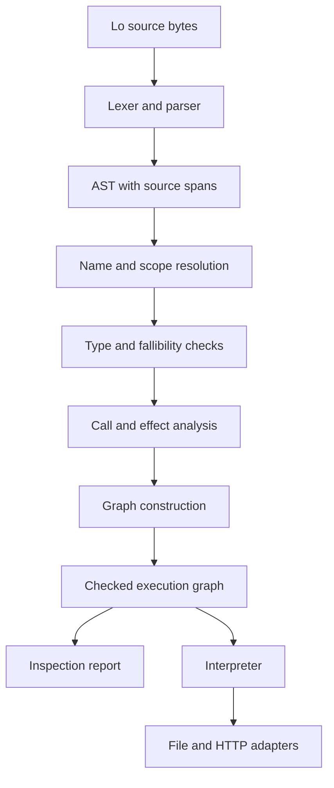

# Lo Compiler Design and Implementation Plan

Lo compiles source programs into a verified execution graph.
Static inspection and a trusted interpreter use the same graph.
The reference implementation uses Go.
This plan defines six implementation stages, their contracts, and their acceptance evidence.

## Status and Authority

The compiler architecture and implementation sequence are accepted.
The frontend, full verifier, checked graph, static inspection, interpreter, File activation, and HTTP execution are implemented.
The [implementation audit](implementation-audit.md) maps the completed requirements to source and acceptance evidence.
The stages below specify the full implementation scope.

Validated commands are `lo parse`, `lo check`, `lo inspect`, `lo run`, and `lo serve`.
The parser and verifier accept all six specification examples.
The verifier checks all built-in signatures and every declared flow, including unused flows.
Accepted programs produce an immutable checked graph with explicit propagation and commit sites.

The [fixture manifest](../testdata/conformance/manifest.json) records the required acceptance stage for each case.
A stage number specifies intended coverage, not a passed test.

The [initial failing integration run](evidence/frontend-red.txt) records the missing public CLI before production code existed.
The [verifier failing integration run](evidence/verifier-red.txt) records missing full verifier behavior before its implementation.
The [stage 3 validation run](evidence/verifier-green.txt) records the compiler checks, integration tests, and build.
Additional regression evidence covers [nested fallibility](evidence/verifier-edge-red.txt), [type distinctions](evidence/verifier-domain-red.txt), and [fallible record conversion](evidence/verifier-record-red.txt).
The [inspection failure evidence](evidence/inspection-red.txt) records the missing command before implementation.
The [stage 4 validation run](evidence/inspection-green.txt) records inspection acceptance and the complete compiler checks.
The [interpreter failure evidence](evidence/interpreter-red.txt) records the missing execution command before implementation.
Runtime regression evidence covers [expanded values](evidence/interpreter-size-red.txt), [host errors](evidence/interpreter-host-red.txt), and [text traces](evidence/interpreter-text-red.txt).
The [HTTP value regression](evidence/interpreter-http-value-red.txt) records the empty-header constructor contract.
The [stage 5 validation run](evidence/interpreter-green.txt) records runtime acceptance and the complete compiler checks.
The [stage 6 validation run](evidence/activation-http-green.txt) records File activation, HTTP acceptance, and the complete compiler checks.
Regression evidence covers [HTTP inspection](evidence/inspection-http-red.txt), [truncated requests](evidence/http-body-red.txt), and [shutdown](evidence/http-shutdown-red.txt).
The [final audit gate](evidence/audit-green.txt) includes additional resource limits and the corrected client-disconnection boundary.

The [language specification](../specification.md) owns Lo syntax and observable semantics.
This design owns compiler structure, internal contracts, and implementation acceptance criteria.
The [README roadmap](../README.md#implementation-roadmap) gives the public milestone overview.
The [repository policy](../.mprlab/POLICY.md) owns development and validation procedures.

Specification sections 22 and 23 define the verifier and runtime contracts.
The [Open Decisions](#open-decisions) section identifies the final contract status.
Each implementation stage needs its applicable specification rules and conformance fixtures before acceptance.

Design sections:

- [Compiler pipeline and stage contracts](#compiler-pipeline).
- [Effects and checked graph](#effects-and-execution-graph).
- [CLI, diagnostics, and execution limits](#cli-and-diagnostics).
- [Inspection contract and report schema](#inspection-contract).
- [Package boundaries](#planned-package-boundaries).
- [Implementation stages](#implementation-stages).
- [Detailed File and HTTP plan](#stage-6-detailed-contracts).
- [Validation plan](#validation-plan) and [open decisions](#open-decisions).

## Accepted Design Decisions

| Decision | Selected design | Reason |
| --- | --- | --- |
| Implementation language | Go | One implementation can contain the compiler, CLI, interpreter, and adapters. |
| First product | Verifier with source diagnostics | Type and boundary checks establish the executable contract. |
| Compiler output | Typed execution graph | Inspection and execution use the same resolved program. |
| Parser | Handwritten recursive descent | The small grammar permits direct control of source spans and diagnostics. |
| Built-ins | One typed catalog | Type checks, inspection, and execution use the same operation definitions. |
| Integers | Arbitrary-precision values | Lo specifies mathematical integer semantics. |
| Initial execution | Interpreter over the checked graph | This gives a direct implementation of branches, handlers, and activation order. |
| Primary tests | Integration tests through the CLI | Acceptance depends on observable language behavior. |

Go has arbitrary-precision integers through [`math/big`](https://pkg.go.dev/math/big).
Its arithmetic methods write results into a receiver.
The Lo value layer will keep these mutable objects private.
Lo operations must not change values shared with another binding.

The implementation accepts the current canonical Lo contract only.
Native code generation, optimization passes, and persistent executable artifacts are outside the initial milestones.

The proposed [native compilation milestone](native-compilation-plan.md) defines the next implementation scope under F001.
It leaves the completed six-stage acceptance scope unchanged.

The selected [training extension design](training-extension-design.md) defines the additional contracts for F002 through F011 and I001.
P001 completed that design task.
F002, F003, and F004 add Float arithmetic and CPU tensors to the interpreter.
F005 through F011 and I001 retain their separate implementation and acceptance work.
Training implementation extends the interpreter independently of F001.
The extension document maps each required specification change to its owning issue.

### Resolved Verifier Decisions

The specification owns these language rules.
The table identifies their compiler consequences without a second normative definition.

| Topic | Specification owner | Compiler consequence |
| --- | --- | --- |
| Lexical contract | Section 17.1 | Validate source encoding, tokens, escapes, and statement boundaries before semantic analysis. |
| Flow visibility and capture | Section 22.1 | Resolve flow declarations before bodies and reject references to outer values. |
| Flow references and cycles | Section 22.1 | Include callback and handler references in cycle detection, including references stored in adapters. |
| Transitive effects | Section 22.2 | Include invoked flow behavior in effect summaries and callback checks. |
| Boundary reads | Section 22.2 | Record boundary reads and commit activation as different behaviors. |
| Fallible values and errors | Section 22.3 | Represent stored fallible values, success, failure, and propagation as different graph operations. |
| Constructors and arguments | Section 22.4 | Keep source evaluation order when you apply expected types and operation constraints. |
| Match cases | Section 22.5 | Validate each case and keep case tests in different evaluation regions from branch bodies. |

## Compiler Pipeline



Each stage gives a representation with more guarantees.
A failed stage returns diagnostics and prevents graph publication.
The interpreter accepts only a checked graph.

### Stage Contracts

Each stage accepts the preceding representation and returns its result or a diagnostic.
The compiler publishes a graph only after all static checks pass.

| Stage | Input | Output | Failure boundary |
| --- | --- | --- | --- |
| Source | Source bytes and file identity | Source text with location data | Invalid encoding or source limits. |
| Syntax | Source text | AST with source spans and source order | Invalid tokens or grammar. |
| Resolution | AST and built-in catalog | Declaration identities and resolved references | Unknown names, duplicate declarations, prohibited capture, or invalid flow references. |
| Type checks | Resolved expressions and expected types | Typed expressions with explicit fallibility operations | Invalid arguments, fields, output types, or propagation. |
| Flow analysis | Resolved call relations and typed bodies | Acyclic flow relations and complete effect summaries | Prohibited cycles or effects. |
| Graph construction | Accepted expressions, flow relations, and source spans | Immutable checked graph | Internal construction failure. |

These are logical stages.
An implementation can combine traversals while it preserves their contracts.
Source errors remain diagnostics even when one traversal performs several checks.
An internal construction failure identifies a compiler defect and prevents execution.

### Source and Syntax

The source layer owns file identity, source bytes, and line positions.
A source span contains a file identifier and a half-open byte interval.
Diagnostics convert these spans into line and column locations for display.

The lexer generates tokens with source spans.
The parser generates different AST nodes for declarations, bindings, calls, projections, pipes, matches, commits, and returns.
Named arguments and positional arguments have different representations until call validation.
Match defaults and predicate heads also have different representations.

Parser requirements:

- Keep the source order of statements, arguments, and match cases.
- Keep original source spans through later compiler stages.
- Apply the normative precedence rules from specification section 17.
- Reject malformed tokens and incomplete expressions with source diagnostics.
- Keep newline handling consistent with the lexical decisions in the specification.
- Stop executable graph construction after a syntax error.

### Names and Scopes

The resolver makes symbols for built-ins, flow declarations, parameters, and local bindings.
It resolves flow signatures before flow bodies where the specification accepts forward flow references.
A value reference must identify a previous binding in the applicable scope.

Resolver requirements:

- Reject duplicate names in one scope.
- Reject names that shadow predeclared names.
- Reject unknown namespaces, types, operations, and references.
- Reject implicit capture of outer values by nested flows.
- Keep explicit context arguments for list callbacks.
- Build call relations for direct calls, callbacks, and declared handlers.
- Reject prohibited cycles as specified by the resolved recursion contract.

Specification section 22.1 defines nested flow visibility and prohibited cycles.
Adapter construction alone does not invoke its configured handler.
The call analysis must distinguish a stored flow reference from an executed call.

Resolution sequence:

1. Register flow declarations and signatures in each lexical scope.
2. Register parameters before the statements in their flow body.
3. Resolve value bindings in source order within their invocation.
4. Resolve direct calls, callbacks, and handlers to declaration identities.
5. Record the source span and invocation context for each flow relation.
6. Reject a cycle with the participating flow references in its diagnostic.

Cycle detection includes stored adapter references because section 22.1 prohibits those cycles.
Effect propagation uses executed call relations because construction does not invoke adapter handlers.
The inspector keeps stored references to describe possible handler execution after adapter activation.

### Types and Fallibility

The type model has different representations for atomic types, containers, exact records, nominal types, boundary types, and fallible types.
Flow signatures contain parameter types, output types, and handler references.
The compiler does not represent a type as an unrestricted string.

The type checker uses inferred types and expected types from call signatures and declared flow outputs.
Expected types supply collection parameters when the language accepts empty construction.
The built-in catalog owns these constraints.

Type requirements:

- Enforce exact record fields and field types.
- Keep `Error` different from structural records.
- Keep `Null` assignable only to `Null`.
- Enforce comparable map keys and range endpoints.
- Accept `String` where a processor accepts `List<Scalar>`, as specified.
- Validate argument names, argument counts, and callback parameter order.
- Validate required adapter handlers and their output types.
- Reject unresolved fallible expressions in plain total flows.
- Represent propagation explicitly inside fallible and self-handling flows.
- Apply branch unification only as specified by the fallibility rules.

An expression result has a value type and propagation behavior.
The representation must distinguish a stored fallible value from failure during expression evaluation.
For example, `List<Int!>` and `List<Int>!` have different type structures.
Specification section 22.3 defines their construction and consumption rules.

The checker supplies an expected type before it validates a dependent constructor.
For example, a declared `List<Int>` output supplies the element type for `List.new()`.
An explicit `List<Int!>` context preserves each fallible element as data.
It does not move the element failure tag to the complete list.

| Source context | Graph operation |
| --- | --- |
| A `T` expression where `T!` is expected | Construct a tagged success. |
| An `Error` where `T!` is expected and `T` differs from `Error` | Construct a tagged failure. |
| An `Error` where `Error!` is expected | Construct a tagged success with the error as data. |
| A permitted consumer of `T!` that needs `T` | Propagate failure to the current flow boundary or extract the value from its success tag. |
| An explicitly fallible field or element | Preserve the tagged value inside its container. |
| Match branches with `T` and `T!` | Convert the `T` branch to a tagged success in the common `T!` result. |

The interpreter follows these graph operations.
It does not infer fallibility again from runtime values or source syntax.

### Built-in Catalog

The catalog is compiled into the implementation.
It specifies each operation one time.
Runtime adapters refer to the same operation identifiers that the compiler uses.

Each operation definition contains:

- Its canonical name and operation identifier.
- Its parameter names and accepted argument forms.
- Its type parameters and type constraints.
- Its output type rule.
- Its callback signatures and effect restrictions.
- Its recoverable error kinds.
- Its boundary read, target construction, or activation behavior.

Some signatures have operation-specific type rules.
For example, `Record.merge` calculates an exact record shape from its inputs.
List processors infer fallibility from their callback signatures.
These rules use typed compiler functions with specified inputs and outputs.

## Effects and Execution Graph

### Effect Analysis

Boundary reads, target construction, and commit activation have different compiler representations.
Construction of a file effect specifies a possible write.
Activation occurs when an evaluated `commit` statement uses that target.
A file read gets external data during expression evaluation.

Flow summaries include effects from invoked flows.
A wrapper around an effectful flow cannot remove its activation behavior from inspection or callback restrictions.
The analysis also includes list callbacks, match predicates, self-handlers, and adapter handlers.
It keeps the invocation context for each relation.

Specification section 22.2 defines purity through direct and indirect commit activation.
After cycle detection, the compiler calculates each flow summary from its body and the summaries of invoked flows.
An unused nested definition does not change its enclosing flow summary.
The verifier still validates that unused definition.
Boundary reads have different summary data because external data can change between evaluations.

### Graph Contract

The IR uses typed node identities and resolved operation identifiers.
Its references point to valid nodes, symbols, types, and evaluation regions.
Private constructors enforce these guarantees before the interpreter receives the graph.

| Graph construct | Meaning |
| --- | --- |
| Constant or parameter | A typed value available to an evaluation region. |
| Constructor or processor call | A resolved operation with explicit arguments. |
| Flow invocation | A resolved flow with its arguments and invocation region. |
| Field projection | Access to a field accepted by the type checker. |
| Match region | Ordered case tests and different branch regions. |
| Propagation boundary | Transfer of a recoverable error to the specified handler boundary. |
| Effect description | A typed committable target that has no activation by itself. |
| Commit activation | An ordered operation that activates its target. |
| Return | The result published by a flow or top-level program. |

Data dependencies supply values.
Control dependencies keep branch selection, handler entry, and commit order.
A flow definition is a reusable template with a different evaluation region for each invocation.

Graph requirements:

- Lower pipes into explicit first-argument calls.
- Keep the original pipe span for diagnostics.
- Evaluate only the selected match branch.
- Keep source order for commit activation in each evaluated region.
- Stop dependent evaluation when an unresolved error propagates.
- Keep different activations for repeated explicit commits of the same target.
- Keep boundary reads in their specified evaluation region and evaluation order.
- Prevent speculative boundary reads and commit activation.
- Keep handler boundaries and trace context.
- Keep different flow invocations when their observable behavior is different.

The initial graph builder keeps the checked program structure without optimization passes.
Before an optimization change, conformance tests must verify activation, reads, branches, and errors.

### Graph Publication

Graph construction occurs inside the compiler boundary.
Its private representations prevent construction of unchecked nodes by callers.
The compiler keeps declaration identities and source spans through each transformation.
Inspection and execution receive the same completed program representation.

Publication requirements:

- Resolve each value reference to its declaration identity.
- Resolve each operation to its canonical catalog definition.
- Give each expression its checked type and source span.
- Keep argument evaluation order independent of parameter positions.
- Give each flow its checked body, signature, handler relation, and effect summary.
- Keep each match branch in a different evaluation region.
- Preserve the order and identity of each commit statement.
- Prevent publication after any source diagnostic or internal construction failure.

For the list-sum example, the list constructor supplies one `List<Int>` binding.
The pipe becomes a `Math.sum` call whose first argument references that binding.
The call produces `Int`, and the top-level return references its result.
The graph keeps source spans for both the original pipe and its supplied argument.

## Interpreter and Adapter Boundary

The interpreter evaluates graph regions and passes typed requests to adapters.
The adapter interface owns external operations and converts recoverable failures into Lo errors.
Each Lo error contains the required kind, input record, and trace data.

Runtime requirements:

- Keep immutable values across bindings and flow calls.
- Keep host integer objects and mutable collections private.
- Append trace frames before entry into a self-handler or adapter handler.
- Keep the original error kind through fallible list processors.
- Include list operation context when an element fails.
- Activate each evaluated commit statement exactly once.
- Stop later top-level activation after a failed top-level commit.
- Convert recoverable adapter failures into the specified Lo error kinds.
- Report compiler invariant failures as host failures.
- Keep fatal host failures different from recoverable Lo errors.

The host owns resource authorization.
Static inspection identifies possible operations and targets.
At runtime, each boundary operation must have authorization for its resolved target.
Approval of a calculated path does not authorize all paths that an expression can return.

The capability policy, path resolution rules, and execution limits must have specified behavior before external operations become executable.
Compiler commands that parse, verify, or inspect a source file do not evaluate its boundary operations.

## CLI and Diagnostics

| Planned command | Result on success | Execution boundary |
| --- | --- | --- |
| `lo parse program.lo` | Syntax representation with source locations. | Read the source file only. |
| `lo check program.lo` | Confirmation that the implemented language contract accepts the program. | Compile without program execution. |
| `lo inspect program.lo` | Static report from the checked graph. | Compile without program execution. |
| `lo run program.lo` | Evaluation of a checked finite program. | Use host authorization for external operations. |
| `lo serve program.lo` | Operation of committed HTTP servers. | Use host authorization for external operations. |

Each implemented command has text output and `--format json` for structured output.
Standard output contains the selected result representation.
Standard error contains diagnostics.
The JSON format keeps integer precision through an explicit value representation.
Its schema must have a definition before command acceptance.

| Exit status | Meaning |
| --- | --- |
| `0` | The command completed without failure. |
| `1` | Source rejection or an unhandled recoverable Lo error. |
| `2` | Invalid command invocation, source access failure, or fatal host failure. |

Each diagnostic contains a stable code, compiler stage, message, and available source span.
Related spans identify the declaration or argument responsible for a conflict.
Type diagnostics include expected and actual types.
Source access diagnostics include the operation and source path.

Every declaration and operation receives static validation before graph publication.
A check that passes confirms source acceptance under the current language contract.
It does not execute the program or authorize external operations.

Server startup and orderly shutdown must have a specified CLI lifecycle before `lo serve` acceptance.
The compiler reports the first diagnostic in source traversal order.
Line and column numbers start at one.
Columns count Unicode scalars, and byte offsets start at zero.
A source span ends immediately after its last byte.
The parser accepts source files of at most 16 MiB and a maximum nesting depth of 256 constructs.

The frontend JSON envelopes are:

```json
{"command":"parse","program":{"kind":"program","span":{},"statements":[]}}
{"command":"check","status":"ok","file":"program.lo","result_type":"Int"}
{"diagnostics":[{"code":"check.type-mismatch","stage":"check","message":"...","span":{},"expected":"Int","actual":"String"}]}
```

Each span has `file`, `start`, and `end` fields.
Each position has `offset`, `line`, and `column` fields.
An AST node has `kind`, `span`, and fields for its syntax construct.
Literal nodes contain `literal_kind` and `text`.
Numeric text retains source precision.
String text contains decoded scalar values.
Successful verification omits `result_type` when the program has no top-level return.
Diagnostics without a source location omit `span`.
Type diagnostics include `expected` and `actual` when those types are available.
Runtime value serialization appears in the execution contract below.
The inspection schema appears below.

### Execution Command Contract

`lo run` verifies the complete source before it opens adapter roots or evaluates the graph.
Its default adapter policy denies all external operations.
The `--read-root DIRECTORY` option authorizes reads within one directory tree.
This option can occur more than once for different roots.
Duplicate normalized roots are invalid.
Parse, check, and inspect reject runtime options.

```bash
./bin/lo run examples/list_sum.lo
./bin/lo run examples/count_letter.lo --read-root examples
./bin/lo run examples/count_letter.lo --read-root examples --format json
```

These examples return `10`, `3`, and a JSON result with integer value `3`.
The [count-letter input](../examples/count_letter_input.txt) supplies deterministic data for the authorized read example.

The CLI resolves relative roots and program paths from its invocation directory.
The file adapter keeps opened roots for the complete command.
It uses [`os.Root`](https://pkg.go.dev/os#Root) to constrain path traversal and symlinks.
Directory roots do not provide process isolation or exclude mounted resources and device files.
The host must select the resource tree that it intends to authorize.

An unmatched target produces `runtime.capability-denied` before program resource access.
An access failure within an authorized root produces the recoverable `File.ReadFailed` kind.
Recoverable failures can enter Lo handlers.
Authorization failures cannot enter those handlers.
The source file itself uses the CLI source-access contract.

The host separates evaluation failures from stored fallible values.
An outer failure in the final result produces `runtime.unhandled-error` and exit status `1`.
Its JSON diagnostic includes an `error` field with the complete typed Lo error.
Text diagnostics include each trace frame's flow, operation, and input record.
Successful commands publish their result only after evaluation completes.

The success envelope is:

```json
{"command":"run","status":"ok","result":{"type":"Int","value":"10"}}
```

A program without a top-level return omits `result`.
Text output prints scalar results directly and uses typed JSON for composite values.
A successful outer fallible value prints its contained result in text output.
Text output without a top-level return is empty.

### Runtime Value Serialization

Every serialized value has its canonical `type` string.
Most values also have a `value` field.

| Type | Representation |
| --- | --- |
| `Int` | Decimal string with exact integer precision. |
| `Float` | Shortest round-trip decimal string for a finite binary64 value, including signed zero. |
| `Device` | Selector string: `cpu`, `cuda:0`, or `cuda-sim:0`. |
| `Tensor<FP32>` | Object with `dtype`, `shape`, `device`, and complete row-major `values`. |
| `String`, `Scalar`, `File.Path` | JSON string. |
| `Bool`, `Null` | JSON boolean or null. |
| `Bytes` | Base64 string. |
| `List<T>` | Array of typed element values. |
| `Map<K, V>` | Array of objects with typed `key` and `value` fields. |
| Exact record or bare `Record` | Object from field names to typed values. |
| `Range<T>` | Object with typed `start` and `end`, plus boolean `include_start` and `include_end`. |
| `Effect` | Operation name, typed `file_path`, and typed `file_content`. |
| `HTTP.Server` | Typed `port` and resolved `handler` and `on_error` flow identities. |
| HTTP request or response | Object with the nominal type's typed fields. |

A fallible success has `type`, `status: "ok"`, and a typed `value`.
A fallible failure has `type`, `status: "error"`, and a typed `error`.
An `Error` has `type`, `kind`, `message`, typed `input`, and a `trace` array of typed records.
Error kind and message fields are JSON strings.
Empty collections and traces serialize as arrays.
Empty records serialize as objects.
Record field names have deterministic sorted output.
Map entries follow the construction order specified in section 23.1.

Tensor shape entries are decimal strings for Lo integers.
Tensor element entries are shortest round-trip FP32 decimal strings, including signed zero.
An empty shape or empty element array serializes as `[]`.
For example, a rank-zero tensor serializes as follows:

```json
{"type":"Tensor<FP32>","value":{"dtype":"fp32","shape":[],"device":"cpu","values":["1"]}}
```

Error inputs and trace frames replace tensors with exact metadata records.
The fields are `tensor_type`, `dtype`, `shape`, and `device`.
The same transformation applies inside records, lists, maps, and fallible values.
A snapshot retains no tensor data buffer.
Empty nested containers receive the transformed element type.

### Execution Limits

The interpreter counts each entered statement, evaluated expression, list iteration, and integer aggregate element as one step.
The default budget is 1,000,000 steps.
`--max-steps POSITIVE_INTEGER` replaces that budget for one command.
This option can occur only once.

| Resource | Limit |
| --- | --- |
| Active flow invocations | 256 |
| Integer magnitude | 1,048,576 bits |
| List elements or positive unfold count | 1,000,000 |
| One file read or string payload | 16 MiB |
| One expanded value | 16 MiB of value weight |
| All evaluated expression results | 64 MiB of accumulated value weight |
| Tensor rank | 8 |
| One tensor dimension | 1,000,000 |
| One tensor element count | 1,000,000 |

Each value has 16 bytes of fixed weight plus its payload weight.
String, path, scalar, and byte payloads use their byte length.
Integer payloads use the byte length of their unsigned magnitude.
Boolean payloads use one byte, Float payloads use eight bytes, and null has no payload.
Container weight includes every contained value, including repeated references to one immutable value.
Record weight also includes field-name bytes.
Range weight includes its endpoint values and two inclusion bytes.
Error weight includes kind, message, input, and trace frames.
Effect weight includes its operation name, path, and content.
Server weight includes its port and flow identities.
HTTP value weight includes its field record.
Tensor weight is `16 + 4*N + 8*rank + len(dtype) + len(selector)` bytes.
Device weight is `16 + len(selector)` bytes.
Repeated tensor references count repeatedly in expanded values.

Tensor operation boundaries validate shapes and axes before CPU kernels receive them.
They check output weight and charge logical work before numeric output allocation.
Successful tensor results then consume the existing cumulative value budget.
Each new output must fit the remaining budget before allocation.
This rule bounds live CPU element payloads through the stricter cumulative value budget.
Shared reshape storage does not reduce value charges.
Failed work retains no output buffer in an error snapshot.
The Go allocator and garbage collector remain outside exact process-memory guarantees.
F008 owns device allocation receipts, transfers, and the combined live resource ledger.

| Tensor work | Additional steps |
| --- | --- |
| Construction, conversion, elementwise operation, broadcast, or transpose | One per output element. |
| Sum | One per input element. |
| Mean | One per input element plus one per output element. |
| Matrix multiplication | `2*m*n*k`. |
| Reshape or metadata | Zero element steps. |

Empty reduction axes preserve these logical charges even when the result shares storage.
Tensor kernels test cancellation during execution.
A host failure bypasses Lo handlers and prevents result publication.

The interpreter checks weight before it publishes an expression result.
These budgets bound specified evaluation work and data expansion.
They do not specify the Go process's exact memory use.
`runtime.limit` reports a budget failure with exit status `2`.
`runtime.cancelled` reports host cancellation with exit status `2`.
Neither failure enters a Lo handler.
The runtime does not narrow integers or silently truncate collections to meet a limit.

### Numeric and Tensor Analysis

The catalog defines 85 built-in operations after F002 through F004.
`internal/tensor` owns validated shapes, operation plans, immutable data, and CPU kernels.
`internal/tensorfacts` propagates static metadata through bindings, records, Match branches, and named flow calls.
It examines every declared flow, including unused flows.
It checks calls again with available argument facts and caches results by flow and facts.
General arithmetic and list callbacks can leave shape dimensions unknown.

Known conflicts produce `check.tensor-shape` with expected and actual metadata.
Dynamic boundaries produce the typed errors in specification section 24.
The analyzer runs only for programs with tensor types.
It permits at most 100,000 expression visits.
Fixed-size structural keys keep shared containers from expanding in the flow cache.
An exceeded bound produces `check.tensor-analysis-limit` with a source span.
The analyzer does not replace exhausted analysis with unknown metadata.

CPU arithmetic uses the `cpu-fp32-strict` profile from P001.
Each multiplication completes its FP32 rounding before the addition.
Reduction order and intermediate failures follow specification section 24.3.
The [forward example](../examples/tensor_forward.lo) returns loss from mean squared error `3` through `lo run`.
This operation set supplies the reference implementation for F005 and F009.

## Inspection Contract

The inspection report comes from the checked graph and the built-in catalog.
It includes direct invocation behavior and behavior through referenced flows.
It distinguishes possible behavior from operations that each evaluated path must execute.

Each tensor node has a `tensor` metadata object.
It contains `dtype`, `profile`, `device`, `layout`, `shape`, and `storage_bytes`.
Known shapes use decimal dimension strings.
Rank-zero shapes use `[]`.
Unknown shapes and unknown storage sizes use JSON `null`.
`storage_bytes` counts the element payload of the result, including shared storage.
It does not identify a backing allocation or sum invocation storage.
Text inspection writes `unknown` for unknown metadata.
A flow body used with different shapes keeps only facts shared by its analysis contexts.
Parse, check, and inspect never initialize a device.

The report contains:

- Flow names, source spans, signatures, and effect summaries.
- Boundary reads and their target expressions.
- Effect descriptions and their commit activation sites.
- Adapter instances, handler references, and activation sites.
- Known recoverable error kinds and dynamic error sources.
- Required capability operations and target descriptions.
- Branch conditions and invocation contexts that control possible operations.

Target descriptions have explicit alternatives for known values and dynamic expressions.
A dynamic target keeps its source span and dependencies.
If static information cannot identify a path, the inspector marks the target as dynamic.
Runtime values can also determine the kinds of user-constructed errors.
The report identifies dynamic error kinds where the full set is unknown.

The report identifies graph entry points, callable adapter handlers, and unused declarations separately.
Source validation also applies to unused flows.
An unused flow does not authorize runtime access to its possible resources.

Inspection requirements:

- Generate deterministic output for the same source and compiler contract.
- Keep different commit sites even when they use the same bound target.
- Include effects from each possible branch if runtime input controls branch selection.
- Distinguish an uncommitted target from an activated target.
- Show failure handling without removing possible effects from handler analysis.
- Generate capability summaries without external reads or adapter activation.

### Inspection Report Schema

The JSON envelope contains `command: "inspect"` and `report`.
The report has the fields below.
Empty report collections serialize as arrays.
Node fields are absent when they do not apply to that node kind.

| Field | Contents |
| --- | --- |
| `file` | Source file identity. |
| `result_type` | The top-level return type, when present. |
| `nodes` | Expression, parameter, commit, and return identities, with kinds, types, spans, operations, and input references. |
| `bindings` | Binding identities, names, regions, spans, and expression references. |
| `flows` | Flow identities, names, parameters, outputs, handlers, effect summaries, and invocation classes. |
| `contexts` | Invocation identities, entry points, parent contexts, flow references, and call sites. |
| `entry_points` | The program and handlers of possibly activated HTTP servers. |
| `reads` | Boundary reads with target descriptions and invocation contexts. |
| `targets` | Constructed effects and servers, their target descriptions, and configured handler references. |
| `activations` | Commit sites, their possible targets, and target selection conditions. |
| `error_sources` | Fallible operations, constructed error values, activation errors, HTTP boundary errors, and possible handler boundaries. |
| `capabilities` | Required operations and targets for program execution and activated adapter handlers. |
| `unused_flows` | Flow identities with no invocation from a program or activated adapter entry point. |

Each report identity is deterministic within one source program.
Node identities refer to checked expressions, including explicit conversions.
Repeated flow calls have different contexts.
Repeated commits have different activation identities.
The inspector does not resolve host paths or read resource contents.

A target description has `kind`, `type`, `node`, `span`, and `dependencies`.
Its `kind` is `known` or `dynamic`.
A known description also has a string `value`.
The type determines the interpretation of that string, including integer precision.
A dynamic description also has the source `expression`.
Dependencies identify the checked nodes that supply its data.

Reads, targets, activations, and errors include their context and conditions.
Each condition identifies its node and invocation context.
Conditions distinguish case tests from selection of case bodies.
Other conditions identify list iterations, propagation success, commit success, handler entry, or adapter requests.
An operation without conditions occurs on each path that reaches its invocation.
Earlier failures can prevent later operations.
The report includes each checked branch with its selection condition.
It does not claim that every listed condition can occur for constant input.

The inspector follows value references and flow arguments to describe returned targets.
It describes one callback invocation for each list operation.
List conditions retain the possibility of zero or many invocations.
Target analysis includes values carried into later list iterations.
Unknown values remain dynamic descriptions with their dependencies.
Inspection never executes a Lo operation through a runtime adapter.

Scalar constructors and supported string operations preserve known input values.
The inspector limits calculated string values to 64 KiB.
Larger calculated strings remain dynamic descriptions with their source dependencies.
Literal strings remain known values within the source size limit.
The inspector rejects more than 4096 invocation contexts with `inspect.limit` and exit status `1`.
This rejection does not publish a partial report.

A target has `origin: "construction"` when analysis reaches its constructor.
An unknown target supplied as data has `origin: "dynamic-target"`.
For an unknown `Effect`, the report lists each possible File activation operation with a dynamic path.
An unknown `HTTP.Server` has a dynamic port description.

Error sources distinguish `fallible`, `activation`, `boundary`, and `value` categories.
The `value` category describes ordinary `Error.new` data.
The `boundary` category identifies HTTP request and response errors after server activation.
These errors reference the adapter `onError` flow, including when the request flow has its own self-handler.
Known error kinds have explicit strings.
Dynamic kinds have a dynamic description of the kind expression.
Handler references identify the applicable boundary if the error propagates.
They do not assert that a stored error value invokes a handler.

Capability operations are `File.read`, `File.append`, `File.write`, and `HTTP.listen`.
Each capability identifies its read or activation site and target description.
Uncommitted targets do not add activation capabilities.
Unused flow analysis does not add program capabilities.
Inspection describes required authorization but does not grant it.

Text output uses the same report data.
It lists entry points, flows, contexts, reads, targets, activations, errors, capabilities, bindings, and nodes in deterministic order.
Each resource line includes its context, conditions, and target description.
Source locations use the diagnostic line and column convention.

### File Workflow Inspection

The [file workflow example](../examples/agent_file_workflow.lo) reads and decodes a file before it selects a write or append target.

```bash
./bin/lo inspect examples/agent_file_workflow.lo --format json
```

The report has one program entry point and an `Int!` result type.
It contains one read, two constructed targets, and one commit site.
The targets have different match conditions.
Their capabilities are:

| Operation | Known target | Condition |
| --- | --- | --- |
| `File.read` | `input.txt` | Entry into `ProcessFile`. |
| `File.write` | `empty.txt` | File decoding succeeds and the text is empty. |
| `File.append` | `summary.log` | File decoding succeeds and the text is not empty. |

The error sources include `File.ReadFailed`, `UTF8.InvalidBytes`, `File.WriteFailed`, and `File.AppendFailed`.
Inspection does not need these files to exist.

## Planned Package Boundaries

The following paths specify the intended Go package responsibilities.
Each milestone adds the packages necessary for its behavior.

| Path | Responsibility |
| --- | --- |
| `cmd/lo/` | Process entry point, arguments, output streams, and exit status. |
| `internal/source/` | Source bytes, file identity, and source spans. |
| `internal/syntax/` | Tokens, lexer, AST, and parser. |
| `internal/resolve/` | Symbols, lexical scopes, and reference resolution. |
| `internal/types/` | Type identities, constraints, and type unification. |
| `internal/catalog/` | Canonical built-in definitions and operation identifiers. |
| `internal/tensor/` | Shape boundaries, immutable CPU data, operation plans, and FP32 kernels. |
| `internal/tensorfacts/` | Static shape facts, shape diagnostics, and inspection metadata. |
| `internal/check/` | Type checks, fallibility rules, and flow analysis. |
| `internal/ir/` | Checked graph types and graph construction. |
| `internal/inspect/` | Static inspection and capability summaries. |
| `internal/value/` | Immutable runtime values and Lo errors. |
| `internal/eval/` | Graph evaluation and handler propagation. |
| `internal/adapter/` | File and HTTP implementations at external boundaries. |
| `internal/diagnostic/` | Diagnostic values and output formats. |
| `internal/compiler/` | Public orchestration of compiler stages in the application. |
| `tests/integration/` | Tests through the built CLI and local resources. |
| `testdata/conformance/` | Positive and negative source fixtures with expected outcomes. |
| `examples/` | Executable programs for the documented commands. |

The compiler core imports typed catalog definitions.
Concrete adapter implementations stay outside the compiler core.
The CLI composes the interpreter with adapters.
The inspector uses the graph without a runtime dependency.
Private representations prevent unrestricted construction of checked graphs and valid domain values.
Smart constructors return `(Type, error)` where construction has invariants.

## Implementation Stages

The stages below divide the four README milestones into smaller implementation tasks.
Stages 1 through 3 implement the verifier.
Stage 4 implements inspection.
Stage 5 implements interpretation.
Stage 6 adds commit activation and HTTP.
Each completed stage must have its deliverables and acceptance evidence.

| Stage | Required prior result | Completion evidence |
| --- | --- | --- |
| 1 Contract and fixtures | Accepted architecture | Specification rules and fixtures with explicit expected outcomes. |
| 2 Frontend | Lexical contract and parser fixtures | CLI acceptance of the parser and first verifier subset. |
| 3 Full verifier | Complete verifier rules and frontend | All static fixtures pass and accepted programs produce checked graphs. |
| 4 Inspection | Checked graph | Deterministic CLI reports with no program boundary operations. |
| 5 Interpreter | Checked graph and runtime decisions | CLI results, error traces, and authorized boundary reads. |
| 6 Activation and HTTP | Interpreter and adapter decisions | Ordered file effects and local HTTP lifecycle tests. |

### Stage 1 Contract and Conformance Fixtures

Deliverables:

- Resolve lexical rules and the semantic decisions necessary for the verifier.
- Put each resolved language rule in the specification.
- Copy each section 19 example into a standalone source fixture.
- Make positive and negative fixtures for applicable section 20 rules.
- Add fixtures for transitive effects, multiline pipes, nested fallibility, and recursion rules.
- Record the expected compiler stage and diagnostic category for each rejection.
- Mark fixtures for later runtime milestones.

Acceptance:

- Map each selected rule to explicit fixture identifiers.
- Keep the intended meaning of each specification example.
- Distinguish agreed semantics from open decisions.
- Specify one canonical rule for each construct in the first implementation subset.

The fixture index records intended outcomes at this stage.
Executable acceptance evidence starts with the CLI in stage 2.

### Stage 2 Frontend and First Verifier Slice

Deliverables:

- Select and pin the Go toolchain for the implementation.
- Add the Go module, CLI entry point, and repository-native Make targets.
- Implement source spans, tokens, and the recursive-descent parser.
- Add `lo parse` and structured source diagnostics.
- Implement the minimal type and catalog path for the list-sum example.
- Add `lo check` for that subset.

The first accepted source program is:

```lo
numbers = List.new(Int.new(1), Int.new(2), Int.new(3), Int.new(4))
total = numbers |> Math.sum()
return total
```

The first rejection case is:

```lo
numbers = List.new(String.new("one"))
total = numbers |> Math.sum()
return total
```

Acceptance:

- Run `lo check examples/list_sum.lo` with exit status `0`.
- Reject the incompatible list argument with exit status `1`.
- Report its source span and expected `List<Int>` type.
- Reject an unknown processor through the same CLI.
- Reject malformed source through `lo parse`.
- Parse all section 19 examples before stage completion.
- Reject unsupported semantics explicitly during this partial verifier stage.

### Stage 3 Full Verifier

Deliverables:

- Implement the specified types and all built-in signatures.
- Resolve flow references, scopes, nested declarations, and handlers.
- Implement fallibility and branch unification rules.
- Implement transitive effect analysis and callback restrictions.
- Implement prohibited-cycle detection.
- Validate adapter construction without external operations.
- Construct checked graphs from accepted programs.

Acceptance:

- Accept all section 19 examples through `lo check`.
- Pass each static conformance case from section 20.
- Reject a wrapper that hides commit activation from a pure callback restriction.
- Reject invalid captures, handler signatures, record shapes, and null assignments.
- Verify nested fallibility against the resolved specification rules.
- Confirm that compiler commands do not execute program boundary operations.
- Verify pipe argument order and explicit fallibility operations through the compiler entry point.
- Verify that rejected source produces diagnostics without a checked graph.
- Validate unused flow bodies before graph publication.

### Stage 4 Inspection

Deliverables:

- Add `lo inspect` over the checked graph.
- Specify canonical text and JSON report formats.
- Include indirect effects and runtime-dependent targets.
- Add `examples/agent_file_workflow.lo` with documented inspection results.

Acceptance:

- Compare report content through the CLI for known and dynamic targets.
- Include the two possible effects of a runtime-dependent match.
- Distinguish target construction from commit activation.
- Keep different activation sites for repeated commits.
- Report known and dynamic error kinds.
- Generate the same report across repeated invocations with the same inputs.

### Stage 5 Interpreter and Boundary Reads

Deliverables:

- Implement immutable values and graph evaluation.
- Implement constructors, processors, flows, match selection, and list operations.
- Implement error propagation, self-handlers, and trace frames.
- Resolve the host capability contract for reads.
- Add file reads and UTF-8 decoding through adapters.
- Add `lo run` with a specified result format.
- Add an executable `examples/count_letter.lo` invocation.

Acceptance:

- Evaluate the list-sum example to `10`.
- Verify integer results outside the signed 64-bit range.
- Evaluate only the selected match branch.
- Reject unauthorized boundary reads before resource access.
- Verify read order and repeated-read behavior against the resolved specification.
- Verify required error kinds and handler trace contents.
- Verify Unicode scalar behavior and invalid UTF-8 failures.

### Stage 6 Commit Activation and HTTP

Deliverables:

- Resolve capability rules for writes and server activation.
- Implement `File.append`, `File.write`, and ordered commit activation.
- Implement HTTP values, server startup, and request dispatch.
- Implement mandatory adapter handlers and response serialization.
- Specify startup, shutdown, and cancellation behavior for `lo serve`.
- Add `examples/http_division.lo` and executable file workflow examples.

Acceptance:

- Verify one activation for each evaluated commit statement.
- Verify two activations when two explicit commits use one target.
- Prevent activation for an uncommitted effect.
- Stop subsequent commits after an unhandled commit failure.
- Verify that self-handlers receive commit failures with required error kinds.
- Verify HTTP success and error responses through a local server.
- Verify adapter errors before handler entry.
- Verify authorization denial, startup failure, and orderly shutdown through public entry points.

### Stage 6 Detailed Contracts

The following contracts specify File and HTTP execution for stage 6.
Specification sections 23.6 and 23.7 own the language rules.
This section owns CLI capability inputs, resource limits, and service lifecycle behavior.

#### Capability Inputs

The CLI supplies capabilities separately from the checked graph.
The graph identifies the requested operations and targets.
The adapter checks authorization for each actual target immediately before resource access.
Inspection does not grant access.

| Input | Authorization | Applicable commands |
| --- | --- | --- |
| `--read-root DIRECTORY` | Read files within the selected directory tree. | `run`, `serve` |
| `--write-root DIRECTORY` | Append or write files within the selected directory tree. | `run`, `serve` |
| `--listen PORT` | Activate servers at the specified port on `127.0.0.1`. | `serve` |
| No capability inputs | Deny all program resource access. | `run`, `serve` |

Each capability input can occur more than once with different targets.
Read roots and write roots use different grants.
The same directory can have both grants.
Duplicate normalized roots within one operation group are invalid.
Duplicate listen ports are invalid.

The CLI resolves relative paths from its invocation directory.
The adapter uses the most specific authorized directory root for a target.
The existing [directory root contract](#execution-command-contract) controls traversal and symlinks.
An unmatched target produces `runtime.capability-denied` with exit status `2`.
Lo handlers cannot recover from authorization denial.

Valid server ports are integers from `0` through `65535`.
A port of `0` asks the operating system to select an available port.
The `--listen 0` capability authorizes this selection, without granting arbitrary fixed ports.
Each activation records its selected address in the server registry.
An invalid port or an occupied authorized port produces `HTTP.ServerStartFailed`.

#### File Activation

`File.append` and `File.write` construct immutable targets without file access.
Each evaluated `commit` activates its target once.
Two commits of one target cause two activations.
An uncommitted target causes no write.

| Target | Activation behavior | Recoverable error |
| --- | --- | --- |
| `File.append(path, text)` | Append UTF-8 bytes, with file creation if the target does not exist. | `File.AppendFailed` |
| `File.write(path, bytes)` | Replace the file contents, with file creation if the target does not exist. | `File.WriteFailed` |

Commits execute in source order within one invocation.
A failed commit stops the current body before later statements execute.
An applicable self-handler can return the flow's declared result.
The caller can then continue after that flow invocation.
The trace includes the failed operation and flow before handler entry.

A later failure does not reverse an earlier successful write.
A failed write can leave partial contents.
Stage 6 provides no transaction across commits and no automatic retry.
Each HTTP request has its own invocation order.
The runtime does not promise a total order for commits from different requests.

#### HTTP Request and Response Boundary

`HTTP.Server.new` stores a port and resolved handler references without a listener.
Its commit creates the listener and starts request dispatch.
Each request gets a new interpreter invocation with its own execution budget.
The handler and its adapter `onError` share that request's budget.
The checked graph and immutable values can be shared across requests.

| Request field | Conversion |
| --- | --- |
| `method` | Valid UTF-8 HTTP method text. |
| `path` | Decoded URL path without the query. |
| `headers` | `Map<String, String>` with canonical HTTP header names and a `Host` entry. |
| `body` | Request bytes without implicit text decoding. |

Repeated header values use `, ` as their separator.
Repeated `Cookie` values use `; ` as their separator.
The header map starts with `Host`, followed by other names in sorted order.
The adapter validates text and body limits before handler entry.

| Boundary condition | Lo error kind | Handler path |
| --- | --- | --- |
| Invalid UTF-8 in request text | `HTTP.InvalidRequest` | Adapter `onError` before the request handler. |
| Request body exceeds its limit | `HTTP.RequestTooLarge` | Adapter `onError` before the request handler. |
| Request body cannot be read completely | `HTTP.RequestReadFailed` | Adapter `onError` before the request handler, when a response is still possible. |
| Request handler propagates a Lo error | Original error kind | Adapter `onError` after the handler trace. |
| Request handler returns an invalid response | `HTTP.InvalidResponse` | Adapter `onError` after response validation. |

The adapter adds its trace frame before it invokes `onError`.
Request errors use operation `HTTP.request`.
Response validation errors use operation `HTTP.respond`.
The adapter frame identifies the configured server port.
Request errors preserve available method and path bytes in their input record.

The Go HTTP parser rejects malformed protocol input before a Lo request exists.
Those protocol rejections do not enter Lo handlers.
A request failure that leaves the response connection usable can produce an `onError` response.
A closed connection cannot guarantee delivery of that response.

Response validation accepts status codes from `200` through `599`.
Responses with status codes `204`, `205`, and `304` must have an empty body.
A response to `HEAD` omits body bytes on the connection.
The response constructors use empty headers, as specified in section 9.2.
The transport can add its own protocol headers.

An invalid response from `onError` is a fatal host failure.
The adapter does not invoke `onError` again or construct a substitute response.
Capability denial, interpreter limits, and invariant failures also bypass Lo handlers.
A fatal request failure closes that connection and stops the service with exit status `2`.

#### Startup and Shutdown

Startup uses the following sequence:

1. Validate CLI inputs.
2. Compile the complete source.
3. Open the authorized file roots.
4. Evaluate the program in source order.
5. Register each listener when its server commit succeeds.
6. After evaluation, verify that at least one server is active.
7. Publish the readiness event with each active address in activation order.
8. Wait for a stop signal or a fatal service failure.

Listeners can receive requests as soon as their commit succeeds.
The readiness event shows that top-level evaluation completed.
Startup executes each commit in source order.
If a later startup operation fails, cleanup closes every listener already active.
Cleanup does not reverse completed file effects.

`lo run` rejects server activation with `runtime.server-requires-serve`.
`lo serve` without an active server publishes `runtime.no-server`.
Both failures use exit status `2`.
An unhandled recoverable startup failure uses exit status `1` after successful cleanup.
A cleanup failure uses exit status `2` and keeps the original failure context.

The JSON events are:

```json
{"command":"serve","status":"ready","servers":[{"address":"127.0.0.1:49152"}]}
{"command":"serve","status":"stopped"}
```

The example address shows one possible port.
The readiness event also contains `result` when the program returns a value.
Its result uses the [runtime value schema](#runtime-value-serialization).
The readiness event contains the servers active at startup completion.
Server activation during a later request does not change that earlier event.

On `SIGINT` or `SIGTERM`, shutdown stops new requests and gives active requests time to complete.
Connections without a completed request header close when shutdown starts.
After the shutdown timeout, the host cancels remaining requests and closes their connections.
The host keeps file roots open until request execution ends.
Successful shutdown publishes `stopped` and exits with status `0`.
Cleanup or shutdown failure produces a host diagnostic and exit status `2`.

| Resource or operation | Limit |
| --- | --- |
| Active servers | 64 |
| One request body | 1 MiB |
| Go HTTP header limit | 64 KiB configuration |
| Request reads, response writes, and request evaluation | 5 seconds each |
| Idle connection | 30 seconds |
| Orderly shutdown | 5 seconds |

These limits apply in addition to the [interpreter limits](#execution-limits).
Client disconnection cancels its request without a service failure by itself.
File operations check cancellation while they wait for data transfer.
Cancellation does not reverse bytes already written.
Filesystem calls can impose additional host constraints.

#### Integration and Acceptance Sequence

The CLI owns process signals, output, exit status, and final resource cleanup.
The File adapter owns directory roots and file operations.
The HTTP adapter owns listeners, request conversion, dispatch, response validation, and request cleanup.
The interpreter owns evaluation, propagation, budgets, and flow traces.
The catalog owns operation identifiers and known error kinds.

Implementation sequence:

1. Add failing CLI tests for write grants, commit order, and activation errors.
2. Implement the File adapter contract through those tests.
3. Add failing tests for local HTTP dispatch and mandatory error handlers.
4. Implement request conversion and response validation through those tests.
5. Add failing tests for partial startup, cancellation, and shutdown with active requests.
6. Implement resource ownership and cleanup through those tests.
7. Add HTTP boundary error kinds to the catalog and inspection report.
8. Add executable File and HTTP examples with explicit capability inputs.
9. Complete the specification rules and evidence mapping for every stage 6 requirement.
10. Run the final stage validation through `make ci`.

| Acceptance area | Public acceptance evidence |
| --- | --- |
| File activation | Exact file bytes after repeated commits, creation, replacement, and append. |
| Failure order | No later commit after an unhandled failure, plus self-handler trace assertions. |
| Authorization | Denial before access, different read and write grants, and directory traversal rejection. |
| HTTP values | Request fields, response bytes, bodyless status codes, and `HEAD` behavior through real HTTP requests. |
| Error boundaries | Handler errors, invalid request data, oversized and truncated bodies, and invalid responses. |
| Startup | Invalid ports, occupied ports, repeated activation, missing grants, and complete cleanup after partial startup. |
| Shutdown | Closed listeners, completed active requests, bounded cancellation, and correct final exit status. |
| Inspection | Boundary errors linked to activated adapters, with no capabilities from uncommitted targets. |
| Host platforms | File cancellation and HTTP lifecycle checks on each declared supported platform. |

The existing File and HTTP integration tests provide the public entry points for this evidence.
Test presence alone does not establish passed acceptance.
The adapter uses Unix system calls for file cancellation.
The qualified platforms are macOS on arm64 and Linux on arm64.
The [race checks](evidence/activation-http-race.txt) cover the public CLI and adapter entry points on macOS.
The [Linux test run](evidence/linux-tests.txt) covers the full test suite in the pinned Go container.

#### Executable Adapter Examples

The File workflow uses paths relative to the invocation directory.
The following commands create a temporary directory and execute the example there.

```bash
make build
lo_repository="$PWD"
lo_workflow_dir="$(mktemp -d)"
printf 'café' > "$lo_workflow_dir/input.txt"
(
    cd "$lo_workflow_dir"
    "$lo_repository/bin/lo" run "$lo_repository/examples/agent_file_workflow.lo" \
        --read-root . --write-root .
    cat summary.log
)
```

The command returns `4` and writes `café` to `summary.log`.
With an empty `input.txt`, it returns `0` and writes `empty input` to `empty.txt`.
The [File example test](../tests/integration/activation_test.go) executes both cases through the CLI.

The HTTP division example uses fixed port `8080`.

```bash
./bin/lo serve examples/http_division.lo --listen 8080
```

From another terminal, a request to `http://127.0.0.1:8080/` returns status `400` and body `division by zero`.
The [HTTP echo example](../examples/http_echo.lo) uses a port selected by the operating system.

```bash
./bin/lo serve examples/http_echo.lo --listen 0 --format json
```

The readiness event gives the selected address.
An HTTP request to that address returns its body bytes with status `200`.
`Ctrl+C` starts orderly shutdown.

## Validation Plan

The [repository policy](../.mprlab/POLICY.md#test-driven-development) specifies the test-driven sequence.
Each behavior change starts with a failing integration test through a real entry point.
The recorded failure must identify the missing or incorrect behavior.
Focused unit tests verify complex type algorithms, cycle detection, and numeric rules.

| Planned target | Scope |
| --- | --- |
| `make build` | Build the CLI. |
| `make test-integration` | Run tests through public entry points. |
| `make test-conformance` | Run the fixtures implemented in the current stage. |
| `make test` | Run integration, conformance, and focused unit tests. |
| `make fmt` | Apply the canonical Go format. |
| `make lint` | Run the selected static checks, including `go vet`. |
| `make ci` | Run formatting, static checks, tests, and the build. |

A partial milestone records the pending fixture groups.
For full verifier acceptance, all static fixture groups must pass.
For full interpreter acceptance, all applicable runtime fixture groups must pass.
An unimplemented group cannot count as passed coverage.

Validation requirements:

- Use local temporary resources for file integration tests.
- Use a local HTTP server for request and activation tests.
- Inject only dependencies necessary to cause failure conditions that are not easy to reproduce.
- Keep compiler, interpreter, and internal operation logic real in those tests.
- Assert exit status, result values, diagnostic fields, and observable adapter behavior.
- Verify that rejected programs cannot activate effects.
- Compare diagnostic codes and spans without dependence on incidental prose.
- Run the smallest applicable Make target during implementation.
- Run `make ci` once at each stage completion checkpoint after the last change.
- Correct failures through the relevant target before the final `make ci` run.

## Open Decisions

The verifier and runtime decisions listed in this plan have specified contracts.
Specification sections 22 and 23 own the language rules.
This design owns command behavior, limits, and qualified platforms.

All six stages have implementations and passed integration tests.
The [implementation audit](implementation-audit.md) records the requirement review and final validation.
No contract decision remains open within these six stages.


## F002 Through F004 Acceptance

The numeric and CPU tensor stack completed its public-entrypoint tests on October 13, 2026.
The tests cover binary64 boundaries, FP32 conversion, shape diagnostics, immutable layout operations, CPU arithmetic, budgets, and cancellation.
Independent fixtures cover non-square matrix products, reductions, and a complete forward-pass loss.
All 85 catalog operations have check and runtime assertions.
The conformance manifest contains 75 fixtures.

Initial failures are recorded for [Float operations](evidence/float-red.txt) and [tensor operations](evidence/tensor-red.txt).
Additional failures cover [shape and snapshot contracts](evidence/tensor-contract-red.txt), [logical work](evidence/tensor-budget-red.txt), [profile metadata](evidence/tensor-profile-red.txt), and [analysis scope](evidence/tensor-analysis-red.txt).
The [final stack check](evidence/numeric-tensor-green.txt) records repository validation.
This validation runs on macOS arm64 with Go 1.27.1.
It does not add Linux execution or CUDA evidence.
Autodiff, Parameters, optimizers, transfers, and complete training acceptance remain with F005 through F011 and I001.

Changed prose received review against Part 1 and Part 2 of the verified ASD-STE100 Issue 9 reference.
The mechanical language check reported no new findings.
It reported 46 unchanged findings across the tracker, README, and specification.
The Governor check reported eight existing managed-file differences.
Those differences concern repository templates and remain outside F002 through F004.
