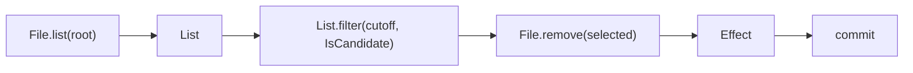

# File Adapter Design

Status: proposed contract, ready for implementation planning.
The operations in this document are not implemented.
The [implementation plan](file-adapter-plan.md) defines the work and acceptance sequence.
The [language reference](../specification.md#9-adapters) remains the contract for implemented operations.

## Contents

- [Decisions](#decisions)
- [Public operations](#public-operations)
- [Entry values](#entry-values)
- [Listing](#listing)
- [Grants](#grants)
- [Removal construction](#removal-construction)
- [Commit and failure progress](#commit-and-failure-progress)
- [Concurrency boundary](#concurrency-boundary)
- [Inspection and native execution](#inspection-and-native-execution)
- [Gateway log cleanup](#gateway-log-cleanup)
- [Scope limits](#scope-limits)

## Decisions

`File` remains a domain adapter.
There is no `IO` parent type, inheritance, or adapter-to-collection conversion.
The runtime can share authorization, cancellation, and diagnostic interfaces between adapters.

`File.list` returns ordinary immutable values in `List<File.Entry>`.
List processors select and summarize those values.
`File.remove` constructs one batch effect.
Only `commit` executes removal.



List callbacks retain the existing purity rule: they cannot activate commits.
Boundary reads remain separate from commit effects.
Thus, a callback can read a file, but each read occurs in callback order.
The cleanup predicate examines only entry metadata.

## Public Operations

| Signature | Classification | Result |
| --- | --- | --- |
| `File.list(root: File.Path) -> List<File.Entry>!` | Boundary read | Observe direct directory children. |
| `File.remove(entries: List<File.Entry>) -> Effect!` | Pure effect construction | Validate and retain a removal selection without filesystem access. |
| `File.read(file_path: File.Path) -> Bytes!` | Existing boundary read | Read file contents. |
| `File.write(file_path: File.Path, file_content: Bytes) -> Effect` | Existing effect construction | Construct a content replacement. |
| `File.append(file_path: File.Path, file_content: String) -> Effect` | Existing effect construction | Construct a UTF-8 append. |

`File.read` does not return a list implicitly.
A decoder or parser determines the values represented by its bytes.

`File.Entry` is a nominal, immutable type.
It has no public constructor, equality operation, ordering operation, or checkpoint encoding.
Its projections are ordinary typed values.

## Entry Values

| Projection | Type | Meaning |
| --- | --- | --- |
| `path` | `File.Path` | Absolute lexical path under the observed directory. |
| `name` | `String` | One direct-child basename. |
| `kind` | `String` | Exactly `regular`, `directory`, `symlink`, or `other`. |
| `size_bytes` | `Int` | Observed nonnegative logical size. |
| `modified_unix_ns` | `Int` | Observed modification time in nanoseconds since the Unix epoch. |
| `link_count` | `Int` | Observed number of filesystem links. |

The adapter validates these projections at the filesystem boundary.
The runtime uses a closed internal type for `kind`.
Entry metadata has no content-read capability.

Each entry also contains opaque provenance:

- The execution-session identity and observed directory identity.
- The relative basename and native file identity.
- The observed size, modification time, change time, file kind, and link count.

A directory handle remains available until the session ends.
The first implementation permits at most 128 observed directories per session.
Repeated listings of the same resolved directory and native directory identity reuse one retained handle slot.
HTTP startup and each request have separate session identities and retained-entry registries.
Shared grant configuration cannot make entries valid across those sessions.
List copies, record fields, flow arguments, and `List.filter` preserve entry provenance.
A reconstructed record cannot satisfy `File.Entry`.
Provenance identifies an observation, not an access grant.

JSON output contains only the six public projections under the `File.Entry` type tag.
JSON does not expose directory handles or opaque identities.
Printed entries cannot become executable entries in a later invocation.
Diagnostic snapshots use the same public projections.

## Listing

1. Resolve the supplied path against the invocation's captured working directory.
2. Authorize the exact directory through a list grant.
3. Open the directory without traversal through symlinks.
4. Enumerate direct children without recursion.
5. Read each child's metadata without following a symlink.
6. Reject invalid UTF-8 names and metadata failures.
7. Sort entries by basename in Unicode scalar order.
8. Return the complete list.

The list contains hidden entries, directories, symlinks, and regular files.
A predicate selects the required kinds.
The operation does not read file contents.
It does not expose an open-file status.

The result contains observations made at different times.
It is not an atomic filesystem snapshot.
A child that appears after enumeration is outside that result.
A child that disappears before its metadata read causes `File.ListFailed`.
The operation never substitutes an empty or partial list after a failure.

The first implementation limits one listing to 10,000 entries.
A name must fit the existing String and value limits.
The 16 MiB expanded-value limit and 64 MiB evaluation limit also apply.
The adapter checks limits before result allocation and publication.
It closes temporary handles on success, failure, and cancellation.

Each enumerated entry consumes one logical step.
Sorting reserves `N * ceil(log2(max(N, 1)))` steps before it starts.
These charges apply equally to interpreter and native execution.
An exceeded entry, handle, work, or value limit produces `runtime.limit`.
Cancellation produces `runtime.cancelled`.
Both host diagnostics bypass Lo handlers.

## Grants

The CLI adds separate repeatable inputs for `run` and `serve`:

```text
--list-root <directory>
--remove-root <directory>
```

Each new grant authorizes one exact directory and its immediate children.
It does not authorize descendant directories.
Paths are resolved once at CLI validation and retained as opened roots.
Symlinked grant paths are rejected.
Duplicate grants within one operation are invalid CLI input.
The same directory can have both a list grant and a removal grant.

A list grant does not permit content reads or removal.
A removal grant does not permit discovery, content reads, writes, or appends.
Existing read and write grants do not imply either new grant.
The existing read/write subtree contract remains unchanged.

The adapter checks the whole removal batch before the first deletion.
Every entry must belong to the current invocation and the same observed directory.
That directory must match an opened removal grant by path and directory identity.
A replaced directory cannot acquire authority from its previous path.

An absent grant produces `runtime.capability-denied` before filesystem mutation.
Inspection reports requirements but never creates grants.
Native artifacts receive grants at execution time, not build time.

## Removal Construction

`File.remove` performs no filesystem access and acquires no lock.
It checks the supplied values and constructs an immutable effect payload.
The construction rules are:

- Accept only regular entries with an observed link count of one.
- Accept entries from one observed directory in one invocation.
- Reject duplicate basenames and duplicate native identities.
- Reject reconstructed records and values from another session.
- Preserve the supplied list order.
- Accept an empty typed list as an empty effect.

Invalid selections produce `File.InvalidSelection`.
Construction does not claim that the observations are still current.
Repeated construction from the same entry values is valid.
The effect retains those values until execution no longer needs them.

The first implementation limits one removal batch to 10,000 entries.
Construction charges one logical step per entry and checks value weight before allocation.
The batch uses the existing `Effect` type, with a distinct internal removal payload.
It does not encode entries as fictitious file contents.

## Commit and Failure Progress

Commit uses this sequence:

1. Authorize every entry and reserve work, diagnostic space, and the progress record.
2. Revalidate every selected entry before any deletion.
3. For each entry in list order, check cancellation and revalidate its identity and metadata again.
4. Remove that basename through the retained directory boundary.
5. Record each successful removal before checking cancellation again.

The commit reserves `3 * N` logical steps before mutation.
This covers batch preflight, per-entry revalidation, and removal.
The progress record is also reserved before mutation.
The revalidation fields are the opaque fields listed in [Entry values](#entry-values).
Changes to any field produce `File.EntryChanged`.
An absent selected entry produces the same error.
Construction and revalidation reject observed directories, symlinks, and entries with multiple links.
Protection against a replacement after the final revalidation requires the coordination described in [Concurrency boundary](#concurrency-boundary).

The operation stops at the first failure.
Successful earlier removals remain completed.
There is no rollback, automatic retry, or silent skip.
One batch effect is not an atomic transaction.
A repeated commit revalidates the entries and fails when a previous commit removed them.
An empty effect succeeds without filesystem access.

### Failure Types

| Condition | Result |
| --- | --- |
| Listing cannot obtain complete observations | `File.ListFailed` |
| Invalid names in directory entries | `File.InvalidName` |
| Invalid removal selection | `File.InvalidSelection` |
| Selected identity or metadata changed | `File.EntryChanged` |
| Removal system call failed | `File.RemoveFailed` |
| Missing operation grant | `runtime.capability-denied` |
| Work, value, entry, or handle budget exceeded | `runtime.limit` |
| Host cancellation | `runtime.cancelled` |
| Required boundary cleanup failed | `runtime.host-failure` |

Lo errors keep the operation arguments in `Error.input` and the existing source trace.
Removal failures add a `progress` record beside the `entries` argument snapshot.
The record has this fixed shape:

```text
Record{
    total_count: Int,
    completed_count: Int,
    completed_bytes: Int,
    failed_index: Int,
    stage: String
}
```

`completed_count` identifies the confirmed successful prefix of the supplied list.
`completed_bytes` sums the observed sizes of that prefix.
It is not a measurement of reclaimed disk space.
`failed_index` identifies the failing entry, or `-1` when no entry caused the failure.
`stage` is exactly `preflight`, `remove`, or `finalize`.
A preflight failure always has `completed_count: 0`.

Host diagnostics preserve the same record in a new structured `removal_progress` field.
A `removal_entries` field retains the ordered public entry descriptions needed to identify the completed prefix.
This applies to cancellation, limits, and cleanup failures after removal starts.
The text formatter includes the confirmed count and failure stage.
Cleanup failure cannot overwrite the original failure or its progress.

A successful `commit` still has no result value.
A flow can calculate its selected count and observed bytes before commit, then return them after success.
Bare `Error.input` retains its current projection restrictions.
The structured progress is available in diagnostic JSON without a new dynamic-record accessor.

No completion report is guaranteed after process termination or an output-channel failure.
A new execution must obtain new observations instead of replaying a printed effect.

## Concurrency Boundary

Directory-relative access prevents traversal outside the authorized root.
Identity revalidation detects changes observed before removal.
It cannot make the identity check and removal one atomic operation.
The [Go Root.Remove contract](https://pkg.go.dev/os#Root.Remove) accepts a name, not an expected file identity.

The adapter does not claim protection against an uncoordinated process that changes the directory between revalidation and removal.
An open-file scan cannot prevent a later open either.
Thus, the adapter does not treat an `lsof` observation as exclusion.
It does not add a quarantine rename with an implied atomic guarantee.

A host that requires protection for active files must coordinate all relevant participants.
The Gateway workflow below selects a cooperative lock protocol.
Generic File operations contain no Gateway policy and no implicit lifecycle lock.

## Inspection and Native Execution

Static inspection reports `File.list` as a boundary read with the `File.list` capability.
It reports a committed removal effect with the `File.remove` capability.
Uncommitted removal construction does not imply activation.
The report identifies a known root when dataflow permits it.
A filtered selection is a calculated set, not an enumerated static filename list.

Inspection never enumerates a directory, examines files, or obtains a lock.
A runtime preview performs discovery and returns public entry descriptions without constructing an applied change.
Preview output is informational and cannot be replayed as authority.
Execution obtains fresh observations.

The same typed target, grant checks, limits, error kinds, and progress schema apply to native artifacts.
The runtime bundle includes all new value, boundary, diagnostic, and platform code.
File entries and removal effects cannot enter checkpoint encoding.

## Gateway Log Cleanup

The first complete workflow removes old deployment logs from one exact Gateway cache directory.
The [proposed Lo program](examples/gateway-log-cleanup.lo) defines selection and activation.
It uses existing String, Scalar, List, Math, and Match operations for the name predicate.
It adds no regex, clock, environment, subprocess, or general IO operation.

### Selected Policy

| Input or rule | Contract |
| --- | --- |
| Directory | Gateway's configured runtime cache plus `deployments` |
| Default macOS path | `$HOME/Library/Caches/mprlab-gateway/deployments` |
| Scope | Direct children of that exact directory |
| Name | Full basename matches `deployment-[0-9]+.log` with ASCII digits |
| Kind | Regular file with one link |
| Retention | `30 * 86400` seconds |
| Cutoff | One captured host time minus retention, expressed as Unix nanoseconds |
| Age comparison | `entry.modified_unix_ns < cutoff_unix_ns` |
| Success result | Removed count and sum of observed sizes |
| Missing directory | Explicit failure, with no substitution of an empty selection |
| Concurrent deployment | Explicit busy result before Lo starts, with zero deletions |

The wrapper resolves the configured Gateway cache through Gateway's existing runtime-path code.
It does not hardcode the default macOS directory when an override is active.
It grants only that directory for listing and removal.
It gives no read-root or write-root grant.
Lifecycle records, installed runtimes, and operator state are outside the granted directory.

### Cooperative Host Protocol

Gateway owns the application-specific lock and wrapper.
All Gateway users of deployment logs must obey this protocol:

1. Use one persistent lock file at `<runtime-cache>/deployment-logs.lock`.
2. Hold a shared lock for the entire lifecycle that can create, open, write, rename, or remove deployment logs.
3. Keep the shared lock between handle closes and subsequent reopens in that lifecycle.
4. Acquire an exclusive nonblocking lock before cleanup captures time or starts discovery.
5. Keep the exclusive lock until the Lo child exits and its report is collected.
6. Do not replace or delete the lock file while any participant can use it.

Every surviving process that can access the logs must retain the required lock.
This includes the Lo child and lifecycle children if their parent terminates.
Use an inherited lock handle whose exclusion remains effective until the last participating reference closes.
The parent must not explicitly unlock that handle while a child can still access logs.
Test these ownership and release semantics on each supported platform.

Readers that require an active-log guarantee must also hold the shared lock for their complete access interval.
A busy lock produces an explicit nonzero result with no deletion.
Lock acquisition failure produces an explicit nonzero result.
There is no automatic retry or interactive prompt.

The existing Gateway log creation path does not implement this protocol.
The Gateway implementation stage must add it before operational cleanup qualification.
The old cleanup script cannot run against the same directory outside the protocol.
Uncoordinated external readers and writers remain outside the active-log guarantee.
This limit must remain visible in the operator documentation.

### Inputs and Execution

The checked example uses a fixture directory and a fixed cutoff.
The production wrapper supplies an absolute directory and one captured cutoff.
Current Lo commands do not accept arbitrary flow arguments.
The first wrapper renders a complete source program from the reviewed example template.
The command selects one of two fixed final expressions:

| Command | Final expression |
| --- | --- |
| `logs cleanup` | `return Cleanup(root, cutoff_unix_ns)` |
| `logs preview` | `return Preview(root, cutoff_unix_ns)` |

The example shows the cleanup expression.
The command owns this closed choice.
User input cannot supply an entry-point name or source expression.
It encodes the path as a Lo string literal and the cutoff as a decimal Int literal.
Within each command's template, only those two literals vary.

The template contains no user-supplied source fragments.

The proposed wrapper command is `mprlab-gateway logs cleanup`.
It sets `CI=1`, closes child standard input, and invokes the selected installed Lo binary without a shell.
It executes the generated source with exact list and removal grants and JSON output.
It retains the lock through child termination and forwards the child's failure and progress.
The child retains its inherited lock reference if the wrapper terminates first.

A preview command, `mprlab-gateway logs preview`, uses the same selection flow without `commit`.
It returns names, selected count, and observed bytes under a shared lock.
Inspection and execution tests must confirm that its selected entry point cannot reach a commit.
A later cleanup captures time again and obtains fresh observations.
The preview is not a frozen approval token.

For native qualification, compile one fixture program and execute it with runtime grants.
The acceptance tests compare its output and resulting directory with interpreter execution.
Operational use of native artifacts with changing inputs is outside this first wrapper contract.

### Difference From the Existing Script

The current script selects old logs, examines open files, rechecks metadata, and removes eligible paths.
The planned workflow keeps the naming and age policy.
It replaces the open-file observation with explicit exclusion among cooperating Gateway participants.
It stops on changed entries instead of silently skipping them.
A missing directory is an explicit failure.
A busy Gateway lifecycle prevents the complete cleanup run.
These behavior changes are part of the proposed contract.

## Scope Limits

The first implementation includes nonrecursive discovery and regular-file removal only.
Recursive traversal, directory removal, arbitrary subprocesses, file watchers, and stream collections are outside this plan.
There is no cross-invocation effect replay or persistent removal journal.
Other package caches and Docker cleanup need separate adapters and acceptance plans.

No language decision remains open for the first slice.
Platform-specific identity capture must satisfy the selected fields and fail explicitly when it cannot.
The Gateway lock integration is a required implementation dependency, not evidence that it already exists.
