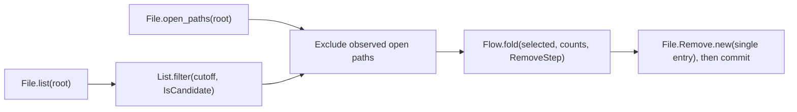

# File Adapter Design

The File adapter supports observations, file replacement, append, and removal.
The [Gateway log example](examples/gateway-log-cleanup.lo) combines these operations into a complete log category.
The [language reference](../specification.md#91-file-adapter) specifies the public language contract.
The [implementation plan](file-adapter-plan.md) records acceptance.
The [mac-cleanup plan](mac-cleanup-plan.md) defines the remaining complete-script requirements.
This document describes the current implementation.
The [shared adapter design](adapter-design.md#file) defines nominal File actions and typed receipts.
The [shared implementation plan](adapter-plan.md) records HTTP client and qualified native Process support.

## Contents

- [Decisions](#decisions)
- [Public operations](#public-operations)
- [Entry values](#entry-values)
- [Listing](#listing)
- [Grants](#grants)
- [Open-file observations](#open-file-observations)
- [Removal construction](#removal-construction)
- [Commit and failure progress](#commit-and-failure-progress)
- [Sequential cleanup](#sequential-cleanup)
- [Concurrency boundary](#concurrency-boundary)
- [Inspection and native execution](#inspection-and-native-execution)
- [Gateway log cleanup](#gateway-log-cleanup)
- [Scope limits](#scope-limits)

## Decisions

`File` is a domain adapter, with no `IO` parent or inheritance.
`File.list` returns ordinary immutable values in `List<File.Entry>`.
List processors select and summarize those values.
`File.Remove.new` constructs a nominal `File.Remove` target.
Only `commit` executes removal.
`Flow.fold` permits ordered callback activation when each candidate needs a separate result.
List callbacks cannot include transitive host observations or commits.
`Flow.fold` callbacks can include both under ordinary fallibility rules.



## Public Operations

| Signature | Behavior |
| --- | --- |
| `File.Path.eq(left_operand: File.Path, right_operand: File.Path) -> Bool` | Compare path text without filesystem access or normalization. |
| `File.list(root: File.Path) -> List<File.Entry>!` | Observe direct directory children. |
| `File.open_paths(root: File.Path) -> List<File.Path>!` | Observe open paths through a bounded host probe. |
| `File.Remove.new(entries: List<File.Entry>) -> File.Remove!` | Construct a removal selection without filesystem access. |
| `File.read(file_path: File.Path) -> Bytes!` | Read file contents. |
| `File.Write.new(file_path: File.Path, file_content: Bytes) -> File.Write` | Construct a content replacement. |
| `File.Append.new(file_path: File.Path, file_content: Bytes) -> File.Append` | Construct an append from Bytes. |

`File.read` does not convert bytes to a list implicitly.
`File.Path` contains text, not authority.
`File.Entry` has no public constructor, equality, ordering, or checkpoint encoding.

Write and append require Bytes.
`UTF8.Bytes.new(text: String) -> Bytes` explicitly encodes text as UTF-8.
`UTF8.String.new(bytes)` remains the fallible decoder.

### Activation Results

| Target | Success type | Exact public fields |
| --- | --- | --- |
| `File.Write` | `File.WriteReceipt` | `path: File.Path`, `bytes_written: Int` |
| `File.Append` | `File.AppendReceipt` | `path: File.Path`, `bytes_written: Int` |
| `File.Remove` | `File.RemoveReceipt` | `total_count: Int`, `completed_count: Int`, `observed_bytes: Int` |

Receipts have no public constructors.
A bound statement uses `receipt = commit target`.
It creates the immutable binding only after activation success.
Write and append success require the complete write and operation-owned resource release.
Removal success requires all selected removals and operation-owned resource release.

Retained directory handles stay open until session cleanup.
A later session cleanup failure keeps the confirmed operation progress.
Receipt copies do not repeat activation.
Another commit of the same target is another attempt.

After removal success, the total and completed counts are equal.
`observed_bytes` sums selected observations and does not measure reclaimed disk space.
Write and append failures keep confirmed byte counts, including partial writes.
No failure publishes a bound receipt.

Host failures expose `write_progress` with `bytes_written: Int` and `stage: String`.
`last_completed_activation` contains `operation`, `span`, and `receipt` for the latest completed activation in the invocation.
This record does not describe the current partial operation.
The invocation keeps only its latest completed activation record.
Diagnostic evidence does not create a result binding.

Cleanup cancellation keeps the original operation failure class.
Recoverable write errors keep `cleanup_errors: List<String>` in `Error.input`.
Host diagnostics expose `cleanup_errors` as a JSON array.

## Entry Values

| Projection | Type | Meaning |
| --- | --- | --- |
| `path` | `File.Path` | Absolute lexical path under the observed directory. |
| `name` | `String` | Direct-child basename. |
| `kind` | `String` | `regular`, `directory`, `symlink`, or `other`. |
| `size_bytes` | `Int` | Observed nonnegative logical size. |
| `modified_unix_ns` | `Int` | Observed modification time since the Unix epoch, in nanoseconds. |
| `link_count` | `Int` | Observed number of filesystem links. |

Opaque provenance connects an entry to its execution session, retained directory, basename, native identity, size, modification time, and kind.
The adapter validates metadata at the filesystem boundary.
Copies, records, flow arguments, and filters preserve provenance.
A reconstructed record cannot satisfy `File.Entry`.
JSON and diagnostic snapshots expose only the six public projections.
Printed values cannot become executable observations in another invocation.

Each session retains at most 128 observed directories.
Repeated observations of one directory identity reuse its handle slot.
HTTP startup and each request have separate sessions.
Grant configuration does not authorize transfer of entries between sessions.

## Listing

`File.list` authorizes an exact directory and enumerates its direct children without recursion.
It includes hidden entries and all four file kinds.
It reads metadata without following child symlinks, then sorts by basename in Unicode scalar order.
It does not read file contents.
A listing is not an atomic snapshot.

An absent, explicitly granted directory produces `File.DirectoryAbsent`.
A child that disappears during discovery produces `File.ListFailed`.
Invalid UTF-8 names produce `File.InvalidName`.
Other metadata failures produce `File.ListFailed`.
A failed listing never returns a partial list.

Each entry consumes one logical step.
Sorting reserves `N * ceil(log2(max(N, 1)))` steps before execution.
One result permits at most 10,000 entries, subject to the 16 MiB value and 64 MiB evaluation limits.
Limits and cancellation produce host diagnostics that bypass Lo handlers.
Handles close on success and failure.

## Grants

The `run` and `serve` commands accept separate repeatable grants:

| Option | Authority |
| --- | --- |
| `--read-root DIRECTORY` | Read contents within the directory tree. |
| `--write-root DIRECTORY` | Write or append contents within the directory tree. |
| `--list-root DIRECTORY` | List the exact directory's immediate children. |
| `--remove-root DIRECTORY` | Remove selected immediate regular files in the exact directory. |
| `--open-files-root DIRECTORY` | Probe open paths in the exact directory and its descendants. |

No grant implies another grant.
The open-file grant is separate because the host probe traverses descendants.
A descendant cannot become a separately queried root through its ancestor's grant.
Duplicate grants for one operation are invalid CLI input.
Exact grant paths reject symlink traversal.

An exact grant for a missing directory stays inert for the invocation.
Listing reports absence while that path remains absent.
If a directory later appears at that path, access is denied.
A replaced directory cannot acquire the previous directory's authority.
Missing authority produces `runtime.capability-denied`.
Inspection never creates authority.
Native artifacts receive grants when they execute.

## Open-file Observations

The native boundary uses the fixed command `lsof -Fn +D .`.
A private child changes its working directory through an inherited directory handle before it executes `lsof`.
It never resolves the authorized pathname again to select its working directory.
The helper accepts no Lo-supplied executable or argument list.
Standard input is closed.

The parser accepts process records, descriptor records, and relative name records from the line-framed output.
It omits the root name `.` and maps child names to the original lexical root.
It removes duplicates and sorts the resulting paths.
An unknown record, invalid UTF-8, NUL byte, invalid relative path, or malformed identifier fails explicitly.
Backslashes and control characters in name payloads fail with `File.OpenFilesFailed`.
This line-framed probe cannot represent those filenames without ambiguity.
It never interprets display escapes as literal filesystem names.
Probe exit status 0 or 1 is accepted only when stripped standard error is empty.
Launch failures and invalid output produce `File.OpenFilesFailed`.

Each output stream permits at most 8 MiB.
Overflow cancels the child and produces `runtime.limit`.
Cancellation stops the child and produces `runtime.cancelled`.
Parsing reserves one step per output byte before scanning and one step per nonempty record.
Path construction and sorting reserve their work and value storage before execution.
A result permits at most 10,000 distinct paths, subject to the normal value limits.

The process fixture verifies the command contract without examining application data.
The [binding test](../tests/integration/file_probe_binding_test.go) replaces a directory path before the child starts.
The child still examines the retained directory.

## Removal Construction

Construction accepts regular entries from one directory and one session.
It rejects duplicate basenames, foreign provenance, and other file kinds with `File.InvalidSelection`.
It preserves list order and accepts an empty typed list.
Hardlinks are valid, including distinct selected basenames with the same native identity.
Link-count policy belongs in the Lo predicate.

Construction performs no filesystem access and acquires no lock.
It reserves one step per entry and checks value weight before allocation.
The maximum batch size is 10,000 entries.
The nominal `File.Remove` target keeps its selection and opaque entry provenance.

## Commit and Failure Progress

Commit authorizes the complete selection before mutation.
It reserves `3 * N` steps and diagnostic storage before removal.
It revalidates the complete batch, then revalidates each entry immediately before removal.
Revalidation compares native identity, size, modification time, and regular-file kind.
It does not compare link count or change time.
Removal uses the retained directory and basename.

A changed or absent entry produces `File.EntryChanged`.
Other metadata or removal failures produce `File.RemoveFailed`.
A batch stops at its first failure without retry or rollback.
Successful earlier removals remain completed.
An empty removal target succeeds without filesystem access.
A repeated commit fails when its observations are stale.

The removal progress record contains:

```text
Record{total_count: Int, completed_count: Int, completed_bytes: Int,
       failed_index: Int, stage: String}
```

`completed_count` identifies the confirmed prefix.
`completed_bytes` sums observed sizes, not reclaimed disk space.
`failed_index` is the failing index, or `-1` when no entry caused the failure.
`stage` is `preflight`, `remove`, or `finalize`.
Preflight failure has zero completed removals.

Lo errors retain argument snapshots, source traces, and removal progress.
Host diagnostics expose `removal_entries` and `removal_progress`.
Cleanup errors preserve the original failure and confirmed progress.
After activation success, a bound commit publishes its nominal receipt.
An unbound commit discards that receipt.
Failure publishes no result binding and stops the current body.

## Sequential Cleanup

`Flow.fold(items, initial, context..., Step)` invokes `Step(context..., state, item)` in list order.
The callback can read external state and commit targets under ordinary fallibility rules.
A successful result becomes the next state.
An empty input returns the initial state.
An unhandled error stops the suffix.

The cleanup example commits singleton removals.
Its self-handler converts only `File.EntryChanged` to a skip.
All other failures propagate.
This gives the workflow explicit continuation without changing generic batch behavior.

Failure traces retain the fold index and completed state.
Host diagnostics add a `flow_progress` array from the outermost active fold to the innermost.
Each record has `operation`, `total_count`, `completed_count`, `next_index`, and `state`.
An in-flight singleton removal can have confirmed progress before the callback completes.
The runtime keeps removal progress and fold progress separately.
Late session or grant cleanup failures retain the final completed state for CLI runs.

## Concurrency Boundary

Directory-relative access preserves the authorized directory boundary.
The final identity check and unlink remain separate operations.
An uncoordinated writer can replace a basename between them.
Open-file observations cannot prevent a later open.
The adapter claims neither atomic identity-checked deletion nor writer exclusion.
It adds no application coordination protocol.

## Inspection and Native Execution

Inspection reports listing and open-file reads separately from removal activation.
It reports `Flow.fold` callback contexts and reachable commits.
A filtered selection remains calculated data, not an invented static filename list.
Unused flows have separate contexts.
Inspection performs no discovery or subprocess execution.

Interpreter and native artifacts share grants, parsing, removal, limits, and diagnostic schemas.
Native builds require an existing absolute `LO_BUILD_ROOT` with no symlink traversal.
The Makefile supplies `_scratch/build-state/` inside Lo for build caches and temporary files.
The [native contract](native-compilation-contract.md#artifact-construction) specifies that boundary.

## Gateway Log Cleanup

The [maintained example](examples/gateway-log-cleanup.lo) takes a fixture root and explicit cutoff.
It selects sorted direct regular files with names matching `deployment-[0-9]+\.log`.
The comparison uses ASCII digits and modification time strictly below the cutoff.
The intended category uses a 30-day cutoff.
It does not apply owner, access-time, or single-link restrictions.

Preview returns `directory_status`, selected names, count, and observed bytes without mutation.
Cleanup returns `directory_status`, removed count, observed bytes, and skipped candidate count.
Directory status is `present` or `absent`.
The workflow avoids a probe when no candidates remain.
It excludes observed open paths and continues after changed or absent candidates.

All example execution, fixtures, and validation stay inside Lo.
The application name identifies a log category only.
No source project, installed script, or real application cache is an acceptance input.

## Scope Limits

This slice includes nonrecursive entry discovery, regular-file removal, and a fixed recursive open-file probe.
It excludes arbitrary subprocesses, directory removal, file watchers, persistent journals, and effect replay.
The complete mac-cleanup script still needs host inputs, process results, cleanup locking, additional metadata, and category orchestration.
