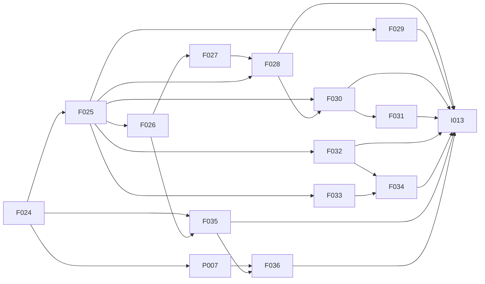

# mac-cleanup Implementation Roadmap

Status: technical plan and implementation backlog, reviewed against repository source on October 31, 2026.
This plan does not implement a new language operation or establish full cleanup acceptance.
The [application design](mac-cleanup-script-design.md) owns the observed workflow and its draft interfaces.
The [application plan](mac-cleanup-plan.md) owns the cleanup policies and acceptance boundary.

## Outcome And First Work

The target is one Lo application with help, preview, storage reports, ordered cleanup, category recovery, and explicit final status.
All acceptance state stays inside Lo.
Application names, paths, ages, commands, messages, and status decisions stay in application flows.
Generic language changes stay reusable across applications.

F026 through F028 implement M1: Console output, terminal results, and an executable declared CLI.
Final local `make ci` and independent review passed.
The [completion record](evidence/cli-runtime/checkpoint.json) contains the results.
F029 is next for entry identity and exclusive file leases.
M2 then combines those leases with F030 processors, F032 observations, and F035 command policy.
This sequence does not depend on modules, user-defined types, generics, or packages.

## Verified Foundation

| Area | Implemented behavior | Boundary that remains |
| --- | --- | --- |
| F024 | Immutable Process contexts, executable discovery, typed results, bounded transport, and selected cleanup scopes. | Current qualified activation is Darwin. Forked and spawned descendants remain denied. |
| F025 | Invocation arguments, home, UIDs, captured time, file owner and timestamps, exact directory observations, scans, and checked removal. | Device, inode, and allocated size are not public metadata fields. |
| Control | Selected Match branches, self-handling flows, ordered folds, and category recovery. | Pure callbacks and pure error handlers cannot activate commits. |
| Traversal | `Flow.worklist` and host quotas for work, values, and retained directory observations. | Scheduling does not grant descendant access or make tree snapshots descriptor-bounded. |
| Runner I/O | Committed Console lines, explicit embedding sinks, and text/NDJSON output. | Command-output forwarding remains F035 work. |
| Program arguments | Literal capture after `--`, declared Boolean options, and deterministic help. | The selected parser does not accept value-bearing options or operands. |
| Program completion | Nominal terminal results select status after resource cleanup and required output. | An ordinary returned Int remains data. |
| Process duration | The default lifetime is five seconds. Native admission also enforces that ceiling. | The draft requests 30, 60, 180, and 1800 seconds for different command classes. |

Source anchors include `internal/runner/command.go`, `internal/runner/execute.go`, and `internal/catalog/observations.go`.
Other anchors include `internal/adapter/file_observation.go`, `internal/value/file_leases.go`, and `runtime/native/src/process.rs`.
The [control evidence](evidence/cleanup-control-composition.json) records the executable control example.
F024 and F025 record their own implementation evidence.
Those records describe the earlier validation of their contracts.

The application draft retains 62 proposed operation names after exclusion of implemented Match behavior and current catalog operations.
That count identifies dependencies. Some draft operations can use the current language contract.
Some draft calls can use current operations or ordinary named flows.
For example, exact root observations can use `File.directory`, `File.list`, and `File.scan`.
The draft's `File.Directory.open` must not become an alias for the current root operation.

## Work Packages And Dependencies

F026 through F028 complete M1.
The [CLI contract](cli-runtime-design.md) defines their selected interfaces and behavior.
Other entries remain planned work outside the implemented language reference.

| Issue | Work package | Direct dependencies | Observable completion |
| --- | --- | --- | --- |
| F026 | Console targets and injected output sinks. | F025 | Ordered stdout/stderr output through `commit` in all software runtimes. |
| F027 | Terminal results and final process status. | F026 | Status selection after output and resource cleanup, including cleanup failures after requested status 1 or 2. |
| F028 | Declared application flags and minimal value helpers. | F025, F027 | Executable help, invalid-argument handling, and dry-run selection. |
| F029 | Program identity and exclusive nonblocking file leases. | F025 | Contention and release across interpreted and native programs. |
| F030 | Selected text, byte, collection, path, and glob processors. | F025, F028 | Executable direct-file and probe predicates with bounded values. |
| F031 | Generic JSON decoding and numeric presentation. | F030 | Typed Docker metadata extraction and deterministic report formatting. |
| F032 | Public identity, allocation, fresh time, and volume observations. | F025 | Coherent metadata and distinct allocation/free-space reports. |
| F033 | Explicit descendant directory authority and retained child observations. | F025 | Bounded recursive traversal without wider exact grants. |
| F034 | Bounded tree snapshots and checked recursive removal. | F032, F033 | Complete eligibility preflight and identity-bound removal with partial progress. |
| F035 | Host-admitted command deadlines and forwarded output. | F024, F026 | Requested durations, output accounting, and recoverable timeouts after confirmed cleanup. |
| P007 | Select and qualify descendant process ownership. | F024 | A bounded ownership design with controlled fork, spawn, detach, and pipe evidence. |
| F036 | Implement the selected descendant execution profile. | P007, F035 | Child creation remains confined and owned through complete cleanup. |
| I013 | Complete the mac-cleanup application and fixture acceptance. | F028, F029, F030, F031, F032, F034, F035, F036 | One checked source passes the complete workflow matrix. |

F022 remains the later module/package library initiative.
The small generic contracts here can use builtins and maintained named flows before that initiative completes.
Existing exact grants and current Process restrictions keep their meanings until their selected replacement contracts pass acceptance.

## Milestones

| Milestone | Required issues | Application evidence |
| --- | --- | --- |
| M1: executable CLI | F026, F027, F028 | Help, invalid options, dry-run selection, visible messages, and actual exit statuses. |
| M2: direct-file cleanup | M1, F029, F030, F032, F035 | One direct-file category with locking, candidate probes, checked singleton removal, and category continuation. |
| M3: recursive caches | M2, F033 | Sorted traversal, preserved directories, exact candidate batches, and bounded retained handles. |
| M4: whole-tree eviction | M3, F034 | Root-inclusive snapshots, full eligibility, root-handle rejection, and checked postorder removal. |
| M5: complete workflow | M4, F031, P007, F036, I013 | Package commands, temporary roots, Docker validation, report mode, summaries, and final aggregate status. |

I013 can add incremental fixture entry sources after each milestone.
Its complete acceptance remains open until M5.
P007 research can proceed independently of console and file implementation.
It must not delay M1 through M4 or weaken current descendant denial.

## Console And Terminal Contracts

### F026: Console Output

The [CLI contract](cli-runtime-design.md) selects `Console.Line.new(stream, text, flush)` for F026.
Construction remains pure. Only `commit` writes the line.
The constructor validates a closed stdout/stderr selection and creates an immutable nominal target.
The host supplies enabled destinations, output sinks, quotas, and their lifetime.
Missing destinations fail explicitly.

Requirements:

- Define UTF-8 encoding and exactly one appended newline.
- Serialize each console stream's committed output without a cross-stream merge guarantee.
- Report partial writes and flush failures with confirmed byte counts.
- Stop blocked output on cancellation without an abandoned worker.
- Bound output and retain sink ownership until active writes finish.
- Keep constructor diagnostics and uncommitted target snapshots free of output payloads.
- Keep earlier confirmed output visible after a later failure.
- Define CLI defaults, embedding injection, and server-request sink ownership before implementation.

The Go implementation wraps `execution.Boundary` with Console activation.
The runner supplies an explicit output owner to that boundary.
Native Session, adapter dispatch, values, ABI exports, and CLI setup implement the same contract.
The catalog, type checker, interpreter, inspector, and semantic inventory include the Console target.

The selected output protocol resolves `--format json` through NDJSON console events and the final result envelope.
Raw application text cannot silently mix with the existing JSON result envelope.
Each console event goes to its selected destination.
Binary payloads need a byte-preserving representation.
Ordinary programs without Console actions still use their selected result renderer.

Public acceptance includes inert construction, Unicode, empty lines, destination separation, ordered commits, short writes, and flush errors.
It also includes a closed pipe, blocked-output cancellation, quotas, and prevention of later commits after terminal failure.

### F027: Terminal Results

The CLI contract selects `Program.Exit.new(code, stdout, stderr)` as a fallible pure constructor.
Its value is inert until a run entry returns it as the final result.
Nested values must not select a status or emit trailing payloads.
An ordinary Int return keeps its ordinary value semantics.

Pure error handlers cannot commit Console targets.
The draft uses terminal payloads for help, startup errors, and UID rejection.
The selected constructor accepts status, stdout bytes, and stderr bytes.

The draft startup handler returns structured status and message data.
The outer reporting flow constructs the fallible terminal result.
The executable CLI example verifies this pattern without the draft's remaining proposed operations.

Requirements:

- Select the valid application status range and invalid-status error.
- Define deterministic stdout/stderr trailing-output order and its JSON representation.
- Select application status only after required output and all owned-resource cleanup succeed.
- Let output, cancellation, budget, or cleanup failure override a requested application status.
- Keep confirmed earlier Console output after failure.
- Define run, serve, and embedding behavior before implementation.

The native CLI must join retained ownership before terminal output.
It must distinguish execution failure from a successful application that requests status 1 or 2.
A numeric `status == 0` condition must not suppress a later ownership failure.

Public acceptance includes statuses 0, 1, and 2, invalid values, ordinary Int returns, and type-correct pure startup handlers.
It also includes output failure and delayed cleanup failure after every selected application status.
The first contract must reject unsupported terminal contexts explicitly.

### F028 And F029: Application Entry And Locks

Raw argument transport already exists. F028 supplies pure option parsing and deterministic help.
Its declarations select exact flags, repeated flags, exclusive groups, optional abbreviations, and operand policy.
The application's own declarations select `--dry-run` and `--report`.
Help completes before lock acquisition, probes, cleaners, or removal.
Unknown flags and conflicting modes select the application's declared argument-error status.

F029 supplies entry identity and an exclusive nonblocking lock lease.
Interpreted entry identity refers to the source entry.
Native entry identity refers to the actual executable after relocation.
Untrusted `argv[0]` and embedded source metadata cannot substitute for that observation.
Embeddings without entry identity need an explicit injected identity or a typed unavailable result.

Lock activation needs explicit host authority and an identity-checked handle.
Path text and printed values do not grant lock authority.
The activation lifetime owns the lease until all participating cleanup completes.
Discarding an ordinary value must not release the program lock early.
Child processes must not retain the lock descriptor.
The initial contract does not need shared or blocking locks.

Public cases include two-process contention, mixed interpreted/native callers, relocation, replacement, missing identity, and cancellation.
Close failures and delayed child cleanup must not appear as successful lease release.

## Value And Observation Contracts

F028 uses existing public value helpers for its executable option parser.
F030 then selects the remaining text, byte, collection, and glob operations from actual application call sites.
F030 depends on F028 so that parser helpers have one canonical owner before remaining processors are selected.
Boolean composition can use Match and ordinary pure flows.
UTF-8 conversions and scalar predicates already exist.
New aliases for implemented behavior are outside this plan.

| Draft call family | Owner | Disposition |
| --- | --- | --- |
| `CLI.parse` | F028 | Implemented pure declarations, structured errors, and help. |
| `Console.Line.new` | F026 | Implemented committed output boundary. |
| `Program.Exit.new` | F027 | Implemented inert terminal result and type-correct startup path. |
| `Program.path`, `Lock.File.new` | F029 | Add entry identity and explicit lock authority. |
| Boolean, list, byte, glob, and text processors | F030 | Reuse current flows where sufficient. Implement only the selected remainder. |
| `File.Path.join`, `parent`, `name`, `to_string` | F030 | Select pure lexical path behavior without filesystem access. |
| `Process.Arguments.format_shell` | F030 | Select display-only quoting. Never turn the display string into execution source. |
| `Int.parse`, `Float.format_fixed`, `String.format`, `JSON.*` | F031 | Select numeric parsing, presentation, JSON values, and typed extraction. |
| `Clock.now_unix_ns`, `File.System.usage` | F032 | Add authorized host observations and immutable results. |
| `File.Path.resolve`, `exists`, `is_directory`, `is_symlink` | F033 | Reuse equivalent exact observations or select an explicitly authorized observation contract. |
| `File.Directory.*`, `File.Entry.observe` | F033 | Reuse exact-root operations and add only necessary retained child behavior. |
| `File.Tree.snapshot`, `File.Tree.Remove.new` | F034 | Select bounded ownership and snapshot-bound activation. |
| `Process.Command.with_timeout`, `with_output` | F035 | Add host admission, bounded output, and confirmed timeout cleanup. |

The quoted short path names belong to the `File.Path` family in their row.
The draft family table assigns selection work without requiring every draft name to become a builtin.

Requirements:

- Specify scalar-based string indices and byte-based byte indices independently.
- Specify slice bounds, negative indices, empty separators, invalid sizes, and malformed input.
- Define stable sorting and duplicate removal with explicit equality rules.
- Keep comparison and equality callbacks pure and total.
- Define glob classes, escapes, leading dots, separators, and case sensitivity.
- Keep basename and hidden-file selection in application code.
- Charge newly allocated data through current value and work quotas.
- Verify malformed UTF-8, NUL-delimited records, and exact-path membership in probe fixtures.

F031 supplies decimal integer parsing, generic JSON values, typed extraction, and the report's selected numeric formatting.
Malformed data, missing fields, wrong kinds, nonfinite values, and invalid precision fail explicitly.
JSON parsing must not depend on Docker field names or silently repair malformed input.
Docker schema validation stays in application flows.

F032 extends immutable file observations with public device, inode, and allocated bytes.
Those fields come from the same native observation as owner, timestamps, kind, and logical size.
Allocated bytes use the native block count multiplied by 512 on the selected targets.
Existing removal receipts keep their logical-byte meaning.

F032 also adds a fresh clock observation and containing-volume usage.
The captured invocation clock remains immutable.
Fresh category cutoffs must not silently reuse that earlier clock.
Volume usage reports observed total, used, and free bytes with explicit failures.
Observed free-space change is not guaranteed reclaimed space.

## Descendants, Probes, And Whole Trees

### F033: Descendant Authority

Current exact listing grants remain exact.
Recursive observation and recursive removal need separate explicit host grants.
The final CLI flag names and embedding types belong to the F033 contract.
Each child operation needs a valid recursive scope and verified parent/entry provenance.
Path concatenation alone does not authorize a child.

Requirements:

- Reuse current exact-root operations instead of duplicate root constructors.
- Select canonical-path, absence, and kind observations without granting authority through path text.
- Add retained-handle operations only where path-based exact operations are insufficient.
- Reject foreign sessions, released observations, mismatched parents, and replaced ancestors.
- Never follow a symlink during descendant traversal.
- Let application predicates reject another owner or filesystem device before descent.
- Retain rejected subtree rows when the application needs them for eligibility decisions.
- Release completed handles and reject attempts to restore authority from snapshots.
- Exercise deep and wide trees beyond 128 cumulative directory visits under bounded live quotas.

`Flow.worklist` remains the traversal processor.
Pending work and retained application state must not keep every completed directory descriptor alive.
Quota exhaustion fails explicitly before additional mutation.

### Probe Policies

| Application use | Required observations and framing |
| --- | --- |
| Existing direct deployment logs | Keep current `File.open_paths` behavior: retained directory, newline records, stripped-empty stderr, and no root row. |
| Ordinary files and recursive caches | Exact candidate batches of 100, NUL framing, zero stderr bytes, and no names outside the batch. |
| Whole-tree eviction | Any probe output prevents eviction, including an observed handle on the root directory. |

These policies are distinct.
The current fixed probe cannot silently stand in for the other two policies.
The first implementation choice is explicit Process composition with F030 byte helpers and F035 deadlines.
A new generic probe operation needs a separate contract if that composition cannot retain the necessary identities.
Command arguments, batch size, stderr policy, and filename predicates stay in application code.

### F034: Tree Ownership And Removal

A snapshot list of ordinary authoritative File entries would retain one directory handle per visited parent.
That shape can exceed the default live-directory quota on ordinary build trees.
F034 must select bounded snapshot ownership before implementation.
The preferred direction is retained parent/root authority with authority-free metadata rows.
Temporary traversal handles close as visits finish.
Later operations reopen relative paths and verify identities under the retained root.

The root row is `.`. Other rows have sorted depth-first relative names.
Rows include supported symlinks without following them.
Application predicates select supported kinds, owners, devices, links, ages, and equality.
Directory access time is excluded only by the application's tree predicate.

Requirements:

- Bind recursive removal to the last approved snapshot or an equivalent identity-bound expected-state contract.
- Reject unexpected additions, replacements, vanished entries, or changed guarded metadata during preflight.
- Evaluate complete eligibility before the first destructive action.
- Recheck identities before each descriptor-relative removal.
- Remove directories after their selected children and the root last.
- Never traverse a symlink target during recursive removal.
- Reject replacements detected during the selected identity checks.
- Report confirmed removal progress after a late failure.
- Keep logical bytes, allocated bytes, and observed free-space change separate.
- Verify bounded handles with snapshots containing more than 128 directories.

The draft's target names only parent and root after two snapshot comparisons.
That shape must change if it cannot enforce the selected expected-state contract.
Snapshot comparison, probes, final checks, and deletion remain separate operations.
The implementation must state its bounded race guarantee and trusted-host assumptions.
It must not claim atomic whole-tree removal, rollback, or exclusion of arbitrary host writers.

## Process Duration, Output, And Descendants

F035 needs coordinated Go, C, Rust, CLI, embedding, and launcher-protocol work.
Adding only `Process.Command.with_timeout` cannot bypass the existing five-second native admission limit.
The host must authorize maximum duration, cleanup duration, output volume, and enabled output modes.
Requests above those limits fail before process creation.
They must not be silently shortened.

| Command class | Application deadline |
| --- | --- |
| Cleaner | 1800 seconds |
| Optional pip discovery | 60 seconds |
| Open-file probe | 30 seconds |
| Storage inventory | 180 seconds |

Tests can inject clocks and short host limits instead of waiting for these full durations.
A command deadline becomes recoverable `Process.Timeout` only after complete owned-process cleanup succeeds.
Parent cancellation, budget failure, cleanup failure, and uncertain ownership remain terminal.
Confirmed filesystem and daemon effects remain visible after timeout or cancellation.

Forwarded child output needs bounded transport through host-owned output sinks.
It must not bypass output quotas or expose unrelated host descriptors.
The contract must select result fields, output order, backpressure, sink failure, and cleanup behavior for each output mode.
Trusted launcher inputs and child environment values remain separate.
Any changed wire format has one canonical decoder and rejects obsolete frames.

P007 supplies controlled evidence for a stronger process ownership model.
Its fixtures include fork, spawn, registered exec chains, detached sessions, inherited pipes, and child exit races.
Process-group termination alone is insufficient evidence for detached descendants.
The design must preserve per-initial-executable scopes and prevent authority union across an exec chain.
F036 implements only the selected, qualified model.
Until then, the current descendant denial remains effective.

## Application Composition And Acceptance

I013 turns the current design source into one checked executable application.
The workflow accepts explicit settings and host inputs in shared named flows.
The default entry supplies the application's declared macOS paths and modes.
Fixture entries supply repository-owned roots and controlled host observations to those same flows.
They do not rewrite the cleanup predicates or invoke the default entry against real caches.

Maintained source assembly can supply fixture entries before modules exist.
The harness must verify that shared flow definitions match the current application source.

| Fixture area | Required cases |
| --- | --- |
| Startup | Help before locks or cleanup, conflicting modes, unknown operands, UID rejection, lock contention, and missing host inputs. |
| Dry run | Declared command previews, selected candidates, and allocation estimates, without cleaners, probes, or removal. |
| Report | Allocated storage inventory without cleanup. Declared read-only inventory commands remain distinguishable from cleaners. |
| Package commands | Optional pip probe first, exact command order, six environment overrides, closed stdin, output modes, and status handling. |
| Direct files | Strict versus vanished-child discovery, exact names, owner/link/age rules, open skips, changed candidates, and unrelated errors. |
| Recursive caches | Sorted visits, preserved directories, excluded subtrees, exact probe batches, cancellation, and retained progress. |
| Whole trees | Root row, rejected subtree rows, symlink names, root open handles, snapshot inequality, replacement, and late removal failure. |
| Temporary roots | Both roots validated before cleanup, exact prefix rules as pure predicates, and controlled missing or invalid roots. |
| Docker | Ambient overrides, selected context/builder/endpoint validation, malformed JSON, response failures, and confirmed daemon requests. |
| Completion | Ordered labels, ordinary failure continuation, terminal failure stop, accurate counters, free-space reports, and aggregate status. |

The fixtures use controlled commands and a local Docker-like endpoint.
They do not run actual package-cache or Docker cleanup.
Their proof does not extend to arbitrary installed tool versions.
The process profile must support every process behavior that the application claims to support.
Unsupported behavior remains an explicit availability result, not another execution backend selected silently.

### Runtime Matrix

| Environment | Required acceptance |
| --- | --- |
| Go interpreter on Darwin | Portable contracts and complete application fixtures under the selected Process profile. |
| Native Darwin software | The same command, file, status, and lifecycle outcomes. |
| Native Linux under QEMU TCG | Portable value, Console, terminal, lock, file, and worklist contracts. Preserve explicit Process unavailability. |
| Metal-linked Darwin artifact | Generic CLI compile/link/run checks without GPU operations or GPU qualification claims. |

Linux Process activation is a separate platform extension if later selected.
It is not a prerequisite for the macOS application roadmap.

## Implementation And Validation Sequence

### Source And Test Map

The paths below identify current implementation areas. New modules belong beside those areas under the selected issue's contract.

| Issues | Go and shared source | Native source | Public regression anchors |
| --- | --- | --- | --- |
| F026, F027 | `internal/types/types.go`, `internal/value/application.go`, `internal/catalog/application.go`, `internal/execution/console.go`, `program.go`, `internal/adapter/console*.go`, and `internal/runner/execute.go` | `console.rs`, `console_process.rs`, `program_exit.rs`, `spawn_ownership.rs`, value traversal, exports, and CLI completion | `cli_runtime_test.go`, `console_boundary_test.go`, `llvm_console*.go`, and `llvm_program_exit_resources_test.go`. |
| F028, F030, F031 | `internal/clioptions/`, catalog/type rules, `internal/runtimeops/`, pure processor dispatch, and `internal/runner/command.go` | `cli_options.rs`, corresponding value processors, CLI options, generated operation exports, and embedding validation | `cli_options_test.go`, `host_invocation_test.go`, builtin catalog fixtures, and new pure processor fixtures. |
| F029 | Execution/session lifetime, adapter resource ownership, runner entry setup, and nominal values | Session cleanup, `exports.rs`, CLI entry setup, and a selected lock module | New two-process lock, relocation, replacement, cancellation, and cleanup-failure fixtures. |
| F032 | `internal/adapter/file_metadata.go`, `file_observation.go`, `internal/value/file_observation.go`, and Host operations | `files.rs`, `file_entries.rs`, `file_observer.rs`, and measurement operations | `f025_file_observation_test.go`, platform metadata fixtures, and Host injection fixtures. |
| F033, F034 | `internal/adapter/files.go`, `file_entries.go`, `file_remove.go`, `internal/value/file_leases.go`, and `internal/execution/file_guard.go` | `files.rs`, `file_entries.rs`, `file_observer.rs`, `file_leases.rs`, resource accounting, and CLI grant transport | `file_observation_lifetime_test.go`, worklist lifetime fixtures, probe fixtures, and new recursive-removal fixtures. |
| P007, F035, F036 | Process policy/limits, `internal/processhost/`, and `tools/processbuild/` | `process.rs`, `process_transport.c`, trusted C launcher/configuration, and session cleanup | Process lifecycle, resource, transport, authority, output, and new descendant ownership fixtures. |
| I013 | Canonical application flows, fixture entry assembly, settings, and controlled command/protocol helpers | The same compiled application flows under selected target availability | `gateway_cleanup_test.go`, package/Docker fixture patterns, and complete workflow fixtures. |

Paths without a directory prefix in the native column belong under `runtime/native/src/`.
Paths without a prefix in the Go column continue the preceding directory in that cell.
Test anchors belong under `tests/integration/`.
Each selected signature also needs matching inspection metadata, semantic identity, runtime exports, and production/test inventories.

### Change Sequence

1. Select the next issue's public types, signatures, authority, failures, and resource lifetime.
2. Add its public CLI or embedding fixture before production changes.
3. Confirm failure because the selected behavior is absent or incorrect.
4. Implement the smallest canonical contract in Go and native runtime code.
5. Run focused interpreter and native checks with current runtime bundles.
6. Verify source, launcher, runtime, and toolchain identities before native acceptance.
7. Update semantic inventories and Darwin link inputs when the source or imports change.
8. Add the milestone's executable application fixture and compare observable outcomes.
9. Complete independent review and correct material findings.
10. Run final `make ci` once after the last implementation correction in the selected stack.
11. Update implemented reference text only for operations that pass acceptance.
12. Keep later proposals outside the implemented specification.

Current anchors include `host_invocation_test.go`, `f025_file_observation_test.go`, and `file_observation_lifetime_test.go`.
Other anchors include `worklist_retained_state_test.go`, `file_probe_test.go`, and `gateway_cleanup_test.go`.
Process fixtures and their native counterparts supply ownership, transport, timeout, and mutation regressions.
Native checks must use rebuilt bundles from the selected current sources.
An old bundle, missing symbol, or stale preparation receipt is not an application assertion failure.

The initial planning review covered language, links, issue identifiers, dependencies, and whitespace.
Implementation tasks keep their own expected failures and final runtime evidence.
The [M1 review](evidence/cli-runtime/review.md) records the implemented stack and corrected source findings.

## Open Decisions Before Each Contract

The [CLI contract](cli-runtime-design.md) owns the selected F026, F027, and F028 decisions.
The remaining decisions follow below.

| Owner | Decision to close before its implementation |
| --- | --- |
| F029 | Canonical entry identity, exact lock authority, lease ownership, and replacement guarantees. |
| F030, F031 | Exact processor list, text/byte boundaries, JSON value/extraction schema, and formatting failures. |
| F032 | Public metadata shapes, allocation arithmetic, fresh-clock errors, and containing-volume result schema. |
| F033 | Recursive grant inputs, retained child representation, and provenance/release checks. |
| F034 | Bounded snapshot representation, expected-state binding, quota admission, and recursive-removal receipt. |
| F035 | Trusted host maxima, per-command admission, forwarded-output result shape, and recoverable-timeout boundary. |
| P007, F036 | Complete descendant ownership and confinement guarantees for the selected profile. |

These are implementation design decisions owned by their issues.
They do not require another user approval for ordinary review or a specialized agent.

## Planning Review

The [review record](evidence/mac-cleanup-planning.json) contains source identities, issue dependencies, draft-call ownership, and scoped language results.
Two independent source and plan reviews found no unresolved material defect after corrections.
The record covers the initial planning checks only.
The M1 review records source and focused runtime checks.
The completion record contains final stack CI.
Later milestones still require their own implementation and acceptance.
