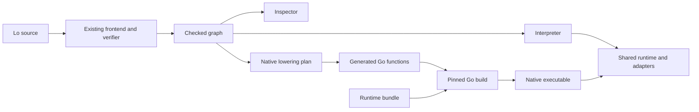

# Lo Native Compilation Milestone

The proposed milestone adds AOT compilation through generated Go source.
Lo will convert its checked graph into direct functions, local variables, branches, and loops.
The pinned Go toolchain will build a native executable with the Lo runtime and adapters.
The executable will run without the Lo CLI, the source file, or an installed Go toolchain.

## Status and Scope

This is a proposed implementation plan for F001.
Native compilation is not implemented.
The completed [compiler design](compiler-design.md) remains the reference for the existing six stages.
The [implementation audit](implementation-audit.md) records their acceptance evidence.

The milestone covers all currently supported Lo programs and all 52 built-in operations.
It includes File workflows and HTTP services.
The initial targets are `darwin/arm64` and `linux/arm64`, which match the currently qualified platforms.
Each target requires execution tests on that target.

The following work is outside this milestone:

- A direct LLVM backend or a C runtime.
- Just-in-time compilation, bytecode execution, and persistent graph loading.
- New Lo syntax, types, modules, or concurrency features.
- New operating systems or processor architectures.
- Native plugins or a public runtime binary interface.
- Automatic parallel execution of graph nodes.
- Speculative reads, changed commit order, and reduced error context.
- Automatic interpreter execution after a native build failure.

`lo run` and `lo serve` remain explicit interpreter commands.
The interpreter provides a second implementation of the same current language contract for differential tests.
It is not a compatibility path for obsolete programs or artifacts.

## Current Implementation and Expected Costs

The frontend already resolves types, flow references, effects, branches, and fallibility.
Its immutable [checked graph](../internal/ir/ir.go) contains explicit conversion nodes and commit statements.
This graph supplies the native backend input without another parser or type checker.

The current runtime has several costs that generated code can reduce.
The following table distinguishes removable dispatch work from runtime work that remains necessary.

| Current code | Current work | Proposed native behavior |
| --- | --- | --- |
| [Expression evaluation](../internal/eval/eval.go) | Select an IR node type for each expression. | Execute the generated operation directly. |
| Flow invocation in `internal/eval/eval.go` | Find a flow and construct its binding map. | Call a generated function with typed parameters and local variables. |
| [Built-in execution](../internal/eval/builtin.go) | Select an operation by name and construct argument collections. | Call the operation helper selected during compilation. |
| [List execution](../internal/eval/list.go) | Invoke the interpreter for each callback. | Execute a generated loop with a direct callback call. |
| [Runtime values](../internal/value/value.go) | Copy integers and collection views to preserve immutable values. | Reuse the value contract initially. Measure remaining allocation costs. |
| [HTTP adapter](../internal/adapter/http.go) | Construct an interpreter invocation for each request. | Construct a shared execution session and invoke a compiled handler. |

Native compilation does not remove arbitrary-precision arithmetic, capability checks, execution limits, or operating-system I/O costs.
The initial implementation retains the current immutable value representations.
Thus, native code alone does not establish a particular speed improvement.

### Exploratory Interpreter Measurements

A local probe on October 12, 2026 used macOS arm64, Darwin 27.0.0, and the existing Lo executable.
Each case had three warmup runs and 20 measured runs.
Python `time.perf_counter_ns` measured each CLI subprocess through completion.
Every run produced the expected result with exit status zero and no diagnostics.

| Program | Input | Median elapsed time | Observed range |
| --- | --- | --- | --- |
| `examples/list_sum.lo` | Four integers | 5.004 ms | 4.573–6.615 ms |
| `String.length` | 10,000 ASCII `a` characters | 5.552 ms | 4.800–7.385 ms |
| `List.filter` followed by `List.length` | The same 10,000 characters | 12.308 ms | 10.549–18.127 ms |

The filter callback compared each scalar with `Scalar.new("a")`.
Both text cases returned `10000`.
These measurements include process startup, source access, parsing, type checks, execution, and output.
They do not isolate interpreter costs or predict native performance.
Stage 0 replaces this exploratory probe with repeatable benchmarks and recorded environment data.

## Backend Choice

The table gives an engineering assessment based on the current Go implementation.

| Option | Benefit | Additional work | Milestone decision |
| --- | --- | --- | --- |
| Generate Go source | Reuse Go values, adapters, garbage collection, and build tools. | Generate direct code and separate the runtime from the interpreter. | Recommended. |
| Generate LLVM IR | Control machine-level representations and optimization. | Define a runtime interface, memory management, arithmetic, and adapter integration. | Defer. |
| Generate C source | Use a conventional native compiler interface. | Implement the runtime in C or introduce a boundary between C and Go. | Defer. |

The Go build command compiles a main package and its dependencies into an executable.
This supports a native artifact from generated source. See the [Go build documentation](https://pkg.go.dev/cmd/go#hdr-Compile_packages_and_dependencies).

LLVM supplies garbage-collection integration mechanisms, but the language runtime must supply the collector and its allocation interface.
That requirement increases the scope of a direct LLVM backend. See [LLVM garbage collection](https://llvm.org/docs/GarbageCollection.html).

The first backend will generate actual Lo control flow.
It will not serialize an IR graph into a Go program that calls the interpreter.
The artifact dependency test must reject compiler and interpreter packages.

## Proposed User Contract

The following commands describe the proposed interface.
They are not current CLI commands.

```bash
lo build examples/list_sum.lo --output ./list-sum
./list-sum run
# 10

lo build examples/count_letter.lo --output ./count-letter
./count-letter run --read-root examples
# 3

lo build examples/http_echo.lo --output ./echo-server --target linux/arm64
# On the Linux arm64 target:
./echo-server serve --listen 0 --format json
```

### Build Command

The proposed syntax is:

```text
lo build SOURCE --output PATH [--target OS/ARCH] [--format text|json]
```

- Require one source file and one output path.
- Use the host target when `--target` is absent.
- Reject targets outside `darwin/arm64` and `linux/arm64`.
- Run the complete verifier before code generation.
- Reject source errors with the existing source diagnostics and exit status `1`.
- Reject invalid options, unavailable tools, and build failures with exit status `2`.
- Return exit status `0` only after publication of the complete artifact.
- Reject output paths that refer to the input source.
- Preserve an existing output artifact when compilation fails or receives cancellation.
- Replace the selected output atomically after a successful build.
- Execute no Lo reads, commits, or handlers during compilation.
- Accept no runtime capability grants as build options.

Build JSON contains `command`, `status`, `artifact`, and `target`.
The command value is `build`.
Successful build output uses `status: "ok"`.
Build diagnostics use the existing diagnostic envelope with a new build stage and canonical build error codes.
Generated Go errors identify a compiler defect or a host build failure, with the source subject and toolchain context.

### Executable Commands

Each artifact contains one compiled program.
It accepts `run` or `serve`, followed by the existing runtime options.
It accepts no source path.
Explicit command selection preserves the current difference between one-shot execution and service execution.

| Input | Artifact behavior |
| --- | --- |
| `run` | Execute the compiled top-level body. Reject reached server activation. |
| `serve` | Execute the compiled top-level body and manage its activated servers. Reject an outcome with no active server. |
| `--format text\|json` | Use the current execution result and diagnostic formats. |
| `--read-root`, `--write-root` | Authorize the actual runtime file targets through the current File adapter. |
| `--listen` | Authorize exact listen ports for `serve`, including the existing port-zero rule. |
| `--max-steps` | Set the same logical execution budget as the interpreter. |

Relative resource paths resolve from the artifact invocation directory.
Capabilities remain absent until the operator supplies runtime grants.
Build metadata grants no resource access.
Exit classes, result serialization, readiness events, and shutdown events keep the current contract.

An artifact includes the Lo runtime and the generated program.
It needs the target operating system and any authorized external resources.
It does not need a Go installation, a repository checkout, a source file, or a separate Lo runtime library.
This scope does not promise a binary without operating-system library dependencies on every target.

## Compiler and Runtime Architecture



The last two arrows describe source reuse.
The artifact includes its own compiled runtime code.
It does not communicate with another runtime process.

### Shared Runtime Boundary

The present adapters import `internal/eval` for budgets, failures, and execution entry points.
The server value also stores `ir.FlowID`.
These dependencies would pull interpreter or graph code into a naive generated executable.
Stage 1 replaces them with shared execution contracts.

| Proposed package | Responsibility |
| --- | --- |
| `internal/identity` | Runtime flow identities shared by checked graphs, values, and adapters. |
| `internal/execution` | Execution sessions, budgets, boundary contracts, host failures, propagation, and program entry points. |
| `internal/runtimeops` | Direct built-in helpers with the canonical numeric, collection, and error behavior. |
| `internal/runner` | Runtime options, authorization setup, results, signals, and service lifecycle. |
| `internal/codegen` | Checked graph lowering and deterministic Go source generation. |
| `internal/nativebuild` | Target validation, toolchain invocation, runtime bundle assembly, and artifact publication. |
| `internal/runtimebundle` | Generated bundle data and its exact source identity. |

The existing `internal/value`, `internal/types`, `internal/catalog`, `internal/source`, and `internal/adapter` packages remain shared where applicable.
The existing `internal/eval` package becomes one consumer of shared operations and execution contracts.
The compiler CLI composes the interpreter or the native builder according to the explicit command.

The adapter-facing program contract has two entry points:

1. Execute the top-level body with a new execution session.
2. Create a request invocation that can call a configured handler or error handler.

The execution package owns sealed wrappers and validating constructors for these entry points.
Interpreter factories retain their checked graph privately.
Generated factories supply compiled functions and static handler metadata.
The adapters receive no IR program and do not choose an execution backend.

Generated flow calls use typed parameters and direct calls.
Only the adapter boundary needs a handler-identity dispatch table.
List callbacks and ordinary flow calls must not use that table.
Each request receives a fresh session.
Its normal handler and adapter error handler share the same budget, as they do today.

Replace `ir.FlowID` ownership with the shared identity type across all consumers in one change.
Remove the old type instead of retaining an alias.
Move shared failures and limits out of the interpreter without duplicate implementations.
Keep operation names and error kinds in the built-in catalog.

### Native Lowering Plan

The backend consumes only a successfully checked program.
It creates a private lowering plan with explicit ordered statements, local variables, calls, branches, source locations, and logical costs.
This representation supports code generation only.
It is not a persistent artifact format or an additional runtime interpreter input.

| Checked construct | Generated behavior |
| --- | --- |
| Literal | Construct or reference the immutable value when evaluation reaches that expression. |
| Binding | Evaluate the initializer once and store its value in a local variable. |
| Reference | Read the local value and charge the required logical cost. |
| Projection | Use the shared projection contract for the known result type. |
| Built-in call | Evaluate arguments in source order, then call the selected helper directly. |
| Flow call | Evaluate ordered arguments, then call the generated flow function. |
| Match | Evaluate the selector once, then only reached case heads and the selected body. |
| Conversion | Generate the specified success, failure, propagation, record, or scalar-list conversion. |
| List processor | Generate an ordered loop with direct callback calls and exact error context. |
| Commit | Charge the statement, evaluate its target, then invoke the shared boundary once. |
| Return | Preserve the outer result tag and the existing publication rules. |

Use compiler-generated identifiers based on stable graph identities.
Encode user strings, field names, and paths as Go string literals through structured generation.
Do not splice source text into Go statements or shell commands.
Use ordered temporary variables to separate argument evaluation from named parameter placement.
Use Go syntax trees and formatting tools to produce valid source.

The first representation uses existing typed value interfaces for locals and function parameters.
Containers can retain `value.Value` elements under their checked type contract.
Direct operation helpers replace runtime operation-name switches.
Dynamic value tags remain necessary for fallibility and heterogeneous runtime interfaces.

Every flow has a generated body and the required error-boundary behavior.
Total Lo flows can still fail with host errors.
Fallible flow results preserve success or failure as data until an explicit propagation node consumes them.
Generated code must preserve failures stored inside records, lists, maps, and returned containers.

Literal initialization must not cause an unreached expression to fail at process startup.
Large integer limits remain associated with the reached expression.
Shared immutable constants still incur each evaluation's logical cost.

### Source Context

The native artifact includes compact source maps with the original source identity, offsets, lines, columns, flow names, and operation names.
It does not need the complete Lo source text.
Add a source-span constructor that accepts the validated positions needed by generated code.
Keep the current source-span JSON shape.

Runtime error locations must refer to Lo source positions.
Temporary Go paths must not replace Lo positions in user diagnostics.
Trace frames must preserve the current ordering and input records.
Diagnostic tests must run after removal of the original source file.

### Logical Costs and Optimization

The native path uses the same default limits as the interpreter.
Stage 0 makes the current charge sequence explicit before backend implementation.
This prevents native speed improvements from silently changing accepted workloads or effects before a limit failure.

- Charge each reached statement before its execution.
- Charge each reached expression before its evaluation.
- Charge a successful expression's expanded value weight after its evaluation.
- Charge list processor and aggregate iterations at their current positions.
- Preserve flow depth across callbacks and handlers.
- Preserve byte, element, integer, and server limits at their current boundaries.
- Poll cancellation at corresponding charge points and inside the existing cancellable I/O adapters.

The charge model includes generated conversion nodes and repeated references.
It does not depend on machine instruction count or actual allocation count.
Differential tests compare results and observable effects immediately below, at, and above each budget boundary.
Cancellation tests compare controlled interruption points, not identical wall-clock timing.

The first milestone removes dispatch and binding maps through code generation.
It leaves Lo arithmetic widths and immutable value ownership unchanged.
It introduces no Lo constant folding, loop fusion, read sharing, speculative execution, or dead-binding removal.
The Go compiler can optimize generated code while observable charge calls and effect order remain intact.
Further representation changes require profile evidence and the same conformance gates.

## Toolchain and Artifact Construction

The repository currently selects Go 1.27.1 and `golang.org/x/sys` v0.49.0.
The compiler release must record one exact toolchain and dependency selection from the repository contract.
Stage 0 verifies the required build flags with that toolchain.
This milestone does not independently upgrade the toolchain.

The proposed builder requires the selected Go installation on the build host.
It validates that installation before compilation.
`GOTOOLCHAIN=local` prevents automatic toolchain selection. See [Go toolchain selection](https://go.dev/doc/toolchain#select).
A missing or different toolchain produces an actionable build diagnostic.
Toolchain installation remains a separate setup step.

### Runtime Bundle

The compiler executable contains an exact runtime source bundle from its own release.
A repository build helper creates that bundle from an explicit file list and dependency manifest.
The bundle includes shared runtime packages, target-specific sources, module data, dependency sources, and required license notices.
It excludes tests, examples, compiler packages, interpreter packages, and private repository files.

The helper writes generated bundle data under `internal/runtimebundle` before the CLI build.
That placement satisfies Go's package-relative embedding rules. See [Go embed directives](https://pkg.go.dev/embed#hdr-Directives).
The generated copy is a build artifact with no independent source authority.
CI rejects a bundle that differs from its canonical inputs.

The builder creates an isolated temporary module with the repository module identity.
Generated `cmd/program` code and copied runtime packages then share one module tree.
This keeps `internal` imports legal without a dependency on the user's checkout.
The module uses vendored dependencies from the bundle.
Go supports builds from that vendor tree without module downloads. See [Go module vendoring](https://go.dev/ref/mod#vendoring).

### Build Isolation

The build process uses argument arrays, a controlled environment, and a temporary working directory.
It does not execute a shell or accept arbitrary compiler flags from Lo source.
The controlled environment overrides ambient `GOFLAGS`, `GOWORK`, toolchain selection, target variables, and module download settings.
It also excludes user overlays and compiler plugins.

The proposed production build uses `CGO_ENABLED=0`, `GOWORK=off`, and `GOENV=off`.
It selects the exact target and uses `-mod=vendor`, `-trimpath`, `-buildvcs=false`, and `-pgo=off`.
It disables module and toolchain downloads for `lo build`.
The required toolchain and operating-system dependencies receive separate qualification on both targets.

Build cancellation stops the compiler subprocess and removes owned temporary data.
An incomplete artifact never replaces the selected output.
Create the publication staging file in the output directory so the final rename stays on one filesystem.
On cancellation, stop the complete owned subprocess group before removal of temporary inputs.
The initial build contract also needs bounds for generated source size, subprocess diagnostics, and elapsed build time.
Stage 0 records measured defaults and canonical build-limit diagnostics before the builder stage starts.

Artifact metadata records the source digest, source identity, Lo compiler identity, runtime bundle digest, toolchain version, and target.
Metadata includes no timestamps, temporary directories, or capability grants.
The executable has no external runtime-version negotiation or compatibility loader.
A new compiler release creates a new artifact with its own complete runtime.

The initial reproducibility gate compares generated source and metadata for identical inputs.
It also compares final artifact hashes for two builds on the same target with the same pinned inputs.
If artifact hashes differ, investigate the exact source of the difference before claiming reproducible artifacts.

## Benchmark and Acceptance Strategy

Benchmarks must distinguish build cost, process startup, and program execution.
One CLI timing cannot establish all three.
Native and interpreted runs must use the same workload, result contract, capability grants, and logical limits.

| Workload | Measurements | Required comparison |
| --- | --- | --- |
| List sum and trivial return | Process latency and artifact size | Existing CLI versus compiled artifact. |
| Map, filter, and fold callbacks | Execution time, allocations, and bytes per operation | Checked interpreter entry versus generated entry, excluding compilation. |
| Unicode text and records | Execution time and allocation volume | The same input corpus and output digest. |
| Large integer arithmetic | Execution time and allocation volume | Exact values beyond machine integer range. |
| File workflow | End-to-end time and exact resulting bytes | Equivalent isolated directories and file-cache conditions. |
| HTTP echo and computed response | Throughput and median and p95 latency | Persistent servers with identical clients, payloads, and concurrency. |
| Native build | Cold and warm build time, peak memory, and artifact size | The same source with empty and populated Go build caches. |

The first CPU corpus uses at least three callback workloads with 1,000 and 10,000 elements.
The corpus varies input values to prevent a constant result from replacing the measured work.
Input construction and result observation follow the same policy for each implementation.
Execution benchmarks can use generated fixture packages through the same exported execution entry used by their artifact wrapper.
Public CLI tests remain the product acceptance layer.

Record the host processor, operating system, toolchain, source digest, limits, cache policy, and concurrency with each result.
Keep raw samples with the benchmark report.
Use at least ten independent samples after warmup.
Change the implementation order between sample pairs.
Record uncertainty with the result instead of treating small timing differences as definite improvements.
Use repository-owned Make targets for benchmark execution.

### Proposed Performance Gates

The following numbers are proposed targets, not measured native results.
Stage 0 fixes the corpus and measurement procedure before optimization work.
It also records any revised targets with their rationale before native performance results are available.

- Achieve at least a 2× geometric-mean execution speed improvement across the fixed callback workloads and both input sizes.
- Keep each CPU, startup, and File workload within 10% of the corresponding interpreter elapsed time.
- Apply the same 10% limit to HTTP p95 latency and the reciprocal throughput ratio.
- Compare allocation volume and artifact size in the report, even when time gates pass.
- Set numeric build-time, build-memory, and artifact-size budgets from the Stage 0 corpus before Stage 2.
- Treat results within measurement uncertainty as inconclusive.
- Correct inconclusive measurement conditions before milestone closure.
- Keep the milestone open when its agreed performance gates fail.

The throughput gate permits at most a 10% increase in time per completed request.
Calculate CPU speed ratios as interpreter time divided by native time for each matching workload and size.
Calculate the geometric mean separately for each target platform.
No performance gate permits removal of authorization, limits, trace frames, or semantic checks at external boundaries.

### Semantic Acceptance

The existing [test inventory](implementation-audit.md#evidence-sources) supplies the initial acceptance corpus.
Each native fixture has an independent expected result in addition to its interpreter comparison.
This prevents a shared runtime defect from passing solely because both implementations agree.

- Compile and execute every supported example under the appropriate runtime command.
- Cover every built-in operation with a native result or expected failure.
- Retain all parser and verifier rejection fixtures through the source compiler.
- Add native build coverage for complete programs and meaningful build rejections from the static manifest.
- Keep parse-only fixtures as frontend tests when they do not describe executable programs.
- Compare text and JSON results, error kinds, traces, source spans, exit statuses, and actual file effects.
- Cover argument order, reached match heads, unused bindings, repeated reads, and repeated commits.
- Cover nested fallible values, self-handlers, callback errors, and adapter error handlers.
- Exercise denied capabilities, limits, cancellation, and partial HTTP startup.
- Exercise malformed requests, disconnected clients, concurrent requests, and graceful and forced shutdown.
- Run artifacts after removal of the Lo source and without Lo or Go on the runtime search path.
- Build outside the source checkout with module downloads disabled and an empty module cache.
- Reject interpreter and compiler packages from the artifact dependency graph.

Differential comparisons use the same logical source identity and deterministic local inputs.
Generated ports and temporary directory names can differ between isolated runs.
The comparison records an explicit mapping for those values.
It must not erase error frames, statuses, operation order, or meaningful path differences.

## Implementation Stages

Each stage depends on the preceding stage's acceptance evidence.
The stages define work for a later implementation pass.
They do not mark any native capability as delivered.

### Stage 0 Establish Contracts and Baselines

Deliverables:

- Add CPU, startup, File, HTTP, and build-corpus benchmark definitions.
- Record the current interpreter baseline and allocation profiles.
- Specify logical charge order from the evaluator and list operations.
- Specify the build CLI, artifact CLI, diagnostic codes, and build limits.
- Record exact performance gates and the two target environments.
- Resolve the toolchain and runtime bundle build procedure.

The initial toolchain probes use the existing CLI build and small Go programs.
They establish host build costs before a native Lo backend exists.
Build budgets remain proposed limits until native qualification measures them.

Acceptance:

- Execute all benchmark inputs successfully with the interpreter.
- Preserve raw samples and machine-readable environment data.
- Add public fixtures for budget boundaries and any missing semantic characterization.
- Demonstrate repeatable measurements before a native speed comparison.
- Record the numeric artifact and build budgets before Stage 2.

### Stage 1 Separate Shared Runtime Contracts

Deliverables:

- Extract flow identities, execution sessions, host errors, and runtime operation helpers.
- Change adapters to accept the shared program and invocation contracts.
- Extract runtime CLI and lifecycle code for both executable forms.
- Replace old imports and remove duplicate or obsolete entry points.

Acceptance:

- Run the relevant public integration tests before the refactor.
- Preserve existing CLI output, effects, budgets, traces, and HTTP lifecycle behavior.
- Verify that shared runtime packages have no interpreter or IR dependency.
- Run File and HTTP race tests after the refactor.

### Stage 2 Build the First Native Program

Deliverables:

- Add `lo build`, deterministic Go generation, the runtime bundle, and the native build driver.
- Implement literals, bindings, references, return values, and the list-sum operation subset.
- Include source maps, runtime options, and artifact metadata from the first executable.
- Reject every unsupported native construct with a source diagnostic during this incomplete stage.

Acceptance:

- Record a failing CLI test for the missing build command before production changes.
- Build `examples/list_sum.lo` and execute the artifact to obtain `10`.
- Remove the input source before a second artifact run.
- Verify build failure, cancellation, invalid targets, and preservation of an existing output.
- Verify that the artifact neither imports the interpreter nor reconstructs an IR program.

### Stage 3 Cover All Values and Pure Flows

Deliverables:

- Implement every current type, conversion, pure operation, and exact record contract.
- Implement direct flow calls, matches, handlers, and generated list loops.
- Preserve nested fallibility, arbitrary-precision integers, Unicode, ranges, and map order.
- Apply logical costs and source context throughout generated execution.

Acceptance:

- Add each public native acceptance case before its production implementation.
- Compare independent expected results with both execution paths.
- Pass all applicable value, flow, callback, error, and limit fixtures.
- Reject missing native operation coverage through a catalog coverage guard.

### Stage 4 Execute File Workflows and HTTP Services

Deliverables:

- Generate File reads, effect construction, and commit operations through shared adapters.
- Generate server targets and direct handler entry functions.
- Support server activation during requests and multiple commits of one target.
- Integrate readiness, cancellation, partial-startup cleanup, and shutdown behavior.

Acceptance:

- Execute the File workflow and both HTTP examples as native artifacts.
- Pass capability, commit-order, request-boundary, and response-boundary fixtures.
- Pass disconnect, concurrent-request, active-request shutdown, and forced-shutdown regressions.
- Preserve per-request budgets and sharing of a budget with the adapter error handler.

### Stage 5 Qualify Artifact Construction

Deliverables:

- Complete offline bundle construction, target selection, and build resource limits.
- Verify generated source identity and artifact metadata.
- Add dependency checks and execution qualification for each target.
- Remove temporary unsupported-operation branches after full operation coverage.

Acceptance:

- Build from a distributed Lo compiler outside the repository checkout.
- Execute artifacts without the compiler, original source, or Go installation.
- Verify artifact construction with disabled network access and an empty module cache.
- Verify source escaping, hostile ambient build flags, spaces in paths, and unwritable output failures.
- Verify repeated build hashes under identical pinned inputs.
- Run native semantic acceptance on macOS arm64 and Linux arm64.

### Stage 6 Measure Performance and Close the Milestone

Deliverables:

- Measure generated artifacts against the fixed Stage 0 baseline and the current interpreter.
- Profile remaining costs in dispatch, value allocation, arithmetic, and adapters.
- Make only measured improvements that preserve the charge model and semantic gates.
- Publish the benchmark report, platform qualification, user commands, and implementation audit.

Acceptance:

- Pass all semantic and performance gates on the declared targets.
- Run the generated artifact race suite for shared runtime and HTTP code.
- Complete the final repository-native validation after the last code change.
- Close F001 only after native build, native execution, and required evidence pass.

## Validation Integration

The proposed Make targets are `test-native`, `test-native-race`, `bench-native`, and `verify-runtime-bundle`.
Their definitions belong in the implementation stages that first need them.
Existing `build` and integration setup must generate the bundle before compilation.
The current `TestMain` directly invokes `go build`, so it needs the same bundle preparation as the Make build.
`make ci` must include native semantic tests and bundle verification after the native path is available.

Benchmarks use a separate target because ordinary CI contention can invalidate performance comparisons.
Both qualified platforms require recorded native runs before milestone closure.
A cross-compilation success alone does not qualify a target.

The race target must instrument generated fixture packages and shared runtime code.
Race builds enable cgo through the test harness.
Linux race builds also require a C compiler. See the [Go race detector requirements](https://go.dev/doc/articles/race_detector#Requirements).
Production builds retain `CGO_ENABLED=0`.

The builder's controlled environment must not accidentally discard the test configuration.
Use an explicit repository test harness for race builds of generated packages.
Keep arbitrary toolchain flags outside the production artifact CLI.

For each behavior change, record the failing integration test before production changes.
For the shared runtime refactor, record the current passing behavior before changes.
Use the smallest relevant Make target during implementation.
Run `make ci` at each completed stage after its last code change.

## Risks and Open Decisions

| Risk or decision | Consequence | Resolution point |
| --- | --- | --- |
| Immutable values still allocate and copy. | Dispatch removal can produce less improvement than the target. | Stage 0 profiles and Stage 6 measured changes. |
| Limits make evaluation order observable. | An optimization can move a failure before a commit or handler. | Stage 0 charge contract and budget differential tests. |
| Shared runtime extraction touches HTTP lifecycle code. | A refactor can regress cancellation or cleanup. | Stage 1 characterization and race tests. |
| Generated source can grow with large programs. | Build time and memory can exceed useful bounds. | Stage 0 numeric build budgets and Stage 5 limits. |
| Runtime source packaging can omit target-specific files. | A compiler can work only inside its own checkout. | Stage 2 bundle construction and Stage 5 isolated builds. |
| Shared helpers can hide shared semantic defects. | Both execution paths can return the same wrong result. | Independent expected results and existing conformance fixtures. |
| Go garbage collection and runtime code remain in artifacts. | Native artifacts can retain allocation costs and substantial size. | Stage 0 artifact budgets and Stage 6 profiles. |

The proposed backend, CLI shape, and two target platforms are the defaults for this milestone.
The exact numeric build-time, build-memory, generated-source, diagnostic-output, and artifact-size limits remain open until Stage 0 measurements.
Stage 0 also confirms the proposed performance targets against the fixed corpus and available measurement hosts.
No native performance result is claimed by this plan.
